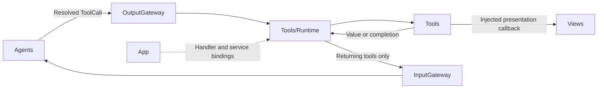
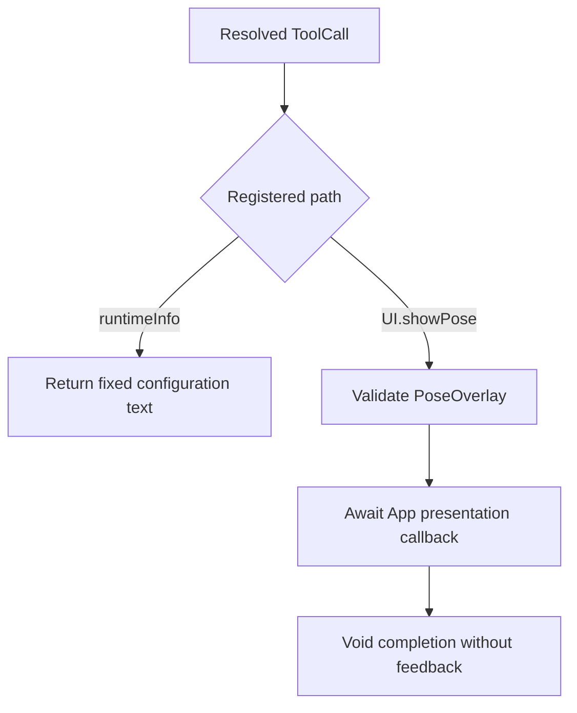
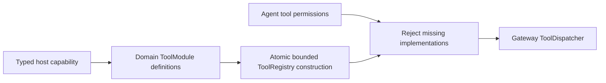

# Tools — Callable Functions

Implements functions reached through ToolCalls. The goal is reusable behavior with explicit results or completion. Tools depends only on AgentCore; App injects any presentation or device service.

## Directory structure

```text
Tools/
├── Runtime/                 # Definitions, catalog, registry, invocation and executor
├── System/
│   ├── SystemTools.swift    # Callable system entries
│   └── Support/             # Domain registration
├── UI/
│   ├── UITools.swift        # Callable presentation entries
│   └── Support/             # Registration, capabilities, types and turn policy
├── Robot/
│   ├── RobotTools.swift     # Tracking aim namespace
│   ├── Aim.swift            # Immediate five-axis aim
│   └── Support/             # Completion-only registration
└── README.md
```

## Upstream and downstream

Arrows show runtime flow through App-supplied handlers.



## Internal flow



`runtimeInfo` is a configuration description, not a live health probe. `UI.showPose` accepts at most 3000 UTF-8 bytes and six COCO-17 skeletons; an empty people list clears the display. App validates session and frame order. Completion means display state was accepted, not that a screen frame was rendered.

Tools owns no queue and bypasses Channel scheduling. VisionPerception retains the latest pending skeleton before dispatch. Tool failures remain observable; no Tool sends results directly to an Agent.

## Feature status

- ✅ [System](System/README.md): fixed runtime information.
- ✅ [UI](UI/README.md): seven completion-only presentation functions.
- ✅ [Robot](Robot/README.md): completion-only `Robot.aim`. The sender accepts five-axis angles; the gripper is not addressed.
- ❌ Search, storage, network, memory and other model/device tools.
- ❌ Live model/device health reporting.

## Issue record

| Status | Issue / next step |
| --- | --- |
| Open | Measure skeleton presentation latency on a physical device. |

✅ ToolRegistry and ToolExecutor compile in this same Tools module under Runtime. Consumers import Tools; the separate runtime target is removed. ❌ The merge adds no Channel scheduling, timeout or implicit handler registration.

## Action runtime stage 2

✅ Tool resource metadata now supports the same Gateway ownership checks as Actions without joining Action queues. ❌ No automatic resource inference; device-facing Tools must declare actual resources.

## Domain-owned registration

✅ ToolModules.builtIn lists SystemToolModule, UIToolModule and RobotToolModule. Domains own ToolDefinition paths, resources and returning/completion handlers. BehaviorAssembly creates a complete ToolRegistry synchronously and validates both model-callable and internal Tool permissions. No App prepareTools task or per-function binding remains. UI.showPose receives the typed PosePresentationCapability and retains its no-feedback completion contract.



Add functions in their domain modules; add domains in ToolModules. Existing capability operations allow implementation changes without App edits. ❌ New native primitives require explicit capability/adapter work. Dynamic registry mutation remains available for explicit isolated runtimes, not production startup.

## Action and Tool presentation boundary

✅ UI completion tools now cover reply append, transcript replacement/closure, turn reset, voice state, gaze and pose. ToolModules injects both UIUpdateCapability and PosePresentationCapability. ❌ Model-selected expression remains an Action pending native model Tool transport.

## Source organization standard

✅ Group related public entry functions in `<Domain>Tools.swift`; do not create a file for every verb. Keep domain roots for callable entries and documentation. Place registration, injected capability protocols, data/error types and supporting policies under `Support/`. Small capability contracts live with their module; independently meaningful state policies retain their own file. Public Swift symbols remain accessible across the Tools target regardless of folder.

Runtime owns shared execution contracts and `ToolModules` (the built-in domain catalog). Register new functions in their domain module; only adding a domain changes the catalog. No function-name mapping belongs in App or UI.

✅ Preserve existing API shapes: UI updates accept `ToolInvocation` and an injected callback; `showPose(call:envelope:present:)` retains its existing pose callback, and `SystemTools.runtimeInfo(_:)` retains its returning signature and unqualified registered path `runtimeInfo`. Folder organization does not change permissions, error handling or feedback.

❌ Native model Tool transport, additional domains and live health reporting remain future work. Do not create empty domain scaffolding.
