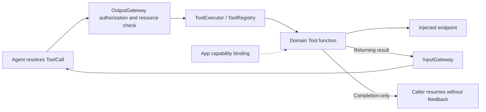

# Tools — Direct Callable Functions

Purpose: implement functions reached through resolved ToolCalls. Design goals: explicit result/completion contracts, bounded registration and typed host injection. Execution contracts belong to Tools/Runtime/Contracts; the separate BehaviorDefinitions compiler plugin generates metadata factories.

## Layout and ownership

| Directory | Responsibility |
|---|---|
| Runtime/Contracts | Requests, context, resources, definitions and responses |
| Runtime | Independent ToolRuntime registry and execution |
| Root | ToolModules domain catalog and ToolMacro declarations |
| System | Fixed runtime-information function |
| UI | Immediate presentation entries; Support owns injected interfaces and values; App owns turn acceptance policy |

Related entries live in `<Domain>Tools.swift`; domain roots contain callable entries and their README. Support contains catalogs, capability protocols, values/errors and supporting policy. Tools has no App, UI, concrete Agent or Gateway dependency. App supplies typed endpoints. Current System/UI tools have no direct PlatformKit dependency. Future device tool domains may depend on PlatformKit for native capabilities when implemented; ToolRuntime remains independent.

## Registration

`@Tool(path:title:resources:)` generates `nameDefinition(handler:)` and `nameDefinition(completing:)`. Domain Support catalogs bind explicit handlers. `ToolModules.builtIn` lists SystemToolModule and UIToolModule; BehaviorAssembly atomically constructs the registry; Gateway BehaviorCoverage checks every model/internal Tool permission before producers start. Attributes do not grant permissions, discover implementations or create dependencies.

Public entry signatures remain explicit: UI updates receive ToolInvocation and an injected callback; showPose receives a request, execution context and presentation callback; runtimeInfo returns a String. Add an entry in its domain catalog; only adding a domain changes ToolModules.

## Execution contracts

Tools bypass Channel FIFO and Action wait barriers. Returning functions produce ToolResponse values, including ordinary errors; Gateway converts them to Agent ToolResult values and delivers them through InputGateway. Completion-only functions return no feedback on success and throw failures to their dispatcher. Cancellation propagates for both kinds. There is no generic Tool timeout or replacement policy.

Protected Tools declare resources and use Gateway's shared ResourceCoordinator. They cannot bypass ownership by avoiding Action scheduling. Current UI/System tools claim no hardware locks. App's output consumer awaits each call; there is no detached Tool worker or Tool-owned queue.

`runtimeInfo` reports fixed configuration text, not live health. UI provides seven completion-only functions: beginReplyTurn, setTranscript, finishTranscript, setVoiceState, print, moveEyes and showPose. Pose input is bounded to 3000 UTF-8 bytes and six COCO-17 skeletons; an empty people list clears it. App checks session/frame order. Completion means accepted state, not a rendered frame. Model-selected expression remains the UI.express Action.

VisionPerception coalesces its bounded replaceable gaze/skeleton output before dispatch. That is not generic Tool coalescing, and reply chunks are not dropped.

## Scope and limitations

✅ SystemToolModule and UIToolModule provide explicit functions under the independent ToolRuntime contracts. See [Runtime](Runtime/README.md), [UI](UI/README.md) and [System](System/README.md).

❌ Native model Tool transport, live health reporting, additional network/storage/device domains and rendering acknowledgment are not implemented. Non-cooperative callbacks can delay callers; metadata does not imply forced interruption.
