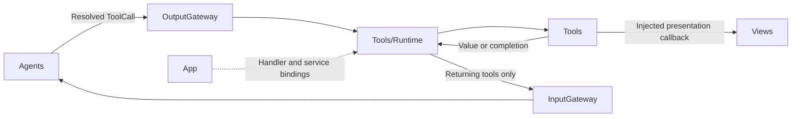
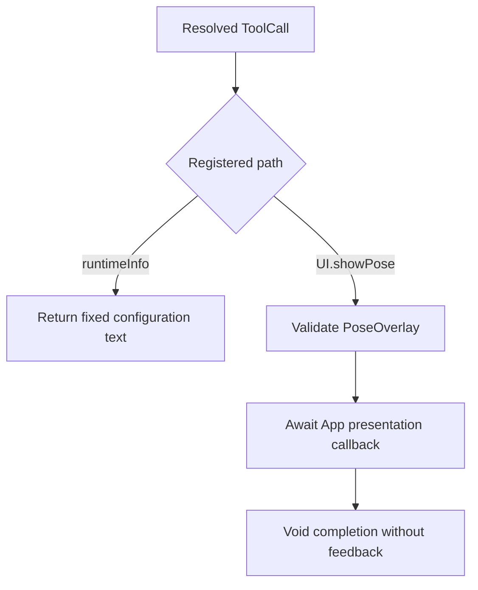
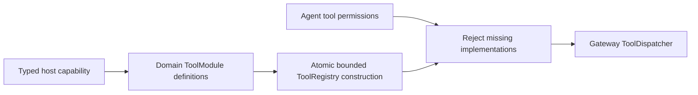

# Tools — Callable Functions

Implements functions reached through ToolCalls. The goal is reusable behavior with explicit results or completion. Tools depends only on AgentCore; App injects any presentation or device service.

## Directory structure

```text
Tools/
├── Runtime/                 # Registry and direct execution
├── System/RuntimeInfo.swift  # Fixed configuration description
├── UI/ShowPose.swift         # Validate and replace the skeleton overlay
└── README.md                # Module boundary and status
```

## Upstream and downstream

Arrows show runtime flow through App-supplied handlers.



## Internal flow



`runtimeInfo` is a configuration description, not a live health probe. `UI.showPose` accepts at most 3000 UTF-8 bytes and six COCO-17 skeletons; an empty people list clears the display. App validates session and frame order. Completion means display state was accepted, not that a screen frame was rendered.

Tools owns no queue and bypasses Channel scheduling. VisionPerception retains the latest pending skeleton before dispatch. Tool failures remain observable; no Tool sends results directly to an Agent.

## Feature status

- ✅ [System](System/README.md): fixed runtime information.
- ✅ [UI](UI/README.md): bounded skeleton display as a completion-only Tool.
- ❌ Search, storage, network, memory and other model/device tools.
- ❌ Live model/device health reporting.

## Issue record

| Status | Issue / next step |
| --- | --- |
| Open | Measure skeleton presentation latency on a physical device. |

✅ ToolRegistry and ToolExecutor compile in this same Tools module under Runtime. Consumers import Tools; the separate runtime target is removed. ❌ The merge adds no Channel scheduling, timeout or implicit handler registration.

## Action runtime stage 2

✅ Tool resource metadata now supports the same Gateway ownership checks as Actions without joining Action queues. ❌ No automatic resource inference; device-facing Tools must declare actual resources.

## Domain-owned registration

✅ ToolModules.builtIn lists SystemToolModule and UIToolModule. Domains own ToolDefinition paths, resources and returning/completion handlers. BehaviorAssembly creates a complete ToolRegistry synchronously and validates both model-callable and internal Tool permissions. No App prepareTools task or per-function binding remains. UI.showPose receives the typed PosePresentationCapability and retains its no-feedback completion contract.



Add functions in their domain modules; add domains in ToolModules. Existing capability operations allow implementation changes without App edits. ❌ New native primitives require explicit capability/adapter work. Dynamic registry mutation remains available for explicit isolated runtimes, not production startup.

## Action and Tool presentation boundary

✅ UI completion tools now cover reply append, transcript replacement/closure, turn reset, voice state, gaze and pose. ToolModules injects both UIUpdateCapability and PosePresentationCapability. ❌ Model-selected expression remains an Action pending native model Tool transport.
