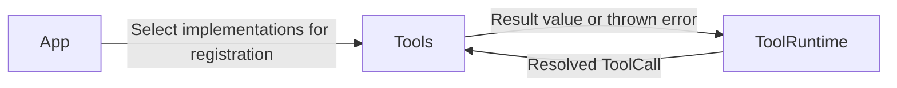

# Tools — Model-Callable Capabilities

Tools contains concrete callable capabilities exposed through the Tool Call path in architecture section 30. Tool implementation is separate from Agent-local capability permissions, runtime registration, execution, and feedback routing.

## Direct relationships

The current System tool has no model, network, storage, or device dependency. Tools may use injected model/platform/presentation services. Data-returning tools return through ToolRuntime and InputGateway; explicitly registered Void tools complete without feedback. Neither directly messages an Agent.

## Implementation status

- ✅ [System](System/README.md): `RuntimeInfo.swift` / `SystemTools.runtimeInfo`, registered by App as `System.runtimeInfo`.
- ✅ Existing fixed runtime configuration description preserved after extraction from App.
- ❌ Vision, Media, Memory, Search, Storage, and Network tool implementations.
- ❌ Dynamic health, model readiness, and device diagnostics for runtimeInfo.

`runtimeInfo` is a fixed configuration description, not a health probe. Tools bypass GhostShell Channel scheduling. Permission and availability checks belong to real implementations and adapters; a configured alias alone does not authorize device access.

## Maintenance

Keep this README synchronized with changes to responsibilities, files, interfaces, and implementation status. ✅ means implemented; ❌ means planned or incomplete. Do not create unused placeholder modules. The [technical architecture](../README.md) defines the target; the [layout audit](../../docs/Repository-Structure.md) records implementation exceptions.

✅ [UI](UI/README.md) contains showPose: immediate bounded skeleton replacement through an injected presentation service, registered as a Void completion tool. No Channel scheduling or ToolResult feedback.
