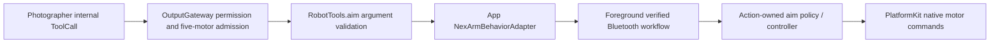

# Robot Tools

Purpose: accept immediate tracking targets through authorized Tool calls. Design goals: one stateless namespace, explicit metadata and injected host effects; no device/session construction.

## Source and contract

`RobotTools.swift` contains the caseless namespace and callable `aim(invocation:using:)`. `Support/RobotToolModule.swift` binds its macro-generated completion-only definition; `Support/RobotTypes.swift` owns errors. Tools depends only on ToolRuntime and the metadata compiler plugin.

✅ `Robot.aim` validates only `base` and `pitch`, finite radians within ±4π (two turns in either direction). It forwards typed values to the App sender. Logical zero is the Action-owned rest; positive angles increase the base and wrist encoder positions. The other three arm joints retain the configured rest targets; motor6 is omitted.

✅ Metadata declares `nexarm.motor.1` through `nexarm.motor.5`. OutputGateway checks source/session permissions and acquires these resources before execution. App allows Photographer only those five motors and reuses the same resource context in BluetoothWorkflow. Competing manual/Action work is rejected explicitly; there is no Tool queue or replacement policy.

✅ Return means the native write was accepted by the transport. It does not establish physical arrival. Missing/unready/background connections become `AimError.notConnected`; invalid arguments fail before effects. Cancellation and resource conflicts propagate, and a possible failed write requires explicit controller recovery. No automatic replay or silent command dropping.

❌ Wi-Fi, tracking arrival measurement, wrist-travel compensation and physical tracking acceptance. See [ADR0102](../../../docs/adr/0102-photographer-aim.md).
