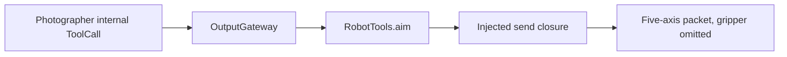

# Robot Tools

Purpose: send one tracking aim without an Action lifecycle. Design goals: validate logical radians here, return when the injected sender accepts them, and leave gesture Actions on the NexArm channel. See [ADR 0091](../../../docs/adr/0091-photographer-aim.md).

✅ `RobotTools.aim` accepts finite `base` and `pitch` strings within four turns and forwards them. Return means the closure returned. It does not wait for a joint to arrive. The camera session's closure calls the production BLE controller.

✅ `Support/RobotToolModule` registers the completion-only Tool. `ToolModules.builtIn` requires the sender. A missing, unverified, or background connection throws `notConnected`. The session does not open a Wi-Fi socket.

❌ Wi-Fi, measured joint travel and wrist-travel recovery are not implemented. Production gestures stay on `Actions/NexArm`.
