# Robot Tools

Purpose: publish immediate tracking targets through authorized Tool calls. Design goals: explicit validation, injected host effects and one latest target without constructing device/session owners.

`RobotTools.swift` contains the callable namespace; `Support/RobotToolModule.swift` binds its macro-generated completion-only definition. Tools depends only on ToolRuntime and the metadata compiler plugin.

✅ `Robot.aim` validates finite base/pitch radians within ±4π and forwards the values through the App adapter. Actions owns rest/angle mapping and limits. The host worker follows motors1–4; wrist roll and gripper are not retargeted.

✅ ADR0126: the Tool publishes an intent and declares no transient motor resources. OutputGateway still validates source/session and internal Tool permission. App's one continuous worker acquires motors1–4 through the same ResourceCoordinator used by Agent Actions and retains that guard for all native writes. Updates replace the latest target in that worker without reacquiring its own resources. No Tool queue, permission bypass or unguarded native writer is introduced.

```mermaid
flowchart LR
    Agent[Photographer ToolCall] --> Gateway[Permission and session validation]
    Gateway --> Entry[RobotTools argument validation]
    Entry --> Adapter[App typed sender]
    Adapter --> Target[One latest aim target]
    Target --> Worker[App continuous worker]
    Worker --> Guard[Shared motor resource authority]
    Guard --> Policy[Actions mapping and motion shaping]
    Policy --> SDK[PlatformKit paced native writes]
```

✅ First publication waits for worker resource/session admission; later publications update its latest target. Return means target accepted by a started worker, not packet delivery or physical arrival. Competing Agent motor operations fail explicitly through execution results and home scheduling history only. Settings manual control bypasses this resource guard. Late worker execution failures use independent home observation without changing completed Tool results; SDK-native facts independently drive device diagnostics/recovery. Old targets are not replayed.

❌ Physical tracking accuracy/arrival, Wi-Fi and device-side stop protection remain pending. [ADR0102](../../../docs/adr/0102-photographer-aim.md) records the original feature; [ADR0126](../../../docs/adr/0126-aim-worker-resource-ownership.md) supersedes its transient five-motor Tool fence.

✅ ADR0132: Robot aim argument errors carry invalidArguments. App preserves distinct Actions admission causes instead of collapsing foreground/control readiness into notConnected. Late worker errors retain the initiating source/session/input/call and an independent worker ID.

❌ Sustained physical-device acceptance and durable error history remain pending.
