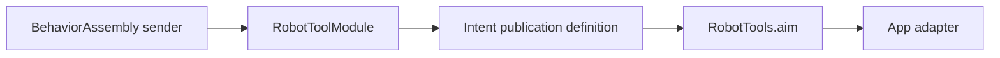

# Robot Tool support

Purpose: hold explicit Tool registration and domain errors. Design goals: independent ToolRuntime context, injected Sendable sender and no device construction.

✅ RobotToolModule binds one completion-only definition. RobotTypes owns invalidAngle validation errors. The callable macro declares no transient motor fence; App guards the continuous worker (ADR0126). Other metadata belongs to the callable declaration; the module does not duplicate it. This directory adds no queue, AgentCore dependency or device owner.

❌ Registration does not validate hardware arrival or physical clearance. Connection/session lifetime stays in App and motion policy stays in Actions.

✅ ADR0132: RobotTypes now owns only invalidAngle validation with a ToolRuntime generic producer code. The obsolete notConnected alias is removed; App adapts actual admission reasons without adding a Tool-to-device dependency.

❌ Sustained physical-device acceptance and durable error history remain pending.
