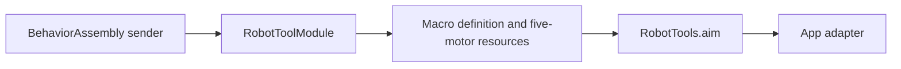

# Robot Tool support

Purpose: hold explicit Tool registration and domain errors. Design goals: independent ToolRuntime context, injected Sendable sender and no device construction.

✅ RobotToolModule binds one completion-only definition. RobotTypes owns invalidAngle/notConnected errors. Resource metadata belongs to the callable macro declaration; the module does not duplicate it. This directory adds no queue, AgentCore dependency or device owner.

❌ Registration does not validate hardware arrival or physical clearance. Connection/session lifetime stays in App and motion policy stays in Actions.
