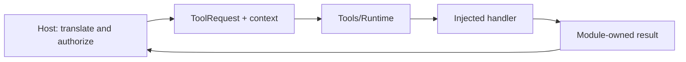

# Tools Contracts

Purpose: define the public inputs, metadata, capabilities and results owned by Tools. Design goals: independent execution, explicit host context and bounded values.

✅ `ToolRequest`, `ToolExecutionContext` and `ToolResource` belong to this module. Context contains opaque source/session/input/correlation identifiers and sequence; it carries no Agent input, output envelope, permissions or resource lease. The host validates identity and acquires resources before execution.

✅ Definitions describe explicitly registered handlers; attached macro declarations belong to the concrete Tools target. Arguments are decoded locally. ToolResponse preserves call identity; completion-only handlers return no response. ToolPoseOverlay belongs to Tools/UI/Support and validates presentation payloads without Agent types.

✅ No dependency on AgentCore, Gateway, App, UI or the other behavior module. These contracts compile inside `ToolRuntime` and contain no concrete behavior. Platform/model capabilities may be consumed by implementations when needed.

❌ Cross-process serialization and durable execution replay are not provided.

✅ ADR0098: Execution values and services are imported from independent ToolRuntime; concrete Tool domains, pose payload and macro declarations remain in Tools. Published paths, feedback and cancellation behavior are unchanged.

✅ ToolResponse.deliveryFailure records bounded feedback transport errors independently of handler value/isError. ❌ It does not imply effects were undone.

✅ Function-defined timeout takes precedence over Runtime defaults: Action keeps request-dependent budget resolvers (including NexArm); Tool stores optional Duration in its definition/registry and @Tool factories. Unspecified Actions/Tools use30 seconds; invalid explicit declarations fail without fallback. ❌ Deadlines cannot forcibly interrupt uncooperative cleanup.

✅ ADR0122: Runtime resource values contain no camera constants. ActionFailure and ActionReport.Entry.Code are bounded opaque identifiers (1–64 UTF-8 bytes); Runtime provides generic execution codes only. NexArm owns its result vocabulary, Actions-owned NexArmExecutionError owns its execution failure-to-report mapping, and Gateway preserves producer identifiers. Existing device failure/report identifiers and presentation are unchanged.

❌ Runtime must not classify pose, foreground, control-readiness or device-feedback failures. Producers provide actionReportCode through ActionExecutionFailureProviding; the generic default handles invalid arguments/resource unavailability and otherwise reports handlerFailed. CancellationError remains cancellation.

✅ ADR0132: ToolResponse.FailureCode is a 1–64 UTF-8 byte opaque identifier. ToolArguments supplies invalidArguments; ToolExecutionFailure is a bounded host adaptation value. Handler failure codes and feedback deliveryFailure are independent; no Bluetooth type enters these contracts.

❌ Sustained physical-device acceptance and durable error history remain pending.
