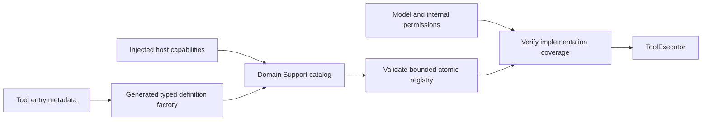
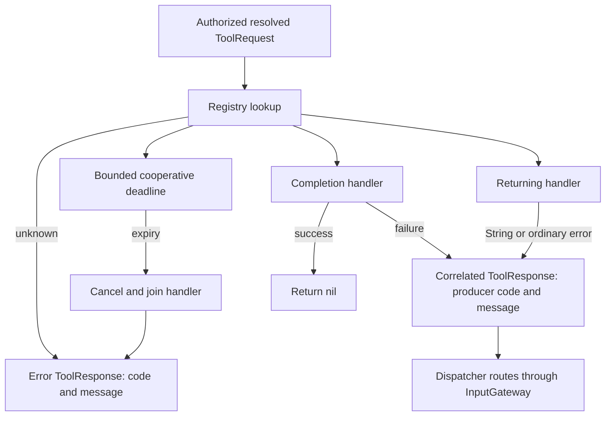

# Tool Runtime

Purpose: register and execute ToolRequests directly. Design goals: explicit feedback kind, bounded catalogs and host-owned effects without Action scheduling. ToolRuntime consumes its own Contracts. The Tools target owns ToolMacro and the compile-time BehaviorDefinitions dependency.

| File | Responsibility |
|---|---|
| ../ToolMacro | Attached metadata declarations and generated factory interface |
| Contracts/ToolDefinition | Generic handler metadata; concrete catalogs remain in Tools |
| ToolRegistry | Actor-owned bounded handlers and resource mappings |
| Contracts/ToolInvocation | ToolRequest plus trusted output context |
| ToolExecutor | Lookup, cancellation and result/completion semantics |

## Registration and bounds

Domain Support catalogs bind `@Tool`-generated factories to explicit capabilities. `ToolRegistry(modules:)` validates the execution catalog atomically: at most32 modules,128 handlers and8 resources per definition. Gateway.BehaviorCoverage checks up to128 Agent capability catalogs against registered paths before producers start. Path segments use the1–64-byte identifier grammar. Duplicate/invalid entries throw in the registry; missing implementations throw in assembly; no partial startup registration is published. Agent declarations remain the permission source.

The registry retains handler and resource mappings. ToolDefinition also carries an optional timeout and display name; this metadata does not create an Action execution record. Dynamic registration APIs support explicit isolated runtimes; production uses the complete catalog constructor.

## Execution and feedback

Registration selects feedback kind; call arguments cannot change it. An empty returned String still produces a result. Cancellation of the calling task propagates; an independently cancelled handler returns an error ToolResponse. Completion waits for the injected endpoint's stated acknowledgement, not necessarily rendered or physical completion.

Gateway checks resource ownership through the same ResourceCoordinator used by Actions, but Tools remain outside Channel FIFO/wait. Runtime owns no work queue or detached worker. ToolExecutor uses one handler task and one timer per active call, with the definition timeout preferred over its30-second Runtime fallback. Registry validation rejects definition timeouts outside (0,86400] seconds; explicit executor fallback overrides remain bounded to300 seconds. Deadline expiry cancels and joins the handler before returning a timeout outcome. An uncooperative handler can still delay its caller.

✅ Macro factories, bounded registration, implementation coverage, resource declarations and both feedback kinds are implemented and tested.

❌ Runtime discovery, forced interruption, implicit permission grants and automatic hardware resource inference are unsupported. Device-facing Tools must explicitly declare their resources.

✅ ToolRuntime compiles this Runtime tree, including Contracts, without project dependencies. Domain catalogs and macro declarations compile in Tools; Gateway imports only runtime contracts.

✅ ADR0098: Execution values and services are imported from independent ToolRuntime; concrete Tool domains, pose payload and macro declarations remain in Tools. Published paths, feedback and cancellation behavior are unchanged.

✅ Completion handler ordinary exceptions now return correlated isError ToolResponse, matching returning Tools. Successful completion remains nil; cancellation propagates only when the calling task is cancelled.

✅ ADR0122: Runtime resource values contain no camera constants. ActionFailure and ActionReport.Entry.Code are bounded opaque identifiers (1–64 UTF-8 bytes); Runtime provides generic execution codes only. NexArm owns its result vocabulary, Actions-owned NexArmExecutionError owns its execution failure-to-report mapping, and Gateway preserves producer identifiers. Existing device failure/report identifiers and presentation are unchanged.

❌ Runtime must not classify pose, foreground, control-readiness or device-feedback failures. Producers provide actionReportCode through ActionExecutionFailureProviding; the generic default handles invalid arguments/resource unavailability and otherwise reports handlerFailed. CancellationError remains cancellation.

✅ ADR0131: ordinary dependency failures retain the producer's LocalizedError description when available, otherwise its original string description. Completion/returning policies and result routing remain unchanged; no native diagnostic classification or reconnect hook is added. ❌ Durable error history remains pending.

✅ ADR0132: ToolResponse carries bounded producer-owned FailureCode through ToolExecutionFailureProviding. Lookup, handler cancellation and deadline expiry use distinct generic codes. Domain/dependency error enums and recovery decisions remain outside Runtime.

❌ Sustained physical-device acceptance and durable error history remain pending.
