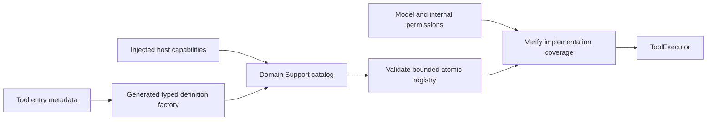
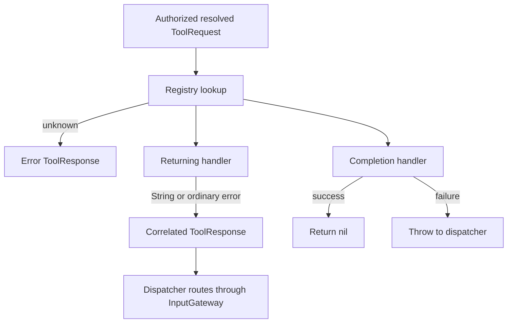

# Tool Runtime

Purpose: register and execute ToolRequests directly. Design goals: explicit feedback kind, bounded catalogs and host-owned effects without Action scheduling. ToolRuntime consumes its own Contracts. The Tools target owns ToolMacro and the compile-time BehaviorDefinitions dependency.

| File | Responsibility |
|---|---|
| ../ToolMacro | Attached metadata declarations and generated factory interface |
| Contracts/ToolDefinition | Domain definitions and explicit built-in catalog |
| ToolRegistry | Actor-owned bounded handlers and resource mappings |
| Contracts/ToolInvocation | ToolRequest plus trusted output context |
| ToolExecutor | Lookup, cancellation and result/completion semantics |

## Registration and bounds

Domain Support catalogs bind `@Tool`-generated factories to explicit capabilities. `ToolRegistry(modules:)` validates the execution catalog atomically: at most32 modules,128 handlers and8 resources per definition. Gateway.BehaviorCoverage checks up to128 Agent capability catalogs against registered paths before producers start. Path segments use the1–64-byte identifier grammar. Duplicate/invalid entries throw in the registry; missing implementations throw in assembly; no partial startup registration is published. Agent declarations remain the permission source.

The registry retains handler and resource mappings. ToolDefinition also carries a display name; this metadata does not create an Action execution record. Dynamic registration APIs support explicit isolated runtimes; production uses the complete catalog constructor.

## Execution and feedback

Registration selects feedback kind; call arguments cannot change it. An empty returned String still produces a result. Cancellation propagates rather than becoming an ordinary error result. Completion waits for the injected endpoint's stated acknowledgement, not necessarily rendered or physical completion.

Gateway checks resource ownership through the same ResourceCoordinator used by Actions, but Tools remain outside Channel FIFO/wait. Runtime owns no work queue, deadline task or detached worker. An uncooperative handler can delay its caller; no generic timeout is implemented.

✅ Macro factories, bounded registration, implementation coverage, resource declarations and both feedback kinds are implemented and tested.

❌ Runtime discovery, forced interruption, implicit permission grants and automatic hardware resource inference are unsupported. Device-facing Tools must explicitly declare their resources.

✅ ToolRuntime compiles this Runtime tree, including Contracts, without project dependencies. Domain catalogs and macro declarations compile in Tools; Gateway imports only runtime contracts.

❌ No change to scheduling, completion, resource arbitration or cleanup algorithms.

✅ ADR0098: Execution values and services are imported from independent ToolRuntime; concrete Tool domains, pose payload and macro declarations remain in Tools. Published paths, feedback and cancellation behavior are unchanged.
