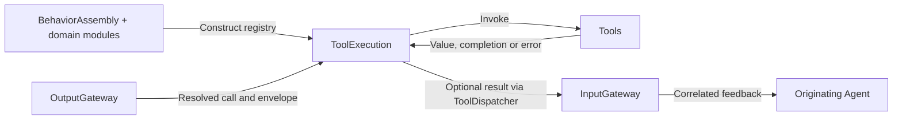
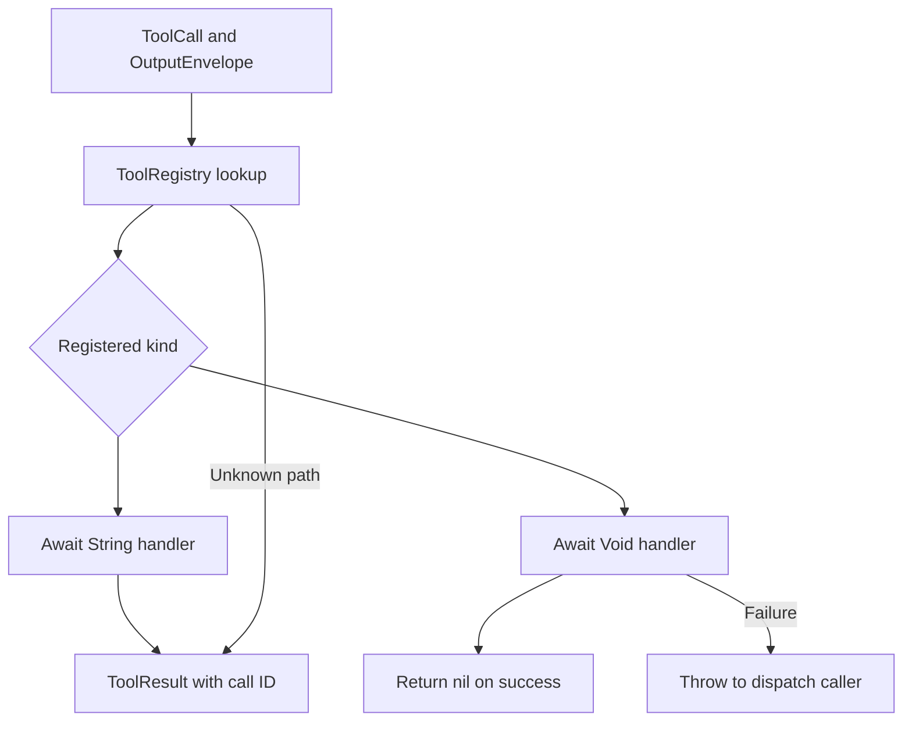

# Tools/Runtime — Direct Tool Execution

Registers and executes resolved ToolCalls. The goal is explicit completion and feedback without Channel scheduling. These runtime files compile within Tools, whose only package dependency is AgentCore.

## Directory structure

```text
Runtime/
├── ToolDefinition.swift # Domain definition and module contract
├── ToolRegistry.swift  # Actor-owned handlers; rejects duplicate paths
├── ToolExecutor.swift  # Execute and select result or completion semantics
└── README.md           # Module contract and status
```

## Upstream and downstream

Arrows show runtime calls through domain handlers assembled by BehaviorAssembly; Runtime and behavior handlers now share the Tools module without self-imports.



## Internal flow



The domain definition selects the handler kind; call arguments cannot select feedback behavior. A returned empty String still creates a result. Returning-handler errors become error results; completion-handler errors throw. Cancellation throws for both kinds. ToolDispatcher sends only non-nil results through InputGateway.

There is no execution queue, replay or automatic serialization of independent callers. The App output consumer awaits calls in order. Actor isolation protects registry access, not handler execution. The registry admits at most 128 entries; production uses atomically constructed domain module catalogs.

## Feature status

- ✅ Shared path namespace, duplicate rejection, returning and completion-only handlers.
- ✅ Correlated feedback, awaited completion and cancellation propagation.
- ❌ Runtime execution timeouts, generic pending-call replacement and durable result delivery.

## Issue record

| Status | Issue / next step |
| --- | --- |
| Open | A non-cooperative handler can delay its caller; no timeout is enforced. |

## Action runtime stage 2

✅ ToolRegistry accepts explicit resources per handler (at most 8; at most 128 handlers). Gateway uses the scheduler-owned ResourceCoordinator for protected direct calls. Tools remain outside Channel FIFO/wait. ❌ Existing unannotated UI tools claim no hardware locks.

## Domain-owned behavior assembly

✅ ToolDefinition separates returning and completion handlers and retains resource declarations. ToolModule provides explicit definitions. ToolRegistry(modules:capabilities:) builds atomically: maximum 32 modules, 128 definitions, 128 capability catalogs, 8 resources/definition, 1–64-byte identifier grammar. Duplicate/invalid entries or missing model/internal Tool paths throw before the registry is exposed. Existing dynamic register methods remain for isolated/explicit runtimes and validate the same identifiers; production uses complete construction. ❌ No asynchronous module discovery or automatic permission grants.
