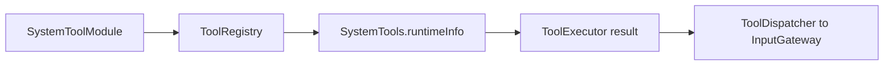

# System Tools

Purpose: small direct system functions, grouped in `SystemTools.swift`. The design keeps callable entries at the domain root and registration in [Support](Support/README.md).

✅ `SystemTools.runtimeInfo(_:)` returns the fixed configuration description. Its registered path remains `runtimeInfo`; it is not a live health probe. `Support/SystemToolModule.swift` declares the returning handler and App composes it through `ToolModules`.

❌ Live health reporting and additional system functions are not implemented. This domain owns no queue or scheduling state.

✅ Entry metadata is declared with `@Tool`; the Support catalog binds generated definition factories to explicit capabilities. Runtime behavior and Agent permissions are unchanged.

✅ System entries consume ToolRequest from Tools/Contracts.
