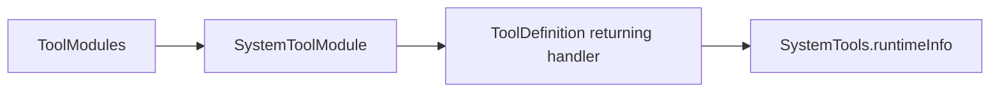

# System Tool support

Purpose: keep domain registration separate from callable system functions. The design uses explicit definitions, with no discovery or hidden App binding.

✅ `SystemToolModule.swift` registers the existing `runtimeInfo` returning handler. It owns no state or queue.

❌ No health service or additional capability interface is needed or implemented.

✅ Entry metadata is declared with `@Tool`; the Support catalog binds generated definition factories to explicit capabilities. Runtime behavior and Agent permissions are unchanged.

✅ Explicit module bindings use Tools-owned contracts; no Agent dependency.
