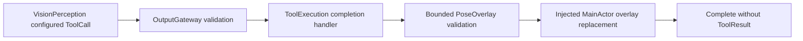

# UI Tools

Purpose: immediate presentation capabilities invoked through Tools/Runtime. Design goals: bounded payloads, explicit completion, no Channel queue, and session-safe injected UI services.

✅ UITools.showPose validates at most 3000 UTF-8 bytes and six COCO-17 skeletons, then awaits atomic replacement through the App callback. Empty people clears the overlay. The handler returns Void; no ToolResult is created or fed back to the Agent. Errors and cancellation propagate to the dispatch caller. CameraCoordinator keeps session and increasing-sequence checks on MainActor.

✅ One sequential App output consumer awaits each call; Tools/Runtime adds no queue or detached task. VisionPerception retains one latest pending skeleton, explicitly replacing older unconsumed UI.showPose state. Moving to Tool does not make presentation zero-cost or bypass MainActor scheduling.
❌ Generic Tool replacement and physical-device latency measurements are not implemented; coalescing is local to VisionPerception skeleton state. No physical device control belongs in this tool.
