```mermaid
flowchart LR
    Agent[Agent internal ToolCall] --> Gateway[OutputGateway validation]
    Gateway --> Tool[Immediate completion handler]
    Tool --> Validate[Bounded typed arguments]
    Validate --> Session[App session validation]
    Session --> Policy[Turn and output sequence / camera frame sequence]
    Policy --> State[MainActor append or replacement]
    State --> Done[Completion without feedback or Action history]
```

# UI Tools

Purpose: immediate presentation effects through OutputGateway and Tools/Runtime. Design goals: explicit text semantics, bounded arguments, session/turn validation and no Channel scheduling. Tools depends only on AgentCore; App supplies typed endpoints and UI owns display state.

| Tool | State operation | Argument contract |
| --- | --- | --- |
| UI.print | Append one reply sentence/chunk exactly once per accepted output sequence | Nonblank text, <=2000 UTF-8 bytes; preserves whitespace |
| UI.setTranscript | Replace the entire recognition preview; empty clears | Text <=4096 UTF-8 bytes; SpeechPerception sends its current preview tail, never an append delta |
| UI.finishTranscript | Clear and close this turn's transcript | No arguments; late partials cannot reopen it |
| UI.beginReplyTurn | Clear reply and expression once per turn | No arguments; recognition preview remains independent |
| UI.setVoiceState | Replace listening/hearing/processing phase | Required state; no microphone admission effect |
| UI.moveEyes | Replace current gaze target | Finite x/y in [-1,1]; negative left/up |
| UI.showPose | Replace all skeletons; empty people clears | <=3000 UTF-8 bytes, <=6 COCO-17 skeletons |

✅ UIToolModule owns completion-only definitions. UIUpdateCapability and PosePresentationCapability expose typed effects; ToolInvocation retains the trusted envelope. CallArguments decodes keys and values without a dependency on Actions. Cancellation is checked before and after each effect. Completion means state accepted, not animation/rendering finished; no ToolResult is generated.

✅ ConversationPresentation retains one turn, closed-transcript/reply flags and at most six sequence entries. App first validates the active session. It rejects old turns, same-ordinal conflicting IDs, wrong sources and non-increasing sequences. Reply/expression require beginReplyTurn. Fresh print sequences append; duplicate sequences never append twice. Only speech updates or Assistant beginReplyTurn can advance the turn. The scheduled expression Action uses this same acceptance policy.

✅ App awaits each Tool on its sequential output consumer. There is no Channel wait or detached task. A wait scope applies only to ActionCalls; Tools do not become barrier members. MainActor scheduling can still take time. VisionPerception's two-entry newest output buffer explicitly coalesces only replaceable gaze/skeleton state, counting replacements; reply chunks are never coalesced.

❌ No generic Tool replacement, physical device control or native model Tool transport is added. Model-selected expression remains the scheduled UI.express Action by explicit product choice. Physical display latency still requires device acceptance.
