# UI Tools

Purpose: immediate presentation effects through OutputGateway and Tools/Runtime. Design goals: explicit text semantics, bounded arguments, session/turn validation and no Channel scheduling. Tools owns its execution contracts; App supplies typed endpoints and UI owns display state.

| Tool | State operation | Argument contract |
| --- | --- | --- |
| UI.print | Append one reply sentence/chunk exactly once per accepted output sequence | Nonblank text, <=2000 UTF-8 bytes; preserves whitespace |
| UI.setTranscript | Replace the entire recognition preview; empty clears | Text <=4096 UTF-8 bytes; SpeechPerception sends its current preview tail, never an append delta |
| UI.finishTranscript | Clear and close this turn's transcript | No arguments; late partials cannot reopen it |
| UI.beginReplyTurn | Clear reply and expression once per turn | No arguments; recognition preview remains independent |
| UI.setVoiceState | Replace listening/hearing/processing phase | Required state; no microphone admission effect |
| UI.moveEyes | Replace current gaze target | Finite x/y in [-1,1]; negative left/up |
| UI.showHistory | Replace history snapshot through a scoped host endpoint | No arguments; internal ConversationMemory permission |
| UI.showPose | Replace all skeletons; empty people clears | <=3000 UTF-8 bytes, <=6 COCO-17 skeletons |

✅ UIToolModule owns completion-only definitions. UIUpdateCapability and PosePresentationCapability expose typed effects; ToolInvocation retains opaque host correlation. ToolArguments decodes keys and values without a dependency on Actions. Cancellation is checked before and after each effect. Completion means state accepted, not animation/rendering finished; no ToolResult is generated.

✅ AppWorkflows.ConversationPresentation retains one turn, closed-transcript/reply flags and at most six sequence entries. App first validates the active session. It rejects old turns, same-ordinal conflicting IDs, wrong sources and non-increasing sequences. Reply/expression require beginReplyTurn. Fresh print sequences append; duplicate sequences never append twice. Only speech updates or Assistant beginReplyTurn can advance the turn. The scheduled expression Action uses this same acceptance policy.

```mermaid
flowchart LR
    Agent[Agent internal ToolCall] --> Gateway[OutputGateway validation]
    Gateway --> Tool[Immediate completion handler]
    Tool --> Validate[Bounded typed arguments]
    Validate --> Session[App session validation]
    Session --> Policy[Turn and output sequence / camera frame sequence]
    Policy --> State[MainActor append or replacement]
    State --> Done[Completion without feedback or Action history]
```

✅ App voice/camera output consumers await each Tool sequentially; history transport awaits its correlated output separately. Tool execution introduces no Channel wait or detached task. A wait scope applies only to ActionCalls; Tools do not become barrier members. MainActor scheduling can still take time. VisionPerception's two-entry newest output buffer explicitly coalesces only replaceable gaze/skeleton state, counting replacements; reply chunks are never coalesced.

❌ No generic Tool replacement, physical device control or native model Tool transport is added. Model-selected expression remains the scheduled UI.express Action by explicit product choice. Physical display latency still requires device acceptance.

## Source layout

✅ `UITools.swift` groups the eight callable presentation entries. `Support/UIToolModule.swift` owns registrations and typed host capability contracts; `Support/UIToolTypes.swift` owns nested value/error types. `App/Workflows/ConversationPresentation.swift` retains the bounded turn/sequence acceptance policy as a separate cohesive implementation. See [Support](Support/README.md).

❌ This organization adds no rendering acknowledgement, queue or native model Tool transport.

✅ Entry metadata is declared with `@Tool`; the Support catalog binds generated definition factories to explicit capabilities. Runtime behavior and Agent permissions are unchanged.

✅ ToolPoseOverlay is the tool-owned decoded payload. App converts it to the UI overlay value. Conversation source/turn acceptance belongs to AppWorkflows, not Tools.

✅ ADR0098: Execution values and services are imported from independent ToolRuntime; concrete Tool domains, pose payload and macro declarations remain in Tools. Published paths, feedback and cancellation behavior are unchanged.

✅ UI.showPose accepts optional finite nonnegative statistics and validates timing consistency before the host effect; existing payloads remain valid and the 3000-byte/six-person bound is unchanged.

✅ Optional adaptive interval statistics remain in UI.showPose; validation accepts 0...1000ms finite values and legacy statistics without the field. No new callable entry or output queue is added.

✅ UI.showPose retains its existing permission and 3000-byte bound while carrying optional normalized image-motion activity in statistics. Invalid activity is rejected before effects.

✅ UI.showHistory invokes the required HistoryPresentationCapability; App validates the root memory session and adapts raw records into UI state. ❌ Navigation and model-callable history presentation remain pending.
