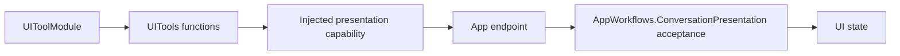

# UI Tool support

Purpose: support immediate presentation tools without exposing implementation files as callable entries. The design keeps registration and host interfaces together, values separate, and stateful acceptance policy independently reusable.

- ✅ `UIToolModule.swift`: seven completion-only definitions, `UIUpdateCapability` and `PosePresentationCapability`; App injects endpoints.
- ✅ `UIToolTypes.swift`: `UITools.Gaze`, `VoiceState` and validation errors; existing public names are preserved.
- ✅ App-owned `App/Workflows/ConversationPresentation.swift`: current turn, transcript/reply flags and one sequence per six update kinds. New accepted turns reset bounded state; stale/duplicate updates are rejected. It owns no queue; App validates session identity.
- ❌ Rendering acknowledgement and new host primitives are not implemented here.

The callback must complete before the Tool completes. Types and policy do not register themselves or grant Agent permissions.

✅ Entry metadata is declared with `@Tool`; the Support catalog binds generated definition factories to explicit capabilities. Runtime behavior and Agent permissions are unchanged.

✅ Support contains capability interfaces and explicit bindings. ConversationPresentation moved to App/Workflows; Tools does not choose permitted Agent identities.

✅ ADR0098: Execution values and services are imported from independent ToolRuntime; concrete Tool domains, pose payload and macro declarations remain in Tools. Published paths, feedback and cancellation behavior are unchanged.

✅ ToolPoseOverlay optionally decodes timing/FPS/replacement statistics independently of AgentCore. Validation rejects negative/nonfinite values and inconsistent total/queue/inference measurements; App converts the values at its existing boundary.

✅ Optional detectionIntervalMilliseconds decodes independently of AgentCore and validates as finite, nonnegative and ≤1000ms; App maps it to the shared presentation value.

✅ Optional imageMotion validates as finite 0...1. Legacy pose/statistics payloads without the field remain valid; no Agent/ModelKit dependency is added.

✅ ADR0132: Domain validation/availability errors provide bounded ToolRuntime producer codes; generic execution and home observation preserve them without importing platform errors. ❌ Physical acceptance remains pending.
