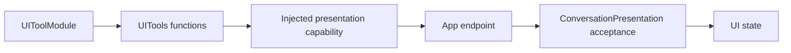

# UI Tool support

Purpose: support immediate presentation tools without exposing implementation files as callable entries. The design keeps registration and host interfaces together, values separate, and stateful acceptance policy independently reusable.

- ✅ `UIToolModule.swift`: seven completion-only definitions, `UIUpdateCapability` and `PosePresentationCapability`; App injects endpoints.
- ✅ `UIToolTypes.swift`: `UITools.Gaze`, `VoiceState` and validation errors; existing public names are preserved.
- ✅ `ConversationPresentation.swift`: current turn, transcript/reply flags and one sequence per six update kinds. New accepted turns reset bounded state; stale/duplicate updates are rejected. It owns no queue; App validates session identity.
- ❌ Rendering acknowledgement and new host primitives are not implemented here.

The callback must complete before the Tool completes. Types and policy do not register themselves or grant Agent permissions.

✅ Entry metadata is declared with `@Tool`; the Support catalog binds generated definition factories to explicit capabilities. Runtime behavior and Agent permissions are unchanged.
