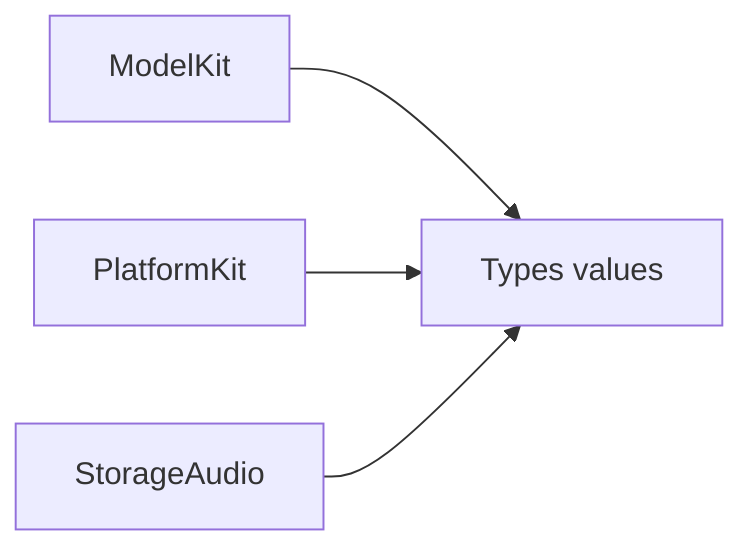

# Audio — Shared audio values

Compiled in the parent Types target.

Purpose: provide immutable Sendable PCM format/frame and microphone sample values independently of model, device and storage SDKs. Design goal: one source of media data contracts without runtime ownership.

✅ AudioFormat retains 8–192 kHz, 1–8 channels and Int16/Float32 encoding limits. AudioFrame retains nonempty aligned data, 1 MiB/frame and finite nonnegative timestamps. Validating constructors report AudioValidationError. ModelKit exports these values and preserves its original constructors and CapabilityError mapping. PlatformKit exports the unchanged MicrophoneFrame value. No queue, hardware access, model loading or state owner is introduced.

❌ Compressed media, file transport and audio mixing are outside these contracts.
