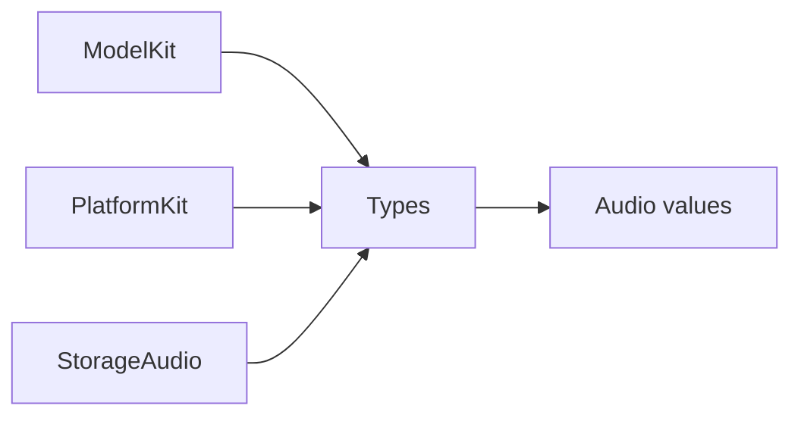

# Types — Shared values

Purpose: own shared immutable Sendable values used by independent SDKs. Design goals: group contracts by domain under one Types compilation target; retain validation at construction and keep runtime/service ownership in consumers.

| Directory | Implemented contracts |
| --- | --- |
| [Audio](Audio/README.md) | PCM formats/frames, microphone samples and validation errors |

## Contracts and scope

✅ Types has no project dependencies. Audio values own PCM validation and immutable samples/format/sequence data. ModelKit re-exports audio values with its public constructor labels and CapabilityError mapping; PlatformKit re-exports MicrophoneFrame.

ImageFrame and NativeImageBuffer currently belong to ModelKit/Core. Types owns no capture, inference, persistence, queues or lifecycle services.

❌ Other shared value categories are not implemented. A category is added only with concrete values and consumers.
