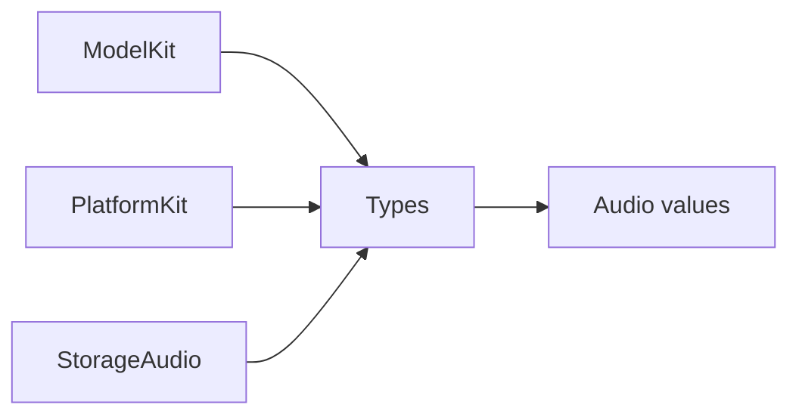

# Types — Shared values

Purpose: own shared immutable Sendable values used by independent SDKs. Design goals: group contracts by domain under one Types compilation target; retain validation at construction and keep runtime/service ownership in consumers.

| Directory | Implemented contracts |
| --- | --- |
| [Audio](Audio/README.md) | PCM formats/frames, microphone samples and validation errors |

✅ Types has no project dependencies; Audio values retain their original limits, validation, sample layout and ownership. ModelKit preserves its original constructor labels and error mapping; PlatformKit preserves its microphone value export.

❌ Image and other shared categories are added when concrete shared consumers require them. ModelKit/Core currently owns ImageFrame and NativeImageBuffer; this migration does not move them or create unused placeholders. Types owns no capture, inference, persistence, queues or lifecycle services.
