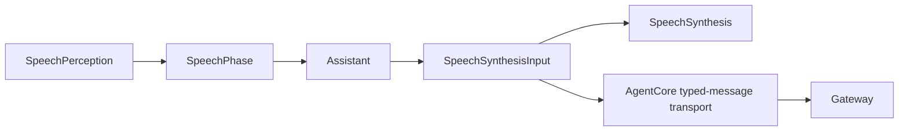

# Speech — Shared speech values

Purpose: immutable speech phase and synthesis-request values shared across perception, Assistant and synthesis. Design goals: keep values independent of AgentCore, models and execution.

✅ SpeechPhase and SpeechSynthesisInput retain existing Codable shape, text/locale validation and audio-ID correlation. Validation throws SpeechValidationError; Agent message admission maps it to CommunicationError.invalidPayload.
❌ Provider locale negotiation, synthesis queues, model calls, text-to-playback policy and conversation state are outside this directory.

