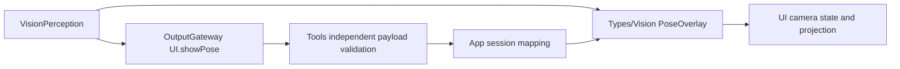

# Vision — Shared presentation values

Purpose: own immutable visual values shared by independent consumers. Design goals: preserve the existing Codable payload without importing Agent, Tool, model or platform services.

✅ PoseOverlay carries frame identity/rotation, compact COCO joints and optional detection statistics. Joint arrays encode exactly three integers; malformed extra values throw DecodingError without an AgentCore dependency. Statistics retain optional backward-compatible fields and numeric validation.
✅ VisionPerception builds values; App maps independent ToolPoseOverlay into them; UI renders them. Rotation projection belongs to UI/Camera, not this value library.
❌ No model result, capture owner, identity tracker, inference scheduling or service is implemented here.

