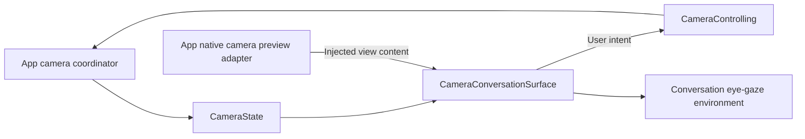

# Camera UI

Purpose: present the camera surface and user controls around startup/conversation content. Design goals: independent camera intent, accessible recovery and no capture/model ownership in UI.

| File | Responsibility |
| --- | --- |
| PoseOverlayProjection.swift | Value-only joint rotation into native sensor coordinates; crop/mirroring remain in App adapter |
| CameraState.swift | MainActor visibility, facing, errors, skeleton/gaze and YOLO statistics values; CameraControlling declares user operations |
| CameraConversationSurface.swift | Injected preview content, dimming, controls, messages and eye-gaze environment |

## Upstream and downstream

App supplies CameraState, CameraControlling and the native preview view. [CameraCoordinator](../../App/Lifecycle/README.md) owns permissions and capture/inference lifetimes. [CameraPreviewAdapter](../../App/Adapters/README.md) owns native layer connection, rotation/mirroring and skeleton drawing. UI owns PoseOverlay values; it imports no platform service.

✅ The same surface wraps startup and ready conversation. Camera availability does not wait for voice-model readiness. The preview uses aspect fill and front mirroring; a 42% black overlay dims it. Preview/dimming never intercept touches, and off/inactive/error states hide old frames.

✅ The primary toolbar is 8 pt below the top safe area. Camera toggle/settings use 48-point targets; All controls share one horizontal capsule: camera toggle → lens switch → Settings. Lens controls appear in the middle only while camera intent is enabled; a 200 ms opacity/scale transition accompanies capsule expansion/collapse. Settings remains at the trailing edge. Existing camera.toggle, camera.switch and app.settings accessibility identifiers stay stable across source/operation renames. Switching is disabled during transitions; on/off replaces pending intent. Permission denial exposes a system Settings link. Reduce Motion disables expansion animation.

✅ UI.showPose reaches CameraState through the App callback; the native adapter draws joints/edges with confidence ≥0.3 and hides rotation-mismatched overlays. UI.moveEyes supplies normalized gaze through App. Front mirroring happens once in perception; lifecycle reset clears pose and centers gaze. Changing camera replaces the vision session while retaining model weights.

✅ Window-owned camera observation survives page navigation. Entering Settings suspends capture without changing on/off intent; returning restores intent. Simulator unavailability is explicit.

❌ Recording, exact preview-crop mapping of gaze, and physical-device visual, navigation, permission and performance acceptance.

Sources compile once in the UI target; there is no App source membership for this directory.

✅ CameraState and its surface contain camera/vision failures only. Removed trackingMessage; Action/Tool execution failures appear only in the home scheduling issue list and do not clear preview or skeleton (ADR0131).

✅ CameraConversationSurface shows a compact YOLO statistics panel at the upper left, with the same 8 pt top safe-area inset and 48 pt header height as the camera/settings toolbar: measured result FPS, next adaptive interval ms, callback-to-model waiting ms, capability-call ms, callback-to-result total ms and cumulative skipped pending frames (displayed as “跳过 N 帧”; counts older pending frames replaced by newer captures). It appears only with a visible camera and a current measured result, uses monospaced digits and clears with the skeleton/session. The header button (`camera.poseStatistics.toggle`) collapses/expands the detail rows while keeping FPS visible; it starts expanded and retains its view-local selection across result updates. Detail rows allow touches through; the header provides an accessible 48 pt target. Reduce Motion disables the 200 ms toggle animation. Missing timing/FPS displays an em dash. ❌ Native screen rendering delay is not included.

✅ The fixed grayscale-percentage menu/state/control method are removed. Detection cadence remains Agent-owned and App-configured; UI has no sampling policy.

✅ The interval row shows Agent-supplied scheduling data; UI does not infer motion, choose FPS or call models. Actual result FPS remains separately measured.

✅ The upper-left panel also displays optional 0...1 image-motion activity with two decimals. This is Agent-supplied normalized evidence, not a threshold control or raw pixel-change percentage; UI still renders values only.

✅ UI/Camera owns PoseOverlay and display statistics. VisionPerception owns its Encodable PoseOverlayPayload; ToolPoseOverlay remains the independently validated Tool contract. App maps Tool values into UI values. UI depends only on StorageChat; AgentCore has zero project dependencies. See ADR0121.

✅ ADR0121 removes the Types module: AgentCore/Input owns generic audio/image transport, UI/Camera owns PoseOverlay, and VisionPerception owns PoseOverlayPayload. App adapts the independent Tool payload into UI values. ❌ Capability SDKs must not import consumer or presentation modules.
