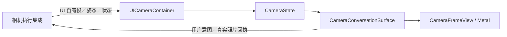

# Camera — 相机、姿态与照片呈现

## 职责与接口

UICameraContainer 唯一拥有 CameraState，实现 CameraPresenting 的只读快照、视频／骨架提交、照片呈现、清屏、状态和事实通知。上游 Actions 负责原生帧转换、权限、设备启停、资源租约及照片业务；UI 不创建原生相机或模型。

## 源码归属

| 文件 | 职责 |
| --- | --- |
| UICameraContainer.swift | 注入呈现端口及根生命周期接纳 |
| CameraState.swift | 独立视频／骨架状态、校验和期限 |
| CameraVideoFrame.swift | 只读像素值、最新状态 mailbox 和可测试骨架网格 |
| PoseOverlay.swift | 骨架与推理统计 UI 值 |
| CameraFrameView.swift | 原生视图和 Metal 显示所有者 |
| CameraConversationSurface.swift | 独立背景、视线、控制、统计及照片观察子视图 |
| CapturedPhotoView.swift / PhotoDeparture.swift | 照片查看、缩略图和真实离场回执 |

✅ 姿态屏幕坐标由 CameraSkeletonMesh 与视频共享变换；测试直接验证生产网格、方向、独立媒体及真实 GPU 完成。运行路径不含额外的比较性投影或临时时序程序。

## 视频、骨架与校验

✅ 相机默认关闭，UI 构造／启动不请求权限。视频和姿态独立接纳：视频直接更新最新原生像素展示值；姿态验证 Tool 随附来源帧，仅更新骨架。模型加载、空检测、失败或停止不清视频。关闭、后台及真实呈现失败按生命周期清理。

两路按捕获后750ms分别到期，并核对尺寸、方向、单调序号和根实时 token。骨架与当前背景可以来自不同序号，但原始姿态与其附件必须匹配。图像和关节共用 upright/aspect-fill/镜像变换。推理统计不包含 UI／GPU 上屏时间。

✅ 视频和骨架各用一个可续期的到期所有者；正常连续帧只更新截止时间，不逐帧取消／创建任务，也不由到期闭包持有像素帧。仅更早期限、清屏或重启取消旧等待，替换仍加入旧任务；stop 取消并加入，不假冒 GPU 结束。

## Metal 所有权与完成

✅ 原生视图仅在主线程管理挂载、布局及故障回调；专用线程创建纹理／顶点、接收 CAMetalDisplayLink drawable 并提交一个图像＋骨架 render pass。像素经 CVMetalTextureCache 复用，不逐帧 JPEG／UIImage，不保留预览层回退。

一个最新待展示包、两个 GPU 在途槽和最多一个合并唤醒。满载跳过显示机会，保留最新状态；网格按姿态／尺寸／方向／镜像修订缓存，GPU 完成前不覆盖 buffer。完成回调保留原生帧及纹理至 GPU 读取结束。

离窗同步关闭接纳并隐藏表面；渲染线程注销显示链、等待真实 GPU 完成后退出。新实例在渲染线程等待旧实例清理，再接管同一图层。故障回调同时核对视图实例与相机代际。macOS 使用同一渲染器进行原生回归；completedFrameCount 只统计真实成功完成。

## 控制、事实与照片

控制忙碌使用 controlBusy/controlMessage，与原生设备或照片错误分开；重叠操作提示在真实请求结束后清除。isEnabled 表示意图，原生停机确认由设备拥有者负责。UI内部变更通知只驱动有界事实流，不再提供公共状态镜像回调。

背景遮暗42%；开关／镜头／设置使用48pt目标，操作期间禁用冲突按钮，权限拒绝可进入系统设置。YOLO 统计初始折叠，展开为页面局部状态。

照片按身份出现、保持并缩成96×128缩略图；真实动画完成后才开放后续交互。检查器用 RetainedFullScreenCover 保留首页。保存先放大再右移离场，忽略向右下缩小离场；替换、后台或离窗明确撤销旧等待，Reduce Motion 使用简化过渡。实际保存、声音、相册事务和移除策略留在上游。

## 失败与待验收

呈现错误保留原 throw／注入故障报告；stale、unavailable 和 stopped 等正常接纳拒绝不产生逐帧异常。GPU 故障清空并隐藏对应原生表面，不伪造完成；重启创建新代际。

❌ 原生 Metal 挂载／重启回归超时、取帧暂停、相机裁剪与视线映射及完整真机前后台验收仍需跟进。

[UI 根](../README.md) · [原生组件](../Components/README.md) · [验证记录](../../../docs/validation/PlatformKit-Containers.md)

✅ 已实现：宿主准备门禁禁止新开相机，已开启相机仍可关闭；镜头切换仅依据相机自身状态，设置入口不受门禁影响；保留原相机忙碌及权限围栏。

✅ CameraState将渲染故障包装为UIFailure后同步交宿主，保留原技术描述和包装源码位置。CameraPresenting的帧新鲜度／方向／代际拒绝保持原领域错误及独立画面／骨架行为，不逐帧升级为全局Toast。

## Direct container contract

UI-owned typed request/reply capabilities have one consumer and at most 64 outstanding requests, including accepted work. Acceptance does not complete a request. Cancellation, consumer exit, root invalidation and late replies are generation-fenced. Foundation dependencies remain empty. Current cross-module ownership is defined by the [overall design](../../README.md).

## Agent-owned UI inputs

✅ UICameraContainer owns CameraInput requests and terminal receipts. The injected consumer listens directly; UI does not route camera events through a business adapter. Native preview and effect completion remain separate from request acceptance. Existing root/frame/photo generation fences still control presentation.

## Native validation preconditions

The macOS GPU regression creates a real hosted layer with explicit bounds and a visible test window before requesting drawables. A fully occluded WindowServer surface is a failed prerequisite, not a passed or skipped GPU result. The renderer's existing lifetime and completion contract remain unchanged; device/native evidence is tracked separately.

✅ 在 `-direct-input-diagnostics` 下每 120 帧报告画面尺寸，并报告首个 GPU 完成；不记录像素、不新增队列或转发任务。性能计时不启用此输出；原生宿主测试与 iPhone 预览分别验收，黑屏根因仍待定位。

## App 相册收录

✅ 照片保存按钮、确认菜单和无障碍标签明确表示“保存到 App 相册”；系统Photos导出只在相册详情提供，预览保存不申请Photos权限。

## 镜头切换准入

✅ CameraState.canSwitchCamera 统一提供翻转按钮准入：UI前台可用、相机已启用且原生采集确认可见，无权限问题且相机控制／拍照／照片处置均空闲。CameraConversationSurface不再以全局模型准备状态禁用翻转；开启和重试门禁保持既有契约。原生执行端仍独立校验权限、资源与前后台，不以按钮可用替代真实完成。

## Container 上下文

UICameraContainer.stateSnapshot 在 Business 显式输出 enabled/visible/busy/facing/needsSettings，Runtime 保留呈现 admission；不包含视频、骨架、错误原文或图像字节。读取无外部效果。

## Passive state observation

The owning stateSnapshot entry point reads current local business/capability values and runtime admission/work facts in the owner's isolation domain. It performs no action, acquisition or device activation. The module root composes the explicitly selected fields; unknown diagnostic coverage is not healthy evidence. Domain-specific completion and failure contracts above remain authoritative.
