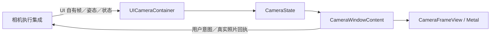

# Camera — 相机、姿态与照片呈现

## 职责与接口

UICameraContainer 唯一拥有 CameraState，实现 CameraPresenting 的只读快照、视频／骨架提交、照片呈现、清屏、状态和事实通知。上游 Actions 负责原生帧转换、权限、设备启停、资源租约及照片业务；UI 不创建原生相机或模型。

## 源码归属

| 文件 | 职责 |
| --- | --- |
| UICameraContainer.swift | 注入呈现端口及根生命周期接纳 |
| CameraState.swift | 独立视频／骨架状态、校验和期限 |
| CameraVideoFrame.swift | 只读像素值、最新状态 mailbox 和可测试骨架网格 |
| PoseOverlay.swift | 骨架与推理统计 UI 值 |
| CameraFrameView.swift | 原生视图和 Metal 显示所有者 |
| CameraConversationSurface.swift | Face 入口与窗口内预览/镜头/快门/错误/照片内容 |
| CapturedPhotoView.swift | 入栈回执、叠图入口、分页浏览和原生缩放 |

姿态屏幕坐标由 CameraSkeletonMesh 与视频共享变换；测试直接验证生产网格、方向、独立媒体及真实 GPU 完成。运行路径不含额外的比较性投影或临时时序程序。

## 视频、骨架与校验

相机默认关闭，UI 构造／启动不请求权限。视频和姿态独立接纳：视频直接更新最新原生像素展示值；姿态验证 Tool 随附来源帧，仅更新骨架。模型加载、空检测、失败或停止不清视频。关闭、后台及真实呈现失败按生命周期清理。

两路按捕获后750ms分别到期，并核对尺寸、方向、单调序号和根实时 token。骨架与当前背景可以来自不同序号，但原始姿态与其附件必须匹配。图像和关节共用从采集 upright 坐标到实际界面方向的旋转、aspect-fill 和显示坐标镜像变换。推理统计不包含 UI／GPU 上屏时间。

视频和骨架各用一个可续期的到期所有者；正常连续帧只更新截止时间，不逐帧取消／创建任务，也不由到期闭包持有像素帧。仅更早期限、清屏或重启取消旧等待，替换仍加入旧任务；stop 取消并加入，不假冒 GPU 结束。

## Metal 所有权与完成

原生视图仅在主线程管理挂载、布局及故障回调；专用线程创建纹理／顶点、接收 CAMetalDisplayLink drawable 并提交一个图像＋骨架 render pass。像素经 CVMetalTextureCache 复用，不逐帧 JPEG／UIImage，不保留预览层回退。

一个最新待展示包、两个 GPU 在途槽和最多一个合并唤醒。满载跳过显示机会，保留最新状态；网格按姿态／尺寸／方向／镜像修订缓存，GPU 完成前不覆盖 buffer。完成回调保留原生帧及纹理至 GPU 读取结束。

离窗同步关闭接纳并隐藏表面；渲染线程注销显示链、等待真实 GPU 完成后退出。新实例在渲染线程等待旧实例清理，再接管同一图层。故障回调同时核对视图实例与相机代际。macOS 使用同一渲染器进行原生回归；completedFrameCount 只统计真实成功完成。

## 控制、事实与照片

Face 背景视觉使用0.30不透明度叠在黑色底板上，使面部主体清楚；仅背景 CameraFrameView 受此值影响。独立拍摄窗口保持完整预览亮度，Face、控制胶囊和 YOLO 统计文字不随视频淡化。背景仍不接管触摸。

控制忙碌使用 controlBusy/controlMessage，与原生设备或照片错误分开；重叠操作提示在真实请求结束后清除。isEnabled 表示意图，原生停机确认由设备拥有者负责。UI内部变更通知只驱动有界事实流，不再提供公共状态镜像回调。

Face 右上角保留胶囊式视觉／跟随开关（eye 图标）和设置入口；仅视觉开启时显示背景翻转，翻转可用性仍服从最上层镜头权限。Face 不额外提供拍摄窗口快捷按钮，拍摄由 Photography Action 打开窗口。视觉开启时在 Face 后方挂载含姿态的 CameraFrameView；拍摄不启用背景。相机入口受应用会话建立、根启动失败及相机控制忙碌状态约束，不依赖对话模型准备成功；请求仍经过类型化端口与 Action 的实际准入。CameraWindowContent 在独立窗口内显示原生预览、照片／视频模式、镜头切换和快门，权限失败可进入系统设置，普通错误可重新开启。完全被上层窗口覆盖时卸载预览渲染器，采集仍由领域拥有。

照片按身份执行一次入栈动画并返回真实完成回执，随后释放该临时全图呈现。CameraGalleryView 独立显示最新三层小缩略图及全部缓存数量；点击在窗口内展开，默认最新照片。顶部上／下一张和保存按钮与索引／状态常驻；保存保持当前页。被FIFO淘汰的当前图切换至最早剩余图，关闭会话退出浏览器。UI不选择模型图片。

原生 UIScrollView 提供1...4倍缩放、双击适应／2倍和放大平移；仅适应大小时允许左右滑动翻页，箭头始终可用并重置缩放。首尾不循环。缩略图最多三张256px，浏览图仅当前与邻页且最大2048px；异步读取受会话、取消和当前目录检查约束。UI通过注入的CameraControlling.previewImage读取，不能访问Storage。

CameraWindowContent 将实时预览铺满内容区，底部140pt控制带覆盖半透明黑色渐变，不再占用独立的不透明画面区域。已有缓存不锁定新拍摄／镜头／模式；实际设备、录像和当前操作准入保持独立。

## 失败与验证边界

呈现错误保留原 throw／注入故障报告；stale、unavailable 和 stopped 等正常接纳拒绝不产生逐帧异常。GPU 故障清空并隐藏对应原生表面，不伪造完成；重启创建新代际。

[UI 根](../README.md) · [原生组件](../Components/README.md) · [验证记录](../../../docs/validation/PlatformKit-Containers.md)

宿主准备门禁禁止新开相机，已开启相机仍可关闭；镜头切换仅依据相机自身状态，设置入口不受门禁影响；保留原相机忙碌及权限围栏。

CameraState将渲染故障包装为UIFailure后同步交宿主，保留原技术描述和包装源码位置。CameraPresenting的帧新鲜度／方向／代际拒绝保持原领域错误及独立画面／骨架行为，不逐帧升级为全局Toast。

## Direct container contract

UI-owned typed request/reply capabilities have one consumer and at most 64 outstanding requests, including accepted work. Acceptance does not complete a request. Cancellation, consumer exit, root invalidation and late replies are generation-fenced. Foundation dependencies remain empty. Current cross-module ownership is defined by the [overall design](../../README.md).

## Agent-owned UI inputs

UICameraContainer owns CameraInput requests and terminal receipts. The injected consumer listens directly; UI does not route camera events through a business adapter. Native preview and effect completion remain separate from request acceptance. Existing root/frame/photo generation fences still control presentation.

## Native validation preconditions

The macOS GPU regression creates a real hosted layer with explicit bounds and a visible test window before requesting drawables. A fully occluded WindowServer surface is a failed prerequisite, not a passed or skipped GPU result. The renderer's existing lifetime and completion contract remain unchanged; device/native evidence is tracked separately.

在 `-direct-input-diagnostics` 下每 120 帧报告画面尺寸，并报告首个 GPU 完成；不记录像素、不新增队列或转发任务。性能计时不启用此输出；原生宿主测试与 iPhone 预览分别验收，黑屏根因仍待定位。

## App 相册收录

照片保存按钮、确认菜单和无障碍标签明确表示“保存到 App 相册”；系统Photos导出只在相册详情提供，预览保存不申请Photos权限。

## 镜头切换准入

CameraState.lensOwner 根据 Face 页面可见性、WindowState 实际层级／遮挡／呈现阶段投影镜头持有者。展开且可见的拍摄窗口优先；最小化／关闭／被完全遮挡后，只有已启用且可见的背景视觉获得权限。普通窗口不持有权限，过渡阶段和业务交接期间两端均禁用。canSwitch(surface) 再检查该分支启用、采集就绪、前台和操作空闲；canSwitchCamera 是拍摄分支的便捷投影。CameraConversationSurface不再以全局模型准备状态禁用翻转；开启和重试门禁保持既有契约。原生执行端仍独立校验权限、资源与前后台，不以按钮可用替代真实完成。

## Container 上下文

UICameraContainer.stateSnapshot 在 Business 显式输出 enabled/perceptionEnabled/lensOwner/visible/busy/facing/needsSettings（facing 是呈现值；模型的设备事实来自 platform.vision.camera），Runtime 保留呈现 admission；不包含视频、骨架、错误原文或图像字节。读取无外部效果。

## Passive state observation

The owning stateSnapshot entry point reads current local business/capability values and runtime admission/work facts in the owner's isolation domain. It performs no action, acquisition or device activation. The module root composes the explicitly selected fields; unknown diagnostic coverage is not healthy evidence. Domain-specific completion and failure contracts above remain authoritative.

## Interface-based preview geometry

CameraVideoFrame retains the native portrait sensor reference independently of its gravity-upright source rotation/size. CameraPreviewBasis and CameraPreviewGeometry convert model-space joints and camera texture sampling into the actual window interface coordinates before aspect-fill and display-axis mirroring. Metal image and skeleton use the same display dimensions/crop; capture gravity changes do not swap the framing of a portrait-locked interface. Mailbox equality and mesh cache keys include source reference and interface orientation. Frames without a sensor reference preserve the supplied upright-frame geometry.

CameraFrameSurface reads UIWindowScene.effectiveGeometry.interfaceOrientation during layout/submission, without enabling interface autorotation or using physical-device gravity as UI orientation. A single coalesced view-owned task reports discrete changes outside the UIViewRepresentable update transaction; renderer replacement/detachment cancels it and epoch checks reject late reports. CameraState keeps a small source basis only when it changes, so ordinary video updates do not invalidate gaze content every frame. Existing already-mirrored attention vectors are converted to display axes, mirroring once after the rotation. Capture/source matching, 750 ms freshness, independent media expiry and joined GPU retirement retain their existing contracts; changed sensor references clear old skeletons and reject mismatched pose attachments.

## Independent camera surfaces

Both renderers retain the same immutable CameraVideoFrame; only the background passes skeleton data. Each renderer owns its native completion and its own failure surface; a failed photo renderer cannot clear shared frames or disable background rendering. Background renderer unmounts when Face is hidden or completely covered; photo renderer unmounts while minimized or fully covered. Neither unmount changes device demand.

Photo rendering uses aspect-fill across the full content surface, with a separate interface-orientation report. photoAspect derives from native frame dimensions and the sensor-to-interface transform; it drives window sizing with zero reserved controls height. The140pt translucent control band overlays live pixels. Preview crop does not change original capture dimensions. Background keeps its common video/pose/gaze geometry.

Background vision presents status, system-permission settings and explicit retry controls inside Face. These use the typed request chain without opening a photo window.

photoAspect is a retained scalar updated only when geometry changes. Root window layout observes this value rather than the per-frame video reference, so new pixels do not rebuild root window content.

Face 左上角在背景视觉启用且存在新鲜姿态统计时显示 YOLO FPS，可折叠展开采样间隔、画面运动、排队／推理／总延迟及跳过帧数。数值来自同一骨架观测的真实 statistics，失效后不保留旧统计；拍摄窗口不显示 YOLO。视觉开关的无障碍状态以视觉分支为准，拍摄独立运行不会使其显示已开启。

## Capture settings and movie presentation

CameraSettings carries full mode/countdown/flash/zoom/duration selections plus actual capability bounds. The140pt translucent overlay offers photo/video selection, a settings menu, bounded zoom choices and one shutter/stop location. Configuration, cancel, start/stop and video disposition go through typed CameraInput; no view invokes native capture. countdown presents the domain's remaining seconds and cancel control. Recording uses startedAt for SwiftUI's timer display, a red indicator, listening-paused text and explicit stop.

CameraRecordingPresentation separates idle/starting/recording/finishing/ready/failed. Ready clips use a local URL and LocalVideoPlayer; save/ignore remains available on a retained failed clip. Busy states disable incompatible controls. Both visual surfaces disable lens switching throughout recording startup/active/finalization, including minimized recording. Window aspect follows real preview dimensions plus140pt controls and52pt chrome. Hidden content does not retain preview/player rendering; business recording continues under its domain owner.

CameraState.photoCaptureRotation and CameraPresentationSnapshot expose the current photo window’s sensor-to-interface quarter-turn angle as a read-only scalar. It combines the native portrait sensor reference with photoOrientation, independently of Face orientation and gravity. Without a fresh admitted frame/basis (less than750ms old) it is nil. CameraPresenting.waitForPhotoCaptureRotation waits on real frame admission with one bounded waiter per root, rejects overflow, and returns the current rotation. A10-second maximum deadline fails explicitly; cancellation, generation changes, root/background shutdown and photo renderer failures release the waiter, and the deadline task is cancelled and joined. Frame admission does not publish per-frame Facts. This confirms display geometry, not GPU completion. Actions awaits it after opening and again at the shutter or recording start; the UI does not reorient existing encoded media when the device moves.

CameraInput与UICameraContainer同文件，描述拍照/录像/背景视觉的UI输入；Shared只传递泛型请求，不解释这些操作。

背景视觉容器透明，由Root提供首页底色。视频内部叠加暗色对比渐变后，以30%透明度合成到首页；该对比层只随背景视频显示，不再覆盖无视频首页。窗口内拍摄预览保持原黑色底。

CameraInput uses previewID for temporary photo disposition. savedPreviewID and savedMediaID separately identify the committed preview operation and persistent album image, including later request-completion failure. Model image loading does not switch UI. CameraInput captures previewSession before queuing; gallery metadata and scoped byte reads stay separate from model selection.

The recording timer and pending-video save/ignore overlay sit above the140-point shutter region, preserving their visibility over the full-height live preview.
