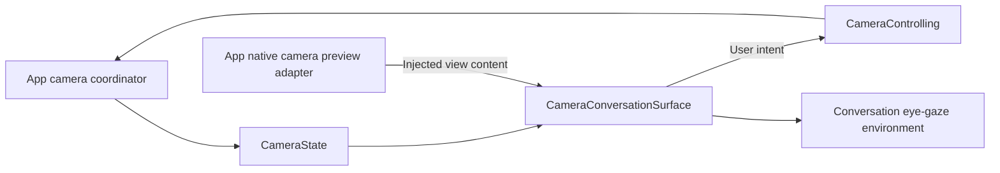

# Camera UI

Purpose: present the camera surface and user controls around startup/conversation content. Design goals: independent camera intent, accessible recovery and no capture/model ownership in UI.

| File | Responsibility |
| --- | --- |
| CameraState.swift | MainActor visibility, facing, errors, skeleton/gaze and sampling-threshold values; CameraControlling declares user operations |
| CameraConversationSurface.swift | Injected preview content, dimming, controls, messages and eye-gaze environment |

## Upstream and downstream

App supplies CameraState, CameraControlling and the native preview view. [CameraCoordinator](../../App/Lifecycle/README.md) owns permissions and capture/inference lifetimes. [CameraPreviewAdapter](../../App/Adapters/README.md) owns native layer connection, rotation/mirroring and skeleton drawing. UI imports AgentCore only for PoseOverlay values; it imports no platform service.

✅ The same surface wraps startup and ready conversation. Camera availability does not wait for voice-model readiness. The preview uses aspect fill and front mirroring; a 42% black overlay dims it. Preview/dimming never intercept touches, and off/inactive/error states hide old frames.

✅ The primary toolbar is 8 pt below the top safe area. Camera toggle/settings use 48-point targets; All controls share one horizontal capsule: camera toggle → lens switch → current percentage menu → Settings. Lens and 1/3/5/10% threshold controls appear in the middle only while camera intent is enabled; a 200 ms opacity/scale transition accompanies capsule expansion/collapse. Settings remains at the trailing edge. Existing camera.toggle, camera.switch and app.settings accessibility identifiers stay stable across source/operation renames. Switching is disabled during transitions; on/off replaces pending intent. Permission denial exposes a system Settings link. Reduce Motion disables expansion animation.

✅ UI.showPose reaches CameraState through the App callback; the native adapter draws joints/edges with confidence ≥0.3 and hides rotation-mismatched overlays. UI.moveEyes supplies normalized gaze through App. Front mirroring happens once in perception; lifecycle reset clears pose and centers gaze. Changing camera/threshold replaces the vision session while retaining model weights.

✅ Window-owned camera observation survives page navigation. Entering Settings suspends capture without changing on/off intent; returning restores intent. Simulator unavailability is explicit.

❌ Recording, exact preview-crop mapping of gaze, and physical-device visual, navigation, permission and performance acceptance.

Sources compile once in the UI target; there is no App source membership for this directory.
