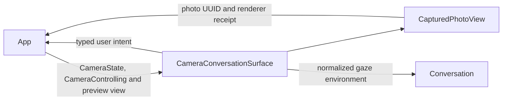

# Camera Presentation

## Summary

Camera controls, injected preview content, pose statistics and one current-photo surface.

## Ownership and boundaries

UI owns display values and rendering acknowledgment. App owns preview-layer mapping, camera admission and export; Agents owns perception policy. No native session/model is created here.

## External relationships and data flow

Runtime arrows show data or capability calls; dashed arrows show injection.

## Camera and pose

The surface wraps startup and ready conversation independently of speech-model readiness. Preview is dimmed by 42%; hidden/off/error states show no stale image. Toggle/lens/Settings use one capsule with 48-point targets; lens appears only while intent is on. Switch is disabled during transitions; denial exposes system Settings. Local geometry uses 200 ms transitions unless reduced motion.

`PoseOverlay` and statistics are independent UI schemas. `PoseOverlayProjection` rotates normalized joints into sensor coordinates; App owns crop/mirroring and native drawing. Timing displays measured FPS, adaptive interval, wait/inference/total milliseconds, skipped pending frames and optional normalized image motion. Missing values are absent/em dash; the UI does not choose inference cadence or claim screen-render latency. Collapse state is view-local.

CameraState contains camera/vision failures. Execution failures belong to the home issue list and do not erase preview/pose.

## Photo rendering

One current UUID fades in 150 ms, holds 250 ms and shrinks to a 96×128 thumbnail over 450 ms. New identity replaces the old surface. Animation completion is one-shot and distinct from target state; disappearance during shrink reports failure. Inspection becomes available after acknowledgment. The full transition layer ignores touches; only the positioned thumbnail/control buttons intercept them.

Inspect/save/ignore forward the rendered UUID. Busy/error/confirmed saved identity come from App. Ignore hides the thumbnail; save retains it. Identity replacement dismisses full-screen inspection. Reduced motion uses fade/direct-thumbnail completion. No gallery or export worker is owned here.

✅ Camera controls, injected preview, pose statistics, identity-fenced photo animation and export affordances.

❌ Video UI and exact preview-crop mapping of eye gaze.

## Related design

[Parent design](../README.md)
