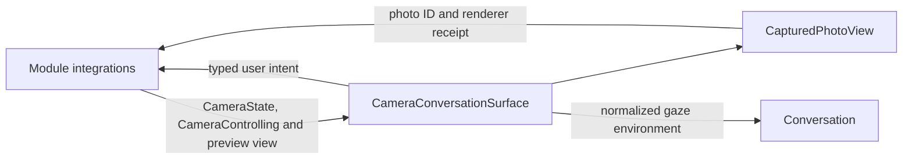

# Camera Presentation

✅ 照片检查器使用共享 retainedFullScreenCover，保留原有全屏黑底和保存/忽略/返回按钮，同时让首页仍挂载；onDismiss 仍以真实关闭完成为退出动画起点，不提前确认效果。

## Summary

Camera controls, injected preview content, pose statistics and one current-photo surface.

## Ownership and boundaries

UI owns display values and rendering acknowledgment. ActionBindings owns frame adaptation, camera admission and export; Agents owns perception policy. No native session/model is created here.

## External relationships and data flow

Runtime arrows show data or capability calls; dashed arrows show injection.

## Camera and pose

The surface wraps startup and ready conversation independently of speech-model readiness. Preview is dimmed by 42%; hidden/off/error states show no stale image. Toggle/lens/Settings use one capsule with 48-point targets; lens appears only while intent is on. Switch is disabled during transitions; denial exposes system Settings. Local geometry uses 200 ms transitions unless reduced motion.

`PoseOverlay` and statistics are independent UI schemas. The native UI renderer applies one upright crop/mirroring transform to pixels and normalized joints. Timing displays measured FPS, adaptive interval, wait/inference/total milliseconds, skipped pending frames and optional normalized image motion. Missing values are absent/em dash; the UI does not choose inference cadence or claim screen-render latency. Implemented: performance details start collapsed, leaving the YOLO/FPS header visible when statistics exist; expansion remains view-local.

`CameraState.isEnabled` initially false, so foreground startup requests no camera permission/capture until an explicit open intent. Camera toggle and Agent camera controls retain the existing host-owned lifecycle.

CameraState contains camera/vision failures. Execution failures belong to the home issue list and do not erase preview/pose.

## Photo rendering

One current ID fades in 150 ms, holds 250 ms and shrinks to a 96×128 thumbnail over 450 ms. New identity replaces the old surface. Animation completion is one-shot and distinct from target state; disappearance during shrink reports failure. Inspection becomes available after acknowledgment. The full transition layer ignores touches; only the positioned thumbnail/control buttons intercept them.

Inspect/save/ignore forward the rendered ID. Busy/error/confirmed saved identity come from ActionBindings. Save and ignore join distinct departure animations/cues, then ActionBindings submits removal through the UI presentation port. Import failure retains it for retry; successful save enlarges before sliding out and ignore shrinks toward the lower-right. Identity replacement dismisses full-screen inspection. Reduced motion uses fade/direct-thumbnail completion. No gallery or export worker is owned here.

Camera controls, injected preview, pose statistics, identity-fenced photo animation and export affordances.

## Related design

[Parent design](../README.md)

PhotoDeparture.swift owns one renderer request/continuation with identity, availability and cancellation fencing. CapturedPhotoView animates save 180 ms enlargement to 1.16 then 420 ms slide beyond the right edge; discard 520 ms lower-right slide and shrink to 0.06. Controls disappear during departure. Inspector closes before thumbnail departure using its actual onDismiss callback, and a request-ID fence starts each departure animation exactly once. Reduce Motion uses a 200 ms fade. Actual animation completion acknowledges the host; disappearance/background cancels with explicit failure, and stale callbacks cannot finish a replacement. ActionBindings retains the component until joined feedback and then requests removal through the UI presentation port.

✅ CameraState 提供 UI 自有 CameraPresentationUpdate 及 present 方法；上层执行服务提交展示值，不直接写页面字段。业务控制资格、租约和会话有效性仍由执行拥有者校验。

## 待实现

- Exact preview-crop mapping of eye gaze and native visual acceptance.

## 公开 State 边界

✅ CameraState.connectFactsObserver 安装同步呈现变更通知，present 完成值更新后回调。回调不查询设备或 Storage；公开事实的编码、可操作资格及原生运行确认由 Camera 的集成拥有者负责。UI 不依赖 StorageState。

[公开 State 契约](../../Storage/State/README.md)

## Platform 根、设备接入与独立影像/姿态呈现

✅ CameraVideoFrame 是 UI 自有只读像素展示值，不含设备或模型服务。CameraState.presentVideo 独立提交最新图像，present(frame:pose:) 核对姿态与其来源附件的序号/方向，仅更新骨架。两路拒绝过期/乱序并分别在捕获后 750 ms 失效；关闭、后台清除两路，模型失败只清骨架。

✅ CameraFrameView 使用 CVMetalTextureCache 与单次 Metal render pass 绘制 BGRA 图像和骨架，共用 upright/aspect-fill/镜像变换。最多两个 GPU 在途命令和一个最新待展示包；完成回调保留像素直至 GPU 读取结束。不逐帧编码 JPEG/UIImage，不保留 AVCaptureVideoPreviewLayer 回退。姿态加载、失败和过期只影响骨架和状态，图像由独立最新帧订阅更新。Tool 完成仅代表状态接纳，不是上屏确认。

渲染设备、管线、纹理或 GPU 执行失败会清空并隐藏该原生表面，提交明确的呈现错误；相机重启创建新渲染代际。设备方向回调也使用代际围栏，旧回调不能改变新帧方向。

## 相机与姿态独立输出修复

✅ CameraCoordinator 在受生命周期管理的任务中独立订阅容量为一的最新原生帧，直接提交 UI 自有图像值；YOLO 继续通过 Gateway 与 Pose Tool 更新骨架。模型启动、失败、空检测和超时不清除实时影像。图像与骨架分别按捕获时间在 750 ms 后失效；停机、换镜头和后台取消并加入两个任务，清除旧会话。骨架使用最新有效结果，沿用相同几何/镜像变换，不再要求与当前预览帧序号相同；仍验证 Tool 自带的原始帧、会话及单调序号。真实进程崩溃不在此故障隔离范围。

## Metal 线程与资源契约

✅ CameraFrameSurface 仅在主线程管理 UIView、图层布局和故障回调；CameraMetalRenderer 在一个专用线程初始化管线、创建纹理、准备顶点并提交命令。CAMetalDisplayLink 提供 drawable，按最高 60 Hz 的显示节奏读取一个最新状态槽，替换待显示状态，不在主线程调用 nextDrawable，也不逐次更新排渲染任务。无新状态时暂停，更新与停止唤醒合并为最多一个通知。

✅ 使用两个固定 GPU 槽及预分配骨架 buffer；空闲槽不足跳过该显示机会，仍保留最新状态。顶点仅随姿态/尺寸/方向/镜像变化重建；各槽按网格修订号更新，GPU 完成前禁止覆盖。CameraRenderMailbox/CameraSkeletonMesh 位于现有 CameraVideoFrame.swift，提供可测试的合并、停止和几何契约。CameraFrameView.swift 保留原生渲染实现，不新增模块或目录。

✅ 离窗/销毁同步关闭接纳并释放待显示值，渲染线程注销 display link，等待两个在途 GPU 命令真实结束后退出；不阻塞主线程，也不丢弃未完成 GPU 资源。旧实例故障回调不得影响重挂载实例。图像/骨架原有过期、独立输出、共享变换及显式故障语义保留。自动化、设备构建与真实上屏性能分别验收。

✅ 重挂载或相机会话代际变化时，新渲染线程先等待上一实例完成清理，再接管同一图层；等待只发生在渲染线程。主线程同步隐藏离窗/停机表面，故障回调同时校验实例与相机代际。

✅ 渲染线程使用可由 CFRunLoopStop 直接退出的 Core Foundation 运行循环，避免 Foundation run(until:) 的外层时限拖延完成信号；原生合成显示链验证必须覆盖实际 GPU 完成后的线程退出和同图层再次启用。

✅ 无 UIKit 依赖的同一 CameraMetalRenderer 在 macOS 也参与编译，供原生显示链合成回归直接使用；界面仍限 iOS，不增加模块或设备依赖。内部 completedFrameCount 仅记录真实成功的 GPU 完成数。停止时借用两个信号量许可等待 GPU，完成后归还许可再析构。

## UI 容器与相机能力注入

✅ UICameraContainer 唯一拥有 CameraState，实现 CameraPresenting 的只读快照、视频/姿态提交、展示状态、清屏和事实观察接口。失活拒绝媒体、清空两路，状态/错误及清理投影仍允许；停止取消并加入到期任务，不冒充 GPU 完成。移除无来源附件的 skeleton 更新入口，清骨架使用显式 clearPose。CameraFrameView 使用同一 state，沿用原生渲染生命周期。

✅ 到期任务替换先取消旧任务，新任务先加入旧任务再等待新期限；清屏保留已取消任务的完成句柄。容器 stop 因此能加入失活前已取消的到期链，结束后释放句柄，避免清屏先丢句柄而伪造清理完成。
