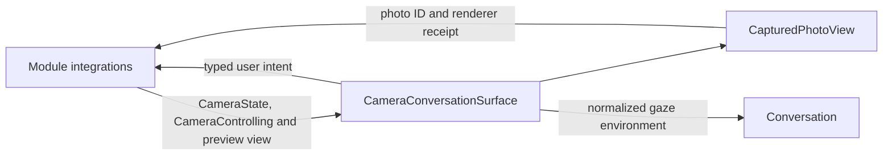

# Camera Presentation

## Summary

Camera controls, injected preview content, pose statistics and one current-photo surface.

## Ownership and boundaries

UI owns display values and rendering acknowledgment. ActionBindings owns preview-layer mapping, camera admission and export; Agents owns perception policy. No native session/model is created here.

## External relationships and data flow

Runtime arrows show data or capability calls; dashed arrows show injection.

## Camera and pose

The surface wraps startup and ready conversation independently of speech-model readiness. Preview is dimmed by 42%; hidden/off/error states show no stale image. Toggle/lens/Settings use one capsule with 48-point targets; lens appears only while intent is on. Switch is disabled during transitions; denial exposes system Settings. Local geometry uses 200 ms transitions unless reduced motion.

`PoseOverlay` and statistics are independent UI schemas. `PoseOverlayProjection` rotates normalized joints into sensor coordinates; ActionBindings owns crop/mirroring and native drawing. Timing displays measured FPS, adaptive interval, wait/inference/total milliseconds, skipped pending frames and optional normalized image motion. Missing values are absent/em dash; the UI does not choose inference cadence or claim screen-render latency. Implemented: performance details start collapsed, leaving the YOLO/FPS header visible when statistics exist; expansion remains view-local.

`CameraState.isEnabled` initially false, so foreground startup requests no camera permission/capture until an explicit open intent. Camera toggle and Agent camera controls retain the existing host-owned lifecycle.

CameraState contains camera/vision failures. Execution failures belong to the home issue list and do not erase preview/pose.

## Photo rendering

One current ID fades in 150 ms, holds 250 ms and shrinks to a 96×128 thumbnail over 450 ms. New identity replaces the old surface. Animation completion is one-shot and distinct from target state; disappearance during shrink reports failure. Inspection becomes available after acknowledgment. The full transition layer ignores touches; only the positioned thumbnail/control buttons intercept them.

Inspect/save/ignore forward the rendered ID. Busy/error/confirmed saved identity come from ActionBindings. Save and ignore join distinct departure animations/cues, then ActionBindings submits removal through the UI presentation port. Import failure retains it for retry; successful save enlarges before sliding out and ignore shrinks toward the lower-right. Identity replacement dismisses full-screen inspection. Reduced motion uses fade/direct-thumbnail completion. No gallery or export worker is owned here.

Camera controls, injected preview, pose statistics, identity-fenced photo animation and export affordances.

## Related design

[Parent design](../README.md)

PhotoDeparture.swift owns one renderer request/continuation with identity, availability and cancellation fencing. CapturedPhotoView animates save 180 ms enlargement to 1.16 then 420 ms slide beyond the right edge; discard 520 ms lower-right slide and shrink to 0.06. Controls disappear during departure. Inspector closes before thumbnail departure using its actual onDismiss callback, and a request-ID fence starts each departure animation exactly once. Reduce Motion uses a 200 ms fade. Actual animation completion acknowledges the host; disappearance/background cancels with explicit failure, and stale callbacks cannot finish a replacement. ActionBindings retains the component until joined feedback and then requests removal through the UI presentation port.

✅ CameraState 提供 UI 自有 CameraPresentationUpdate 及 present 方法；上层执行服务提交展示值，不直接写页面字段。业务控制资格、租约和会话有效性仍由执行拥有者校验。

## 待实现

- Video UI and exact preview-crop mapping of eye gaze.
