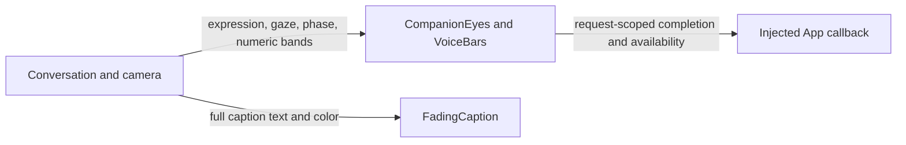

# Reusable UI Components

## Summary

State-driven eye geometry, numeric spectrum bars and streaming captions.

## Ownership and boundaries

SwiftUI presentation with native Core Animation/Metal rendering. Components consume UI values and emit renderer acknowledgment; they own no inference/device/scheduling services.

## External relationships and data flow

Runtime arrows show data or capability calls; dashed arrows show injection.

## Eyes and completion

Both eyes preserve shape identity/path topology across clear, smile, happy, laugh, thinking, surprised, sad, love, angry, scared and playful states. Each eye is 21% of face width, gap 19%, height 25%. EyePose supplies smile/slant/heart/opening/width/rotation/color/offset values; native layers interpolate matched paths and transforms without swapping images or emoji.

Normal expression changes use a 0.65-second eased layer transition. Waking from closed uses a 180 ms cubic ease-out (0.16, 1, 0.3, 1); closure uses 460 ms ease-in-out. A native animation delegate acknowledges the request ID and whether its duration completed; replaced or unavailable requests do not fabricate success. One-shot emphasis adds 6% then returns, including when the emotion matches the persistent base. Gaze uses horizontal 14%/vertical 9% face-width offsets and a 0.32-second eased transition. Blink/breath are independent layer animations, delayed 1.2 seconds after waking and removed when inactive, reduced motion or resting closed. Disappearance/inactivity reports unavailable so the host can cancel a wait. Reduce Motion uses a 0.2-second acknowledgment transaction and suppresses repetitive motion.

## Spectrum and captions

`VoiceBars` draws 32 supplied bands, without FFT or audio generation. Production metering and synthetic preview values remain distinct. Geometry uses public safe-area values, without modifying system island UI. Decorative drawing ignores touch and VoiceOver.

`FadingCaption` retains a stable character prefix, shows the latest 320 characters, renders a stable prefix and revised suffix as two Text spans, interpolates revised-suffix opacity over 250 ms and auto-scrolls. Eighteen-point vertical padding/edge fades keep boundary text readable. Accessibility receives the full caption. Reduced motion retains readable state.

✅ Parameterized expressions, request-scoped animation completion, numeric bars and bounded caption rendering.

❌ Multistage performance queues and gesture-driven gaze.

## Related design

[Parent design](../README.md)

## Native companion rendering

✅ `EyeGeometry.swift` supplies eight clockwise cubic segments with shared anchors and equal incoming/outgoing tangent handles. Smile/slant and closed-eye deformations apply the same derivative to their handles; slant lowers the selected brow within the eye bounds. Love uses corresponding top/lobe/side/bottom anchors and a softly rounded notch/tip. Linear path interpolation preserves continuous derivatives at every join, avoiding the former side reversal and protruding curves. The geometry remains portable and topology is identical across all expressions. `NativeCompanionSurface.swift` owns a stable UIView, CAShapeLayer eyes and a CAMetalLayer rim. Explicit path/shadowPath/transform interpolation starts from presentation values on interruption. Shadows have explicit bounded eye paths; no full-screen blur or per-frame SwiftUI eye body is used. `CompanionEyes` is only the startup/standalone wrapper for this same implementation.

✅ `ListeningMotion.swift` uses a monotonic epoch and actual listening generation. One native update supplies the same timestamp to both eye animations and halo state; every new generation replays the front even if SwiftUI coalesces off/on. The cached bundled Metal pipeline is prepared off MainActor before a coordinated wake commits. Pipeline/GPU failures reach an injected display callback; eyes still retain genuine animation acknowledgment when the halo is unavailable.

✅ `ListeningHalo.metal` draws one premultiplied fullscreen triangle pass. A soft point-source flash, circular radial front and filled luminous tail expand from the generation-latched contact point and converge into the rim over 720 ms, settles by 1.05 seconds, and combines cyan/blue/violet/pink/amber fields with local highlights. A 320 ms entry starts at at least 0.85 visibility and rises to 1; the unchanged 320 ms smoothstep exit preserves current opacity during reversal; there is no duplicate SwiftUI fade. Reduce Motion uses a static field and 200 ms fade.

✅ `MetalHaloRenderer.swift` owns a user-interactive run-loop thread and CAMetalDisplayLink, sampling targetPresentationTimestamp. UIKit passes only a latest immutable state snapshot through Mutex. Wake notifications coalesce to one pending slot; at most three GPU commands are in flight. A full frame budget drops only that display frame instead of queueing. Transitions request the attached screen's supported refresh rate; settled flow requests 60 Hz. Idle/reduced settled/inactive rendering pauses after the needed frame. Disposal is idempotent, invalidates on the render thread and joins GPU completions off MainActor before stopping its loop. Frame callbacks use an autorelease pool, and the terminated owner releases its Thread reference. Views own no microphone, camera or model lifetime.

❌ Requested refresh is not guaranteed FPS. Synthetic device traces and live camera/ASR/model acceptance are distinct; see [validation history](../../../docs/Validation-History.md).

✅ Implemented refresh hint: finite eye-layer transitions explicitly request the attached screen's supported CAAnimation preferredFrameRateRange, matching the Metal transition request. Actual ProMotion refresh remains system-controlled.

✅ Implemented perceptual synchronization: activation starts at at least 0.85 alpha and uses a 320 ms cubic ease-out rise and a faint rim from the first frame and distance-dependent edge arrival, while the contact-point front converges over 720 ms. The rim no longer has a separate 180 ms delay that would visually follow completed eye opening; exit keeps its smooth reversible fade.

✅ Implemented: replaced the hollow rounded-rectangle activation front with a filled soft point-light pulse and circular radial wave. ListeningLightOrigin validates finite normalized coordinates; ListeningMotion latches the origin only on a new generation. NativeCompanionSurface maps the local content point into the full-window Metal layer, including safe-area offsets. A matching SIMD2 uniform feeds the same GPU pass; per-pixel radial distance drives edge arrival. Keep the shared eye/light clock, reversible fade, reduced-motion static field and bounded renderer. Live backdrop refraction is deferred: SwiftUI distortion cannot directly sample the existing UIKit camera/Metal/eye layers; do not introduce a frozen screenshot or a costly per-frame snapshot.

The host-facing origin value is `ListeningLightOrigin(x:y:)`, with coordinates in 0…1 relative to home content bounds (top-left origin). Nonfinite values use the eye-center default per axis; out-of-range finite values clamp. `ConversationState.listeningLightOrigin = nil` uses the current eye center. UIKit converts content coordinates into the full-window layer before the activation latches them; only a fresh generation starts a new wave. Steady-state updates do not relocate a running/fading wave.

✅ Implemented: normal activation begins with at least 0.5 opacity and rises to 1 using the existing 320 ms eased entry. Enlarge/brighten the contact-point flash and radial front; activation-only terms vanish by 0.9 s. Keep settled rim and the existing exit duration/smoothstep unchanged, including Reduce Motion fades.

✅ Implemented: normal entry visibility starts at at least 0.85. A native discrete z-position animation places the existing Metal flash above eyes only during the 0.9 s activation pulse, then restores the original settled/exit stacking. Reduce Motion retains its static field. Exit opacity duration/easing remain unchanged.

✅ Implemented (2026-10-13): UI.Notice.showNotice/dismissNotice and UI.Light.updateLight are canonical presentation Actions for trusted business calls, currently registered by no Skill. Neutral Actions values cross RuntimePresentation into root-owned HomeEffectsWorkflow, which retains one replaceable notice expiry and one light expiry, UUID-fenced cleanup, and explicit stop. Notices remain separate from factual ExecutionIssue history; actual upper-layer errors have display priority and Action failures remain panel-only. Decorative light accepts normalized origin, initial opacity/intensity and duration; it never changes consent, microphone or eyes. Native renderer separates light generations from listening eye generations and preserves existing exit fade. RuntimePresentation converts neutral Action requests into UI-owned values; AppPresentationWorkflow retains existing dependencies. No UI project dependencies or new directories.

✅ Implemented: UIModule.effectDefinitions exposes the same canonical factories for isolated hosts, with nil capability explicitly unavailable. Robot Assistant fixtures no longer register unrelated feedback/light/notice paths; isolated effect tests retain explicit capabilities. Clearing a decorative override restores an already-active listening rim without replaying its wake burst; its new generation still replays normally.
