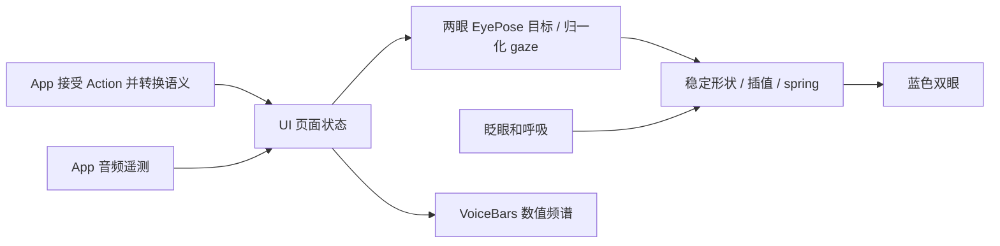

# UI Components

用途：复用纯 SwiftUI 绘制和字幕组件。设计目标：状态驱动、稳定动画身份、明确的无障碍行为；组件不创建模型、网关或设备。

| 文件 | 职责 |
| --- | --- |
| CompanionEyes.swift | CompanionEyes 双眼、EyePose 参数、EyeSilhouette 形状、eyeGaze 环境值和 VoiceBars 频谱绘制 |
| FadingCaption.swift | 字幕稳定前缀、后缀淡入、滚动与完整文本无障碍朗读 |

## 上下游关系

Conversation 和 Camera 页面提供状态，App 将已验证的 Action 情绪、视线与设备音频遥测转换为 UI 值。组件只接收 VoicePhase、EyeExpression、归一化 gaze 和数值频段；Actions/UI 不依赖本模块。

✅ 双眼各占 faceWidth 的 21%，眼间净距 19%，高度 25%；上限和位置由页面决定。所有表情共享形状身份与路径拓扑，切换只更新笑弧、斜率、开合、宽度、旋转和位移，不替换图片或 emoji，也不创建表演队列。

✅ clear、smile、happy、laugh、thinking、surprised、sad、love、angry、scared、playful 均有参数定义。表情使用 0.65 秒、阻尼 1 的 spring 连续转向新目标；gaze 使用水平 8.5% / 垂直 5.5% faceWidth 位移及 0.32 秒、阻尼 0.86 的 spring。眨眼/呼吸独立，时间线至多 60 Hz，非活跃场景暂停。

✅ VoiceBars 绘制 32 个输入频段，不自行做 FFT。生产值来自 PlatformKit/App 的真实音频分析；视觉预览显式提供模拟数值。底部青蓝条向上，回应紫色条沿估算的岛底弧线向下；166 × 62 pt Canvas 留出转角空间，内部轮廓宽 126 pt，基线 y=24，沿两端法线绘制渐短频段。只使用公开安全区几何，不修改系统灵动岛。

✅ Reduce Motion 禁止重复眨眼/呼吸与频谱跳动，保留短暂状态插值、静态活动提示和字幕。装饰图层不拦截触摸或进入 VoiceOver。字幕保留最近 320 字符、约 400 ms 后缀淡入及完整文本朗读。

扩展表情时同步更新 Action 语义、Assistant JSON、App 的穷举转换和 EyePose；保留对应配置/行为检查。源文件按当前组件命名，旧 VoiceOrb 实现和文件名已移除。

❌ 多阶段表演编排、手势驱动 gaze、精确系统岛形状及真机帧时、功耗和视觉验收。

✅ FadingCaption 滚动窗口上下各约 18 pt 使用透明度渐变遮罩，边缘透明度趋于 0；正文上下保留 18 pt 空间，首尾文字滚动到边界时仍可完整阅读。保留原有流式后缀淡入、自动滚动、320 字符显示范围和完整文本 VoiceOver 朗读。
