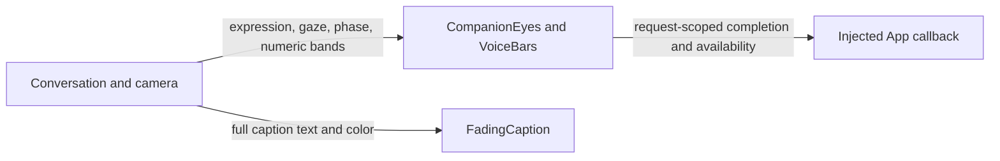

# Reusable UI Components

## Summary

State-driven eye geometry, numeric spectrum bars and streaming captions.

## Ownership and boundaries

Pure SwiftUI rendering. Components consume UI values and emit renderer acknowledgment; they own no inference/device/scheduling services.

## External relationships and data flow

Runtime arrows show data or capability calls; dashed arrows show injection.

## Eyes and completion

Both eyes preserve shape identity/path topology across clear, smile, happy, laugh, thinking, surprised, sad, love, angry, scared and playful states. Each eye is 21% of face width, gap 19%, height 25%. EyePose interpolates smile/slant/heart/opening/width/rotation/color/offset; no images or emoji are swapped.

Expression uses a 0.65-second damping-one spring; removed-transaction completion carries its request ID. One-shot emphasis adds 6% then returns, including when the emotion matches the persistent base. Gaze uses horizontal 14%/vertical 9% face-width offsets and a 0.32-second damping-0.86 spring. Blink/breath are independent, at most 60 Hz and paused when inactive. Disappearance/inactivity reports unavailable so the host can cancel a wait. Reduce Motion uses a 0.2-second acknowledgment transaction and suppresses repetitive motion.

## Spectrum and captions

`VoiceBars` draws 32 supplied bands, without FFT or audio generation. Production metering and synthetic preview values remain distinct. Geometry uses public safe-area values, without modifying system island UI. Decorative drawing ignores touch and VoiceOver.

`FadingCaption` retains a stable character prefix, shows the latest 320 characters, fades revised suffixes over about 400 ms and auto-scrolls. Eighteen-point vertical padding/edge fades keep boundary text readable. Accessibility receives the full caption. Reduced motion retains readable state.

✅ Parameterized expressions, request-scoped animation completion, numeric bars and bounded caption rendering.

❌ Multistage performance queues and gesture-driven gaze.

## Related design

[Parent design](../README.md)
