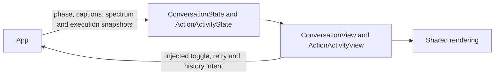

# Conversation and Execution Presentation

## Summary

Render conversation phases/captions/eyes and bounded Action, Task and Agent log values.

## Ownership and boundaries

App owns input/output lifetimes and supplies validated values. Views forward listening/retry/history intents and own only local presentation selection. Device connection policy is confined to Settings.

## External relationships and data flow

Runtime arrows show data or capability calls; dashed arrows show injection.

## Conversation

Startup is noninteractive while preparation runs and exposes progress/error/retry. Listening starts only from explicit interaction. User transcription and Assistant reply occupy separate slots: final user text moves above the eyes, while reply remains below; the next accepted recognition turn resets both. Actual audio telemetry drives playback phase/spectrum independently of caption timing.

`ConversationState` separates phase, base/finite expression, renderer request identity and gaze. App invalidates transient completion on session/turn reset. Components provide full-text accessibility, stable caption identity and reduced motion. Camera background is injected.

## Logs and issues

`ActionActivityItem`, `ExecutionIssue`, `TaskLogItem` and `AgentRuntimeLogItem` are UI-owned projections. App supplies bounded snapshots/revisions/eviction counts; UI does not execute or persist them. The sheet has Action / Task / Agent tabs, source/status filters and an internal-Action toggle. There is no Signal collection/subscription in this UI.

Home summaries show up to three exact Channel names, concurrent/queued counts and recent nonfailure terminal state for three seconds. Failures are shown in the scheduling issue list. Dismissal affects retained display identities only, never execution/cancellation. Internal maintenance success is hidden by default while failures remain visible. Direct Tools have no synthetic scheduled rows.

Task details use retained input/call identities for related Action and executor model history. Missing/evicted evidence remains explicit. Outcome strings distinguish accepting state, native completion, cancellation before/after execution and retained child failures; they do not imply physical rollback.

## Preview boundary

Debug conversation/Action previews explicitly use synthetic state and bypass model/camera/audio/Bluetooth startup. Release ignores their launch flags. Page-owned refresh only drives display hiding; observers and long-lived work belong to App.

✅ Independent conversation/log values, request-scoped expression callbacks and read-only task/history navigation.

❌ Durable execution audit and device-specific stage progress.

## Related design

[Parent design](../README.md)
