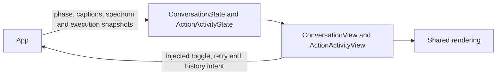

# Conversation and Execution Presentation

✅ 已实现（2026-10-13）：ConversationView 的根启动失败提示改为“应用准备失败”，因为准备过程包括 Agent 服务和配置恢复；继续显示实际错误，不将 scopeClosed 一概归为模型文件失败。

## Summary

Render conversation phases/captions/eyes and bounded Action, Task and Agent log values.

## Ownership and boundaries

App owns input/output lifetimes and supplies validated values. Views forward listening/retry/navigation intents and own only local presentation selection. Device connection policy is confined to Settings.

## External relationships and data flow

Runtime arrows show data or capability calls; dashed arrows show injection.

## Conversation

Startup is noninteractive while preparation runs and exposes progress/error/retry. Listening starts only from explicit interaction. User transcription and Assistant reply occupy separate slots: final user text moves above the eyes, while reply remains below; the next accepted recognition turn resets both. Actual audio telemetry drives playback phase/spectrum independently of caption timing.

`ConversationState` separates phase, base/finite expression, renderer request identity and gaze. App invalidates transient completion on session/turn reset. Components provide full-text accessibility, stable caption identity and reduced motion. Camera background is injected.

## Logs and issues

`ActionActivityItem`, `ExecutionIssue`, `TaskLogItem` and `AgentRuntimeLogItem` are UI-owned projections. App supplies bounded snapshots/revisions/eviction counts; UI does not execute or persist them. The sheet has Action / Task / Agent tabs, source/status filters and an internal-Action toggle. There is no Signal collection/subscription in this UI.

Home summaries show up to three exact Channel names, concurrent/queued counts and recent nonfailure terminal state for three seconds. Failures are shown in the scheduling issue list. Dismissal affects retained display identities only, never execution/cancellation. Internal maintenance success is hidden by default while failures remain visible. Direct Tools have no synthetic scheduled rows.

Task details use retained task/call identities for related Action filtering; canonical Agent request records are available separately in Settings. Missing/evicted evidence remains explicit. Outcome strings distinguish accepting state, native completion, cancellation before/after execution and retained child failures; they do not imply physical rollback.

## Preview boundary

Debug conversation/Action previews explicitly use synthetic state and bypass model/camera/audio/Bluetooth startup. Release ignores their launch flags. Page-owned refresh only drives display hiding; observers and long-lived work belong to App.

✅ Independent conversation/log values, request-scoped expression callbacks and read-only task execution navigation and independent Agent records.

❌ Durable execution audit and device-specific stage progress.

## Related design

[Parent design](../README.md)

## Home task and caption contract

✅ Implemented: `ConversationView` removes the task/Skill disclosure and its local expansion state. Only an active foreground Task renders a small target icon and one truncated line `任务：<goal>`, with full-goal accessibility; no box, Skill count/list or background-task shortcut. Task/Agent history remains available through the existing execution sheet. Root-owned bounded projections update on task/Skill changes rather than model tokens; the 100-row Task projection preferentially retires terminal rows to retain active work.

✅ `ConversationCaptionLayout` exposes independent `taskCenterY` and `captionCenterY`. The task row stays fixed for viewport/face geometry regardless of transcript finalization, empty text or activity. The moving ASR view owns its own position animation; its promoted area starts below the 18-point goal with an 8-point gap. The task clears top controls by at least 72 points. Regression covers compact/tall screens and both transcript slots.

✅ Task details independently show failure reasons; missing history evidence is not interpreted as startTask failure.

✅ Implemented: ConversationView replaces the eye tap with a 0.5 s/24 pt long press, one toggle per recognized hold, and an accessibility activation. The hint/status say 按住; release preserves continuous listening. A press subtly compresses the face. ConversationState.displayedExpression returns closed when the voice session is off and the requested/default expression while on. Explicit closed Actions can close active eyes; nonclosed finite performances reject while off rather than fabricate visual success. NativeCompanionSurface covers the screen edges without intercepting touch; halo follows isVoiceActive across processing/reply pauses, fades on off/failure and pauses when inactive.

✅ Implemented: listeningControlMessage surfaces rejected overlapping toggle intents in the bottom caption area and clears on the next accepted interaction.

✅ Implemented: the hold-off path interrupts active replies as well as capture; a passive isReplyActive value supplies accurate control wording after capture failure. Halo is still active through automatic reply pauses. No model/player work is owned by the view.

✅ ConversationCaptionLayout exposes independent taskCenterY and captionCenterY. Task center is fixed for viewport/face geometry, unaffected by transcript finalization/empty/activity; promoted caption begins below the 18-point task with 8-point gap. NativeCompanionSurface replaces separate eyes/halo instances and receives generation ID/phase/expression/gaze/hold state in one update. Preview can cycle native effects without recording/models.

✅ Implemented validation aid: the DEBUG-only `-companion-cycle-preview` launch argument opens the isolated visual surface and automatically exercises six 1.3-second wakes / 0.8-second sleeps. It creates no camera, microphone or model runtime; physical Animation Hitches evidence must be labeled synthetic UI acceptance.

✅ Implemented: ActionActivityState projects one latest fresh failure toast from Agent output and App/runtime/system issues, with bounded deduplication and no historical replay. Action snapshots and call-scoped issues stay log/panel-only. Eight-second page-owned expiry does not remove execution evidence.

✅ Implemented layout: toast is centered yellow text with an inline warning icon (up to three lines), with no card/header/scroll/close control. It temporarily replaces the lower assistant/status slot; a new live ASR turn dismisses the notice while retaining error history.

✅ Implemented clearance: ASR position animates only on transcript finalization changes. Task appearance/removal commits the reserved gap immediately, so its pinned row cannot overlap an already-promoted caption during a spacing tween.

✅ Implemented: ConversationState exposes optional listeningLightOrigin (normalized home content coordinates). A simultaneous zero-distance drag captures the initial contact inside the existing half-second hold region without changing its recognition/cancellation policy; accessibility activation clears the touch origin and uses the eye-center default. Preview exercises different origins on each wake. Origin changes while active do not move an in-flight wave.

✅ Implemented: removed toast projection from Action execution snapshots. Only fresh Agent output and App/runtime/system issues may offer a toast; an issue with a call-scoped context remains log-only. Retain bounded deduplication, stale-snapshot fencing, UUID-fenced eight-second expiry and full log evidence. ConversationView replaces the material card/header/scroll/close button with centered yellow text and an inline warning icon in the lower caption slot; up to three lines, no touch interception. While visible, the lower reply/hint slot yields to the notice. ASR and task geometry remain independent.

✅ Implemented: add optional injected voicePressChanged callback. Zero-distance drag reports touch-down (root coalesces repeats), touch-end/page disappearance report release. Hold recognition still submits one toggle at 0.5 s; callback owns no native work and cannot enable capture.

✅ Implemented (2026-10-13): UI.Notice.showNotice/dismissNotice and UI.Light.updateLight are canonical presentation Actions for trusted business calls, currently registered by no Skill. Neutral Actions values cross RuntimePresentation into root-owned HomeEffectsWorkflow, which retains one replaceable notice expiry and one light expiry, UUID-fenced cleanup, and explicit stop. Notices remain separate from factual ExecutionIssue history; actual upper-layer errors have display priority and Action failures remain panel-only. Decorative light accepts normalized origin, initial opacity/intensity and duration; it never changes consent, microphone or eyes. Native renderer separates light generations from listening eye generations and preserves existing exit fade. RuntimePresentation converts neutral Action requests into UI-owned values; AppPresentationWorkflow retains existing dependencies. No UI project dependencies or new directories.

✅ Implemented (2026-10-13 caption/error lifecycle): mask bottom ASR and reply/status immediately while a notice is visible, restore retained text after dismissal, and preserve pinned Task/promoted ASR layout. Consent-off clears both captions; root HomeEffectsWorkflow owns one UUID/text-fenced350ms reply fade/removal task, cancelled by new text/turn/off/shutdown, scheduled only after reply-policy/playback/native-resume barriers. Agent errors stay in factual root failure notices, not persistent voiceStatus copies. App root contexts explicitly choose afterFirstUnlock file protection, including their directory; repository persistent factory accepts protection while its SDK default remains whileUnlocked. This mitigates lock-boundary writes, without claiming the screenshot proves that cause or hiding other storage failures.

✅ ExecutionIssue 已增加可选 userMessage 展示值，日志 message 不变；首页 visibleNotice 优先使用宿主提供的 userMessage，错误 toast 的身份、去重、到期和日志面板保持现有行为。UI 不解析语音 SDK 错误。

✅ Execution-history navigation: ConversationView/ActionActivityView have no task-history view factory; TaskLogItem carries only execution display fields. Task details retain requester/executor/mode/Skills/parent/state/failure/event timeline and related Action filtering. Background task evidence remains execution diagnostics and is not described as conversation history.
