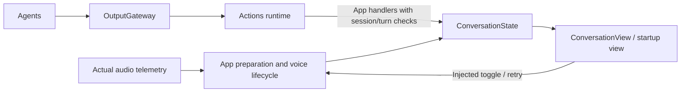

# Conversation UI

> Current status (2026-09-29): the user identified desktop simulator screen sharing as the cause of missing iPhone camera/microphone input. BLE settings and conversation binding are restored; receipt-admission and robot-only disconnect fixes remain. iPhone BLE acceptance without screen sharing is still pending; no causal claim is made about the earlier BLE failure.

Purpose: display startup and conversation state through eyes, captions and spectra. Design goals: accessible user controls, observable readiness and no Agent/model/device ownership in views.

| File | Responsibility |
| --- | --- |
| ConversationState.swift | MainActor phase, transcript, reply, expression, spectra and readiness/activity values; VoicePhase and EyeExpression are UI types |
| ConversationView.swift | Ready conversation, startup/error/retry display, common atmosphere and explicitly labeled visual preview |

## Upstream and downstream

App owns ConversationState and injects a voice-toggle operation. [VoiceSessionCoordinator](../../App/Lifecycle/README.md) runs the Agent/input/output sessions and applies accepted updates. Views render state and forward intent; they never start inference or recording directly.

✅ Startup eyes are noninteractive while models prepare; progress, errors and retry remain visible. After preparation and Agent registration, tapping the eye region starts voice; tapping again stops recording/playback. No automatic microphone startup occurs. Entering Settings stops voice without destroying the root-owned runtime. Background/interruption/route cleanup belongs to App.

✅ SpeechPerception Actions set/close recognition captions and phase; Assistant Actions begin replies, append captions and change expressions. OutputGateway is always crossed. Speech signals control capture admission/logging only. User/OS lifecycle resets and actual audio telemetry are App-owned state updates. Session/turn/sequence checks reject stale output.

✅ Recognition and reply share the lower caption slot. FadingCaption shows the last 320 characters, retains stable prefixes and fades revised suffixes over about 400 ms; VoiceOver receives the full text. Raw model history belongs to the durable journal, not a Gateway display buffer. Final recognition closes its caption, replies remain until the next onset, and actual playback selects the speaking phase independently of caption timing.

✅ Navy translucent atmosphere preserves the injected camera background. Blue procedural eyes sit at 40% of content height; each is 21% of face width with a 19% gap and a 600 pt face-width cap. Production receives 32-band microphone FFT values at the bottom and playback FFT values below the estimated island edge. Component geometry and motion live in [Components](../Components/README.md).

✅ Camera-owned normalized gaze reaches both startup and ready eyes through the environment. Expression, gaze and phase remain separate inputs. VoiceOver, Dynamic Type and Reduce Motion are supported.

✅ `ConversationVisualPreview` and Xcode Preview contain synthetic numeric bands only, with a simulated-frequency slider, phase toggle and semantic-expression picker. No audio is generated or played. Debug `-conversation-preview` bypasses camera/microphone/model startup; add `-preview-speaking` to start its reply state. Release ignores the preview launch flag.

Sources compile once in UI; page navigation does not create or destroy the voice runtime.

❌ Physical-device startup latency, layout/animation, accessibility/landscape and face-tracking acceptance; hand-driven gaze and additional character pages remain unimplemented.

✅ ConversationView receives shared BluetoothSettingsState presentation values and displays real connected/motion-completion status alongside conversation. It receives no device service or motion closure; Agent outputs still pass through Gateway and Actions. ❌ The display is not an emergency-stop control or evidence of independent position measurement.

✅ Connected but unverified robots display “机械臂已连接，控制待验证”; the conversation does not imply motion readiness from a radio connection alone.

## Unified channel execution display

✅ `ActionActivityState` receives complete UI-owned display snapshots projected by AppWorkflows. The home footer replaces the robot-only motion label with up to3 channel summaries plus an overflow/history link; concurrent channels retain separate rows. Same-channel parallel work and queued work show counts. Nonfailure terminal summaries hide after3s while history remains available; failures persist until dismissed or superseded by a newer execution in that channel. Dismissal never removes runtime records or cancels Actions. Newer revisions replace older state; dismissed IDs are bounded by retained records.

✅ `ActionActivityView` exposes a read-only sheet containing all retained active records and the latest100 terminal records, using definition-provided names, exact Channel strings, generic statuses and timestamps without execution IDs or raw arguments; errors display the bounded thrown description. Cancellation pending says “正在取消”; terminal cancellation says “执行前已取消” or “已取消” based on whether execution started; completed settings/state/activity operations do not claim physical completion. Connection readiness remains a separate fallback label, and Settings send-only tests do not feed this Action display. Views own only presentation selection and a wall-clock auto-hide refresh; long-lived observation remains in App. Dynamic Type, VoiceOver labels and system sheet controls are retained; no motion animation is required.

❌ Device-specific stage progress and physical iPhone layout/accessibility acceptance remain separate. This is process-local recent history, not a durable per-conversation audit or an emergency-stop control.

✅ Debug-only `-actions-preview` renders the actual conversation/status components with explicitly labeled synthetic records for parallel, queued, cancelling and failed states; it bypasses models, camera, audio and Bluetooth startup. Release ignores the flag. ❌ Preview data is not execution acceptance.

✅ The execution footer uses native iOS26+ Liquid Glass (`glassEffect`) with a material fallback on earlier supported systems. Home and detail records include all scheduled Actions without filtering. Fixed internal UI updates are immediate Tools. Tool calls are not execution records.

## Action and Tool presentation boundary

✅ The native glass panel receives every scheduled Action, including expression; fixed presentation Tools generate no records. Failed rows use the description from the thrown error rather than a frontend error catalog. ❌ Tools/audio recognition are not synthetic Action rows.

## Generic Action presentation

✅ ActionActivityItem stores UI-owned display fields and phase/timestamps. AppWorkflows derives title, status, symbol and issue descriptions from runtime observations. Channel names remain case-sensitive and unchanged; no action-path title catalog is needed.

✅ Summaries aggregate exact Channel names for display across tasks; additionalRunning explicitly represents concurrent work. This is not a shared FIFO or resource-ownership boundary. Version checks, bounded dismissals, three-second success hiding and failure retention remain unchanged. Synthetic previews use the same record-driven presenter.

❌ No claim of physical rollback/stop follows cancellation wording; no locale resource system or new per-Action views are introduced. See ADR 0086.

## Composed Action outcomes

✅ History displays partial-failure counts and every retained leaf problem supplied by App, including motor/target/feedback details. UI imports no Action result types.

❌ Execution retention remains bounded to the runtime history; this is not persistent audit storage.

✅ Action details show whole-execution timeout separately from child issues, using the display strings supplied by App.

✅ ActionActivityItem and its Execution fields are UI-owned display data. AppWorkflows converts runtime observations and result details before state replacement. The action panel imports neither execution modules nor Agent result types.
