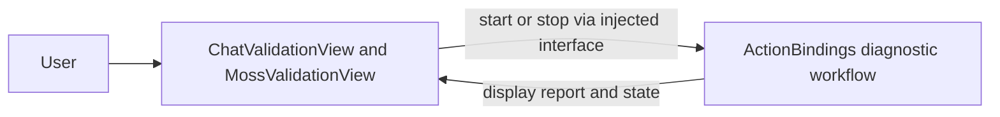

# Diagnostics Presentation

## Summary

Injected debug forms for language generation and MOSS synthesis/playback reports.

## Ownership and boundaries

UI owns editable text/running/stopping/report state. ActionBindings diagnostics owns model/device calls, exclusive admission, cleanup and result formatting. Reports are diagnostic output, not production acceptance claims.

## External relationships and data flow

Runtime arrows show data or capability calls; dashed arrows show injection.

## Interfaces and lifecycle

`SpeechDiagnosticState` and `SpeechDiagnosticControlling` expose MOSS text, status, report, start and stop. The host joins producer/playback cleanup before terminal state. Chat diagnostics use an injected check in a page-scoped task and are debug-only. View disappearance cancels page work; cancellation does not manufacture success.

No separate microphone/player/model backend exists in this target. Production controls and native telemetry are reused by the host. Debug/synthetic results remain visibly distinct from actual model and physical-device evidence.

Injected chat/MOSS diagnostic presentation.

## Related design

[Parent design](../README.md)

## 待实现

- 暂无本目录独立的实现待办；跨模块及实际模型/设备验收见所属模块说明。

✅ SpeechDiagnosticState 通过公开的运行/停止/报告呈现接口接收执行结果；执行者不直接修改页面字段。
