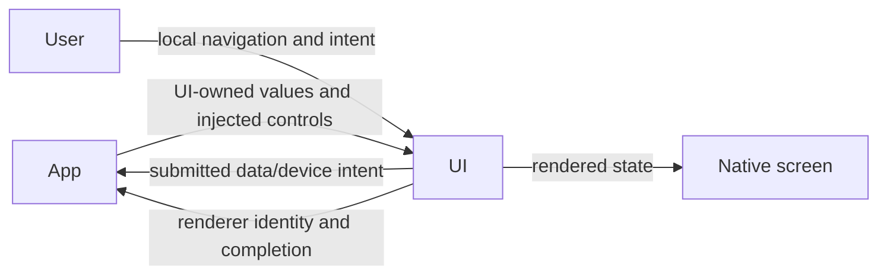
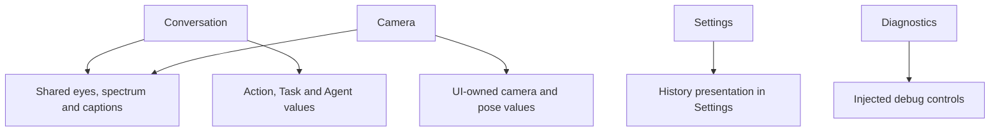

# UI — Presentation and Human Interaction

## Summary

Independent SwiftUI views, display values and injected interaction interfaces.

## Ownership and boundaries

Foundational module with zero project dependencies. App adapts Agent/device/storage values and implements injected controls; views own drafts/navigation/rendering. Long-lived models, devices and task cleanup stay with their host owners.

## External relationships and data flow

Runtime arrows show data or capability calls; dashed arrows show injection.

## Internal structure

## Interaction and acceptance

Page navigation, disclosure, dialogs and drafts are local presentation. Submitted operations invoke host controls, which route directly to their actual owner. Agent-driven presentation invokes a registered function and scoped App endpoint before state changes. A later ActionResult reports the function's completion boundary; it is not the trigger for that same UI mutation.

App rejects stale session/turn/request/frame updates before converting them to UI values. UI never imports Agent, Action, model, transport or persistence types. Independent display schemas include camera/pose, settings/resources/history and Action/Task/Agent logs.

Finite expressions carry renderer identity and completion acknowledgment; setting a persistent base expression only commits state. Passive pose/gaze/spectrum updates have no long-lived UI queue. View disappearance cancels page-scoped reads/diagnostics and renderer availability, not root-owned execution.

✅ State-driven conversation/camera/settings/history/log/diagnostic surfaces, native local navigation, accessibility and Reduce Motion paths.

❌ Multistage character performance and persistent UI audit storage.

Native visual acceptance is recorded in [validation history](../../docs/Validation-History.md).

## Related design

[Parent design](../README.md) · [Camera](Camera/README.md) · [Components](Components/README.md) · [Conversation](Conversation/README.md) · [Diagnostics](Diagnostics/README.md) · [Settings](Settings/README.md)
