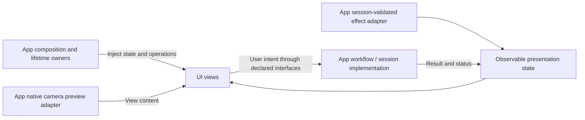

# UI — Pages, State and User Controls

Purpose: render application state and collect user intent. Design goals: MainActor UI isolation, independent compilation and previews, narrow operation interfaces and no model/device/service construction.

UI covers SwiftUI views, observable page state, user interaction and the operation interfaces consumed by those pages. Files are grouped by feature; reusable visuals live in Components. Cross-module workflows and runtime ownership remain in [App](../App/README.md).

```text
UI/
├── Conversation/  # ConversationState, ready/startup views and labeled visual preview
├── Camera/        # CameraState, user-control protocol and camera surface
├── Components/    # Eyes, spectra and captions
├── Settings/      # Form/history states, operation protocols and views
└── Diagnostics/   # Diagnostic state/control protocol and views
```

## Upstream and downstream

UI is a separate SwiftPM target. Its only project dependencies are AgentCore (PoseOverlay values) and StorageChat (conversation record values). It does not import App, AppWorkflows, Agents, Gateway, Actions, Tools, ModelKit or PlatformKit. Platform rendering content is supplied by App; no full service container is passed to a page.

[Actions/UI](../Actions/UI/README.md) and [Tools/UI](../Tools/UI/README.md) declare executable behavior in their owning modules. They reach this UI module's state through App-bound handlers; their `UI.*` call paths are protocol names, independent of the Swift module name.



The diagram shows runtime use; compile-time dependency goes from App/AppWorkflows to UI. Operation protocols live beside their consuming pages. Conversation receives ConversationState and a toggle closure; Camera receives CameraState, CameraControlling and injected preview content. SettingsState invokes SettingsOperating while owning edits/loading/error UI. History and MOSS receive state plus control interfaces. The Debug chat page awaits an injected diagnostic operation. Effects and model/session handling live in App workflows, adapters and lifecycle owners.

Pages can own short-lived rendering/load tasks and cancel their scoped operations on disappearance. They never own voice runtime, camera capture, model construction or long-running application supervision. Background/session cleanup belongs to the App host. Storage record types used for display do not grant access to the journal service.

## Presentation scope

Conversation renders captions, eyes, spectra, generic Action execution state and injected robot connection state. Settings includes Bluetooth discovery/connection controls and manual-operation presentation. Actual device spectrum data is injected; standalone previews use labeled synthetic bands. UI never owns a BLE connection, controller, registry or model service.

✅ Conversation, camera, settings/history and diagnostic pages expose typed operations and shared domain values.

❌ Cross-platform views and independent multi-window state routing are not implemented.
