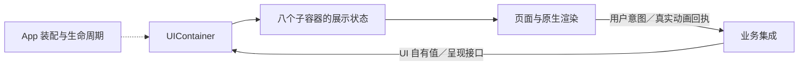

# UI — 呈现与人机交互

✅ 已实现：常驻首页保留挂载，但应用导航覆盖时由注入的导航通知暂停相机；返回首页按原开启意图恢复。导航保持根聆听，深层 Assistant 历史加载不得停止会话；真正场景失活仍遵循 App 策略。

## 职责与边界

UI 是零项目依赖的基础模块，不导入 FactoryKit、PlatformKit、Storage、Actions 或 Agents。只接收 UI 自有值和注入的操作接口，拥有展示状态、原生渲染及交互回执；不拥有设备、模型、仓库或业务策略。

App 缓存唯一 UIContainer 并管理生命周期；AgentBindings / ActionBindings 将业务值转换后提交呈现端口，页面将用户意图交给注入的控制端口。ApplicationControl 决定异常是否提示，UI 只负责呈现、去重和期限。

## 模块关系与数据流

外部只描述直接相邻关系；业务和原生设备的完整链路见[总体设计](../README.md)。

## 子容器与源码归属

✅ 根构造时一次创建八个子容器，不在首次回复或页面切换时补建；构造与 start 不请求权限、不读取仓库、不启动设备或模型。

| 子容器 | 拥有的展示状态 | 源码 |
| --- | --- | --- |
| home | 会话、表情回执、字幕、频谱、运行日志、Toast、Notice、装饰光 | [Conversation](Conversation/README.md) |
| camera | 视频、骨架、照片及离场呈现 | [Camera](Camera/README.md) |
| settings | Provider 草稿、发现／保存状态及 revision | [Settings](Settings/README.md) |
| modelResources | 资源列表、偏好、安装状态及 generation | [Settings](Settings/README.md) |
| navigation | 应用路径与导航呈现 | UIContainer.swift |
| history | 历史列表、详情及分页展示 | [Settings](Settings/README.md) |
| devices | 蓝牙展示快照 | [Settings](Settings/README.md) |
| diagnostics | 语音合成与音频检测展示 | [Diagnostics](Diagnostics/README.md) |

[Components](Components/README.md) 提供无业务依赖的眼睛、光环、频谱、字幕及常驻全屏覆盖组件。页面局部展开、焦点、图片检查器及页面请求任务仍由视图拥有。

## 接纳、生命周期与完成

- ✅ 业务通过只读 Presenting 协议及类型化更新提交；应用级状态由子容器唯一创建，字段写权限留在 UI。App 注册的子能力均来自同一根。
- ✅ start 开启接纳；invalidate 同步使实时代际凭证失效，关闭视频／骨架／实时会话及动画接纳，解除动画等待。
- ✅ 后台保留导航、草稿、历史、资源／设备事实和异常记录；后台不弹 Toast，回前台不重放旧异常或自动恢复旧会话。
- ✅ stop 幂等关闭全部接纳，取消并加入 UI 自有期限任务，清理敏感草稿及展示回调；旧根不可重启，旧端口不能修改新根。
- ✅ 会话／轮次、设置 revision、资源 generation、分页 ticket、相机序号／方向等业务围栏独立保留，根代际不替代它们。
- ✅ 状态接纳不代表 GPU 上屏、动画结束或设备停机。原生视图拥有 Metal 生命周期和真实 GPU 完成，照片及表情通过身份匹配返回真实回执。

## 应用根与导航

ApplicationRootPorts 定义 UI 自有请求契约。ApplicationRootView 使用 PersistentHomeNavigation，将首页和原生相机／表情树常驻在 NavigationStack 外；导航和图片覆盖保留首页身份及窗口挂载。覆盖只调整命中与辅助功能，离窗仍如实撤销回执。前台页面保持亮屏；场景失活由 App 关闭业务接纳。

设置／历史导航保持根聆听；相机仅在首页且 App 前台时运行，覆盖期间暂停，返回按原开启意图恢复。bootstrap/retry 由注入的生命周期接口执行。保留真实聊天／语音诊断入口，诊断结果不作为生产或硬件验收。

## 约束与待完成项

✅ 子容器和所属状态、接口同文件归类；导航归 UI 根，音频检测归 Diagnostics，眼睛和频谱分别拥有原生实现。应用根只提供实际页面与真实诊断入口，不承载模拟状态或性能对比程序。导入顺序、声明属性和格式由统一规则维护。

❌ Metal 持续挂载／重启稳定性、全量集成失败、原生取帧暂停及完整真机验收仍待关闭。渲染方式选择不等于性能已最优，详见[验证记录](../../docs/validation/PlatformKit-Containers.md)。

✅ 光环渲染线程退出与 GPU 槽位回收已有明确完成屏障；相机媒体复用到期任务，频谱缓存固定属性。保持两个显示线程和现有帧率，实际内存、功耗与流畅度仍须真机测量。

✅ 光环失败锁存与状态去重；历史详情读取随页面取消、目录异步解析、时间线按数据变更缓存；资源编辑只发意图，由唯一业务拥有者合并恢复与自动保存。图片及空闲日志刷新保留现状，等待实测。

✅ 字幕已改为单个SwiftUI Text＋TextRenderer，移除双UILabel／富文本覆盖路径；只在有限250ms淡入期间启用本地显示节奏，保留完整文字、320 Character边界、滚动、无障碍与生命周期取消。仅使用原生API，实际性能另测。

✅ 已实现：home提供独立模型准备呈现值及加载眼睛；UI不导入ModelKit或App。根页面连接重试／取消与活动变化通知，设置和已有停止入口可用，不阻塞主线程。

✅ 已实现：home／devices各持有UI自有BluetoothConnectionStatus及版本围栏；接纳保留事实更新，后台无需重放Toast。基础库不引入Signal／Actions。

✅ UI 使用 UIContainerError 及原始渲染错误报告，过期提交以显式 Bool／拒绝计数表达；错误展示值由上层提交，UI 根不决定 Toast／语音／状态机策略。
