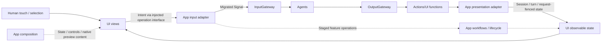
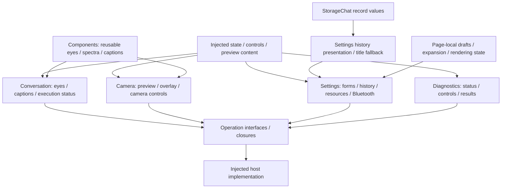

# UI — Presentation State and Human Interaction

UI renders application state, captures human intent and owns local presentation behavior. It preserves familiar touch interaction while allowing the same exposed business operations to be driven through Agents. Pages receive state and narrow operation interfaces; they do not construct Agents, models, Gateways or device services.

Design goals: MainActor isolation, independent compilation/previews, passive business state and explicit presentation acceptance.

## Upstream and downstream

Arrows show runtime interaction; UI has no import dependency on the services shown outside its boundary. Dashed lines identify staged host workflows.

Business rendering does not automatically generate another Signal. Scrolling, expansion, animation and form drafts remain local UI state. Completion-only presentation calls do not inject a synthetic ToolResult. Migrated business output follows OutputGateway; existing host workflows remain documented exceptions.

## Internal structure

Arrows show presentation/data ownership and user intent, not business-service calls.

## Design principles and core mechanisms

**Render state and express intent.** UI operation protocols describe what a page needs, without naming the service that implements it. Traditional touch interaction remains available; migrated business intents enter the same Agent flow as conversational requests. UI never assembles a model, device session, registry or business runtime.

| State/effect | Owner and acceptance rule |
| --- | --- |
| Draft / scroll / expansion | Page-local presentation state; no automatic business Signal |
| Business result / captions / pose | Supplied by host adapters after applicable session/turn/request/frame freshness checks |
| Localization / title fallback | UI presentation policy, independent of persisted raw records |
| Animation / rendering completion | Renderer-specific identity/callback; distinct from accepting a state update |
| Long-lived capture / model / device operation | Host lifecycle/workflow owner; page lifetime cannot define cleanup |

**Acceptance and visual completion are distinct.** A registered presentation function can complete when the current scope accepts state. It must not claim that an animation finished unless its renderer contract actually acknowledges it. App converts independent domain payloads into UI-owned values; UI does not inspect Agent permission or call protocol metadata.

**Presentation is not a feedback generator.** Re-rendering observable state does not emit another Signal. Meaningful user or domain feedback uses explicit operation interfaces, preventing accidental self-triggered business loops. Existing settings/device workflow paths remain staged exceptions and are labeled separately from Agent routing.

## Ownership and boundaries

- Conversation, Camera, Settings and Diagnostics own SwiftUI pages, observable states and their consuming operation protocols. Components owns reusable visuals.
- The UI target depends only on StorageChat record values. It imports no App, AppWorkflows, Agents, AgentCore, Gateway, Actions, ModelKit or PlatformKit services.
- [Actions/UI](../Actions/UI/README.md) owns callable presentation behavior. App maps Actions.PoseOverlay into UI/Camera.PoseOverlay and validates acceptance before mutation; canonical `UI.*` addresses are independent of Swift target names.
- Pages may own rendering/load tasks and scoped cancellation, but not capture, model residency or long-lived runtime supervision. Native preview content is supplied by App.
- UI owns localized wording and history title fallback; Storage retains original data. ModelResourcesState retains drafts/status snapshots, while AppSettingsWorkflow owns resource work.

## Implementation status

✅ Conversation, camera, settings/history/resource and diagnostic interfaces, independent previews, bounded execution-status presentation and typed state acceptance. Expression render IDs/callbacks do not embed a runtime queue.

❌ Complete Agent/typed-Signal routing for every UI business operation, cross-platform presentation and independent multi-window routing remain outstanding. Real animation, microphone/BLE touch interaction and device tracking need physical acceptance.

See [App](../App/README.md), [Conversation](Conversation/README.md), [Camera](Camera/README.md), [Settings](Settings/README.md), [Components](Components/README.md) and [Diagnostics](Diagnostics/README.md).
