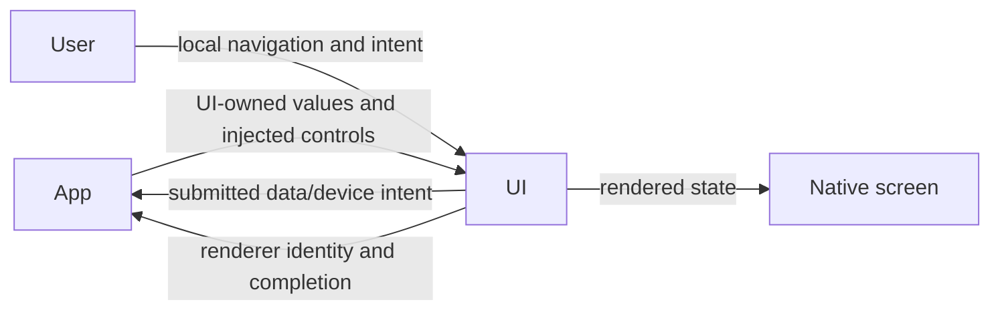
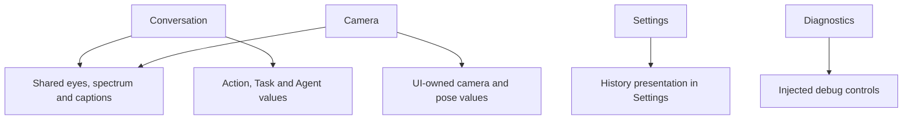

# UI — Presentation and Human Interaction

## Summary

Independent SwiftUI views, display values and injected interaction interfaces.

## Ownership and boundaries

Foundational module with zero project dependencies. App adapts Agent/device/storage values and implements injected controls; views own drafts/navigation/rendering. Long-lived models, devices and task cleanup stay with their host owners.

## External relationships and data flow

Runtime arrows show data or capability calls; dashed arrows show injection.

## Internal structure

✅ Home refinement: camera intent initially off, YOLO details initially collapsed, and a single unboxed foreground goal above the user caption; Conversation owns separate pinned-goal and moving-caption geometry.

## Interaction and acceptance

Page navigation, disclosure, dialogs and drafts are local presentation. Submitted operations invoke host controls, which route directly to their actual owner. Agent-driven presentation invokes a registered function and scoped App endpoint before state changes. A later ActionResult reports the function's completion boundary; it is not the trigger for that same UI mutation.

App rejects stale session/turn/request/frame updates before converting them to UI values. UI never imports Agent, Action, model, transport or persistence types. Independent display schemas include camera/pose, settings/resources/history and Action/Task/Agent logs.

Finite expressions carry renderer identity and completion acknowledgment; setting a persistent base expression only commits state. Passive pose/gaze/spectrum updates have no long-lived UI queue. View disappearance cancels page-scoped reads/diagnostics and renderer availability, not root-owned execution.

✅ State-driven conversation/camera/settings/history/log/diagnostic surfaces, native local navigation, accessibility and Reduce Motion paths.

❌ Multistage character performance and persistent UI audit storage.

Native visual acceptance is recorded in [validation history](../../docs/validation/Validation-History.md).

## Related design

[Parent design](../README.md) · [Camera](Camera/README.md) · [Components](Components/README.md) · [Conversation](Conversation/README.md) · [Diagnostics](Diagnostics/README.md) · [Settings](Settings/README.md)

✅ Listening presentation: long-press interaction/accessibility remain local; UI displays active-session halo and resting open/closed eyes from passive state, without native audio/haptic ownership.

✅ Implemented: UI packages a native Metal vertex/fragment edge-light resource with no project dependencies. Conversation submits long-hold stop during replies; halo follows consent while native capture pauses. A GPU edge field and two-span caption fade replace full-screen layered blur and per-character 30 Hz reconstruction.

✅ Implemented: waking eye transition is rapid and separate from slow closure; first blink is delayed after a fresh wake epoch, and loading no longer scales the eyes. Halo keeps one stable native layer and generation-scoped GPU opacity envelope with no App/Action dependencies.

✅ Implemented: Camera adds an identity-fenced PhotoDeparture acknowledgment and pure numeric departure layout. Saving enlarges to 1.16 then translates wholly right without shrinking; ignoring shrinks toward the lower-right outside screen bounds. UI owns no audio or album transactions.

✅ Conversation separates pinned goal and moving ASR. Components use an atomic native Core Animation/Metal companion surface; UI still has zero project dependencies. UIKit owns state-to-layer commits, immutable Metal snapshots cross one isolated rendering thread; no 60 Hz SwiftUI body loop for eyes/rim.

✅ Implemented: Conversation adds passive error-toast presentation, driven by root-owned failure projections. No Agent/provider dependency is added.

## 历史记录收敛（2026-10-13）

✅ Implemented: 设置入口改为 Agent 记录，仅提供真实 Assistant 聊天记录；前台 Task 按持久化身份在对话内展开，不再提供重复任务页面。

❌ 历史记录页面板块重新设计及原生 UI/真机验收。

✅ Implemented: listening light origin is a UI-owned normalized presentation parameter, captured from the actual hold and latched per activation. No new device/Action lifetime or module dependency is introduced.

✅ Implemented: home notices are restricted to upper-layer Agent/App/system failures; Action failure color/status stays in the current Action panel. Notice is plain centered yellow icon/text, with no card or close control.

✅ Implemented (2026-10-13): UI.Notice.showNotice/dismissNotice and UI.Light.updateLight are canonical presentation Actions for trusted business calls, currently registered by no Skill. Neutral Actions values cross RuntimePresentation into root-owned HomeEffectsWorkflow, which retains one replaceable notice expiry and one light expiry, UUID-fenced cleanup, and explicit stop. Notices remain separate from factual ExecutionIssue history; actual upper-layer errors have display priority and Action failures remain panel-only. Decorative light accepts normalized origin, initial opacity/intensity and duration; it never changes consent, microphone or eyes. Native renderer separates light generations from listening eye generations and preserves existing exit fade. RuntimePresentation converts neutral Action requests into UI-owned values; AppPresentationWorkflow retains existing dependencies. No UI project dependencies or new directories.

✅ ExecutionIssue 已增加可选 userMessage 展示值，日志 message 不变；首页 visibleNotice 优先使用宿主提供的 userMessage，错误 toast 的身份、去重、到期和日志面板保持现有行为。UI 不解析语音 SDK 错误。

## Task history v2 and in-place compression

✅ Implemented: UI exposes passive indexed history compressions and a chronological timeline. Task summaries expand to original model request details; UI never chooses persistence or constructs business summaries.

## 会话存储性能重构 v3

✅ 已实现：历史列表使用元数据计数和标题，正文详情异步按ID加载；删除 delta/fragments UI 字段，使用完整 response。

✅ Settings renders task metadata and requests as independent cells in a contiguous timeline with increased internal padding and native separators, without per-item Section margins or task headings. Timeline requests/task metadata have distinct type icons; expanded task requests omit icons and place the orange ReACT badge after bottom status. One page-local request destination and immediate expansion remain implemented. Native layout/gesture acceptance remains pending.

✅ First-level boundaries span the full card, while Task source text/internal separators align to the primary icon-adjacent text column. Native simulator screenshots verify collapsed/expanded static layout using real UI code and synthetic data independently of unavailable model runtime dependencies; gestures and model/storage acceptance remain separate.

✅ Settings history detail uses User Request / Assistant Response / Tasks and Skills / Prompts / Action Execution / Generation Meta headings. Share exports the Codable value shown by each page as public.json with a stable .json filename, preserving raw fields. Native transfer requests perform bounded encoding on demand; no formatted diagnostic-text export remains. Native share-target acceptance remains separate.

✅ Function Catalog belongs to Tasks and Skills; Parsed Output and Generation Meta contents are shown directly without their disclosure wrapper rows or expansion state. JSON sharing and single-level navigation retain their existing contracts.

✅ Task-row disclosure: the full Task summary cell toggles its source rows. The separate expansion-control cell is removed, source count follows status, and the trailing chevron aligns with request rows (right when collapsed, down when expanded). Hierarchical separators retain full-width outer boundaries and inset expanded source boundaries.

✅ ReACT visual hierarchy: top-level ReACT requests use a single-arrow orange cycle symbol; ReACT input text retains orange while responses use secondary color and ordinary input uses primary color; task summaries add a blue Task capsule after task status/count using the existing ReACT capsule styling. Expanded task requests remain icon-free.

✅ Request Task/Skills layout: retain one Tasks and Skills section with responsive Task/Skills subpanels and wrapping Skill revision capsules. Deduplicate equal record-owner/request-snapshot Task IDs and label snapshot activity as Active at request; show distinct IDs only when evidence differs. Function Catalog stays in the same section; raw JSON exports remain unchanged.

✅ Structured Function Catalog: request details decode their immutable catalogJSON once into UI-local Action/Tool entries, grouped with counts and alias/path labels. Per-function disclosure shows recorded Channel, parameter names and Tool definition; malformed snapshots retain visible errors/raw JSON. No live registration or export mutation.

✅ Agent records: AgentRecordsView/AgentRecordDestination form a UI-local view-injection hub, distinct from ConversationHistoryView. Conversation/task duplication is absent: conversation state has no task collection or task-group flags, and task-only pages/filtering/exports are removed. Conversation Task compressions still expand raw sources. Execution logs have no task-history view callback/input-ID payload; task execution details and related Actions remain.
