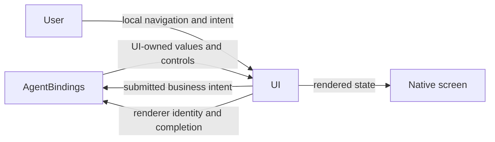
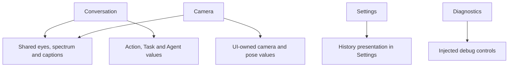

# UI — Presentation and Human Interaction

## Summary

Independent SwiftUI views, display values and injected interaction interfaces.

## Ownership and boundaries

Foundational module with no cross-module dependencies. Owner-specific AgentBindings/ActionBindings adapt business/native values and implement injected controls; views own drafts/navigation/rendering. Long-lived models, devices and task cleanup stay with their host owners.

## External relationships and data flow

Runtime arrows show data or capability calls; dashed arrows show injection.

## Internal structure

Home refinement: camera intent initially off, YOLO details initially collapsed, and a single unboxed foreground goal above the user caption; Conversation owns separate pinned-goal and moving-caption geometry.

## Interaction and acceptance

Page navigation, disclosure, dialogs and drafts are local presentation. Submitted operations invoke host controls, which route directly to their actual owner. Agent-driven presentation invokes a registered function and scoped UI endpoint before state changes. A later ActionResult reports the function's completion boundary; it is not the trigger for that same UI mutation.

The owning integration and UI endpoints reject stale session/turn/request/frame updates before converting them to UI values. UI never imports Agent, Action, model, transport or persistence types. Independent display schemas include camera/pose, settings/resources/history and Action/Task/Agent logs.

Finite expressions carry renderer identity and completion acknowledgment; setting a persistent base expression only commits state. Passive pose/gaze/spectrum updates have no long-lived UI queue. View disappearance cancels page-scoped reads/diagnostics and renderer availability, not root-owned execution.

State-driven conversation/camera/settings/history/log/diagnostic surfaces, native local navigation, accessibility and Reduce Motion paths.

Native visual acceptance is recorded in [validation history](../../docs/validation/Validation-History.md).

## Related design

[Parent design](../README.md) · [Camera](Camera/README.md) · [Components](Components/README.md) · [Conversation](Conversation/README.md) · [Diagnostics](Diagnostics/README.md) · [Settings](Settings/README.md)

Listening presentation: long-press interaction/accessibility remain local; UI displays active-session halo and resting open/closed eyes from passive state, without native audio/haptic ownership.

UI packages a native Metal vertex/fragment edge-light resource with no cross-module dependencies. Conversation submits long-hold stop during replies; halo follows consent while native capture pauses. A GPU edge field and two-span caption fade replace full-screen layered blur and per-character 30 Hz reconstruction.

waking eye transition is rapid and separate from slow closure; first blink is delayed after a fresh wake epoch, and loading does not scale the eyes. Halo keeps one stable native layer and generation-scoped GPU opacity envelope with no App/Action dependencies.

Camera adds an identity-fenced PhotoDeparture acknowledgment and pure numeric departure layout. Saving enlarges to 1.16 then translates wholly right without shrinking; ignoring shrinks toward the lower-right outside screen bounds. UI owns no audio or album transactions.

Conversation separates pinned goal and moving ASR. Components use an atomic native Core Animation/Metal companion surface; UI still has no cross-module dependencies. UIKit owns state-to-layer commits, immutable Metal snapshots cross one isolated rendering thread; no 60 Hz SwiftUI body loop for eyes/rim.

Conversation provides passive error-toast presentation, driven by root-owned failure projections. No Agent/provider dependency is added.

## 历史记录接口

设置入口改为 Agent 记录，仅提供真实 Assistant 聊天记录；前台 Task 按持久化身份在对话内展开，不再提供重复任务页面。

listening light origin is a UI-owned normalized presentation parameter, captured from the actual hold and latched per activation. No new device/Action lifetime or module dependency is introduced.

home notices are restricted to upper-layer Agent/App/system failures; Action failure color/status stays in the current Action panel. Notice is plain centered yellow icon/text, with no card or close control.

UI 消费宿主注入的 notice/light 值；实际错误优先于装饰提示，装饰光与聆听 generation 独立。原生渲染见 [Components](Components/README.md)，会话投影见 [Conversation](Conversation/README.md)。

ExecutionIssue 已增加可选 userMessage 展示值，日志 message 不变；首页 visibleNotice 优先使用宿主提供的 userMessage，错误 toast 的身份、去重、到期和日志面板保持现有行为。UI 不解析语音 SDK 错误。

## Task history v2 and in-place compression

UI exposes passive indexed history compressions and a chronological timeline. Task summaries expand to original model request details; UI never chooses persistence or constructs business summaries.

History must fold a terminal Task when the loaded paginated source subset matches its exact input/request references. Complete source evidence remains independently pageable. Subsequent timeline pages must merge Task compression metadata as well as request rows, without changing row styling/navigation.

History pagination becomes appearance-driven for archive lists, dialog timelines and expanded Task sources. UI-local cursor/ticket state prevents overlapping/duplicate attempts; page-owned tasks cancel on disappearance, while long-lived business operations remain root-owned.

## 公开端口与应用根界面

ApplicationRootPorts 定义 UI 自己的根请求/会话能力，不包含业务模块类型；ApplicationRootView 拥有首页、导航树、设置/历史目的地及诊断展示。AgentApplicationUI 在 AgentBindings 实现这些请求端口；bootstrap/retry 是注入的生命周期接口，页面不拥有根服务。

SettingsProviderOperations、ModelResourcesOperating 与展示错误值属于 UI 的公开请求契约；调用实现和业务判断在上层。BluetoothViewSnapshot 由 UI.apply 接纳，连接/控制事实仍由 NexArmControlService 拥有。HomeEffectsWorkflow 只依赖 Foundation 和 UI 自身类型，持有有界期限状态；业务 invocation 到 PresentationOwner 的转换在 ActionBindings。

UI、ModelKit、PlatformKit、Storage 仍无项目依赖；Actions/Agents 的外层集成可以依赖 UI，UI 不反向依赖它们。实际 Action 直接调用模块公开呈现端口，本地点击/导航不经过 Agent。

## 待实现

- Multistage character performance and persistent UI audit storage.

- 历史记录页面板块重新设计及原生 UI/真机验收。
