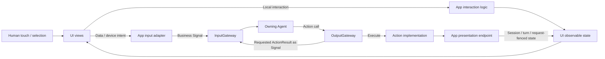
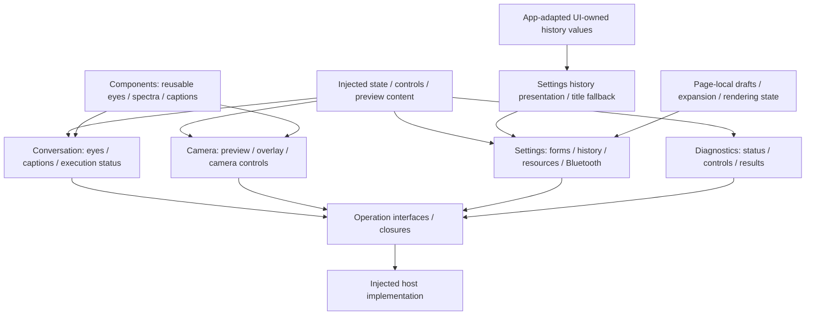

# UI — Presentation State and Human Interaction

UI renders application state, captures human intent and owns local presentation behavior. It preserves familiar touch interaction while allowing the same exposed business operations to be driven through Agents. Pages receive state and narrow operation interfaces; they do not construct Agents, models, Gateways or device services.

Design goals: MainActor isolation, independent compilation/previews, passive business state and explicit presentation acceptance.

## Upstream and downstream

**Agents form the backend business layer; Actions are the operation interfaces they call.** UI has two control paths:

| Source | Path | Examples |
| --- | --- | --- |
| Direct user interaction | UI → App interaction logic → UI state update | Open a page, dismiss a dialog, switch a log tab |
| Agent decision | Signal → Agent → Action call → OutputGateway → Action implementation → App presentation endpoint → UI state update | Open settings during a conversation, show a reply, display a captured photo |

When a user gesture requests data or device work, App converts it into a business Signal: **UI → App → InputGateway → owning Agent → Action call → OutputGateway → Action implementation → data/device/presentation endpoint.** Pure presentation interactions stay local; immediate native cleanup remains App-owned.

Arrows below show runtime interaction, not import dependencies. App injects state, operation interfaces and native preview content into UI.

**Both control paths reuse the same UI state-update interface.** For example, a user opening settings calls App's local navigation method; an Agent's `UI.Navigation.open` Action calls the App presentation endpoint. Both commit the route through `NavigationState.show`, keeping presentation logic in one place.

**UI usually updates during Action execution.** The Action invokes the presentation endpoint and commits accepted state before returning. When requested, `ActionResult` reports success or failure at the declared completion boundary to the initiating Agent so it can decide the next step; receiving it is not the trigger for that Action's UI update. A business result may lead the Agent to select a subsequent presentation Action.

Rendering does not automatically generate another Signal. Scrolling, expansion, animation and form drafts remain local UI state. Completion-only presentation calls do not inject a synthetic ToolResult.

## Internal structure

Arrows show presentation/data ownership and user intent, not business-service calls.

## Design principles and core mechanisms

**Render state and express intent.** UI operation protocols describe what a page needs, without naming the service that implements it. Traditional touch interaction remains available; migrated business intents enter the same Agent flow as conversational requests. UI never assembles a model, device session, registry or business runtime.

| State/effect | Owner and acceptance rule |
| --- | --- |
| Draft / scroll / expansion | Page-local presentation state; no automatic business Signal |
| Business result / captions / pose | Supplied by host adapters after applicable session/turn/request/frame freshness checks |
| Localization / title fallback | UI presentation policy, independent of persisted raw records |
| Animation / rendering completion | Renderer-specific identity/callback; distinct from accepting a state update |
| Long-lived capture / model / device operation | Host lifecycle/workflow owner; page lifetime cannot define cleanup |

**Acceptance and visual completion are distinct.** A registered presentation function can complete when the current scope accepts state. It must not claim that an animation finished unless its renderer contract actually acknowledges it. App converts independent domain payloads into UI-owned values; UI does not inspect Agent permission or call protocol metadata.

**Presentation is not a feedback generator.** Re-rendering observable state does not emit another Signal. Meaningful user or domain feedback uses explicit operation interfaces, preventing accidental self-triggered business loops. Explicit settings/data/device/camera requests enter their owning Agents; local navigation and page presentation remain frontend operations; native diagnostics and immediate lifecycle cleanup retain host ownership.

## Ownership and boundaries

- Conversation, Camera, Settings and Diagnostics own SwiftUI pages, observable states and their consuming operation protocols. Components owns reusable visuals.
- The UI target has zero project dependencies. It imports no App, AppWorkflows, Agents, AgentCore, Gateway, Actions, ModelKit or PlatformKit services.
- [Actions/UI](../Actions/UI/README.md) owns callable presentation behavior. App maps Actions.PoseOverlay into UI/Camera.PoseOverlay and validates acceptance before mutation; canonical `UI.*` addresses are independent of Swift target names.
- Pages may own rendering/load tasks and scoped cancellation, but not capture, model residency or long-lived runtime supervision. Native preview content is supplied by App.
- UI owns localized wording and history title fallback; Storage retains original data. ModelResourcesState retains drafts/status snapshots, while AppSettingsWorkflow owns resource work.

## Implementation status

✅ Conversation, camera, settings/history/resource and diagnostic interfaces, independent previews, bounded execution-status presentation and typed state acceptance. Local interaction and Agent-issued UI Actions share presentation state/interfaces; UI imports no Agent/runtime services. Expression render IDs/callbacks do not embed a runtime queue.

❌ Cross-platform presentation and independent multi-window routing remain outstanding. Real animation, microphone/BLE touch interaction and device tracking need physical acceptance.

See [App](../App/README.md), [Conversation](Conversation/README.md), [Camera](Camera/README.md), [Settings](Settings/README.md), [Components](Components/README.md) and [Diagnostics](Diagnostics/README.md).

✅ ADR0169: Settings receives ModelResourceViewSnapshot as passive items/group data. Eligibility is supplied by the business layer; this adds no module dependency or UI effect. History also uses independent UI values.

✅ ADR0170: Settings resource state gains a passive refresh revision and revision-checked snapshot/error setters. These contain no business/native/Agent dependencies or async work.

✅ ADR0171: resource page only performs initial restore; progress comes from injected root observation. Passive state distinguishes refresh-owned error from other errors and clears only a refresh-owned error on accepted recovery snapshot.

✅ ADR0172: Resource operation errors use the existing passive error state and stay visible across progress recovery. No Agent/runtime import or additional state algorithm.

✅ ADR0173: Existing passive resource notice/error values are assigned by the registered preference endpoint; no new timer, imports or business decision.

## Completion batch — provider presentation and capability policy

✅ Implemented: provider discovery model-family eligibility belongs to Actions ProviderModelList; ModelKit validates/decodes raw IDs only. Preserve filtering/dedup/order and bounds at the app boundary. SettingsState becomes a passive editable snapshot, with no tasks or injected execution; SettingsInteractionWorkflow in the existing Settings directory owns bounded form admission, revision and page-independent saves. UI forwards edits/discovery/cancellation/save through SettingsControlling.

✅ Implemented: presentation-enabled provider intents select a second registered UI.ResourcePresentation.showProviderResult call after the business call, on success or failure. Headless requests retain one call. Private result lookup and revision/session fences prevent credentials in protocol payloads and stale form updates. One attempt only, no recursive presentation/replay; producer and presentation failure chains remain distinct. App injects the native UI endpoint; business functions remain independent of UI and call protocols.

## Typed device, navigation and environment entry points

✅ Implemented: app.interaction/1 maps explicit device commands and Agent-requested navigation destinations to fixed registered functions through ApplicationControl and the shared root transport. This Agent now coordinates native resource interactions as well as model resources; it performs no native I/O. UI device controls emit typed intent through a root-owned BluetoothInteractionWorkflow; native BluetoothWorkflow remains the injected connection/recovery/manual worker host. Existing arrival tolerance, timeouts, pacing and takeover algorithms stay unchanged.

✅ Implemented: System.Device.control validates bounded string arguments and invokes neutral DeviceControlCapability; successful submission reports acceptance, not physical arrival. Read-only status and selected connection commands are explicitly model-granted. UI.Navigation.open commits native route state through App; manual taps and Agent calls share `NavigationState.show`. A bounded latest motor-intent worker sends only changed values, with reset/stop priority and explicit failure display. No queued motion replay.

✅ Implemented: app.environment/1 stores latest sequenced scene/device/capability facts in the root Agent, with finite categories and bounded data. App still performs synchronous background/native safety fencing before reporting facts; physical safety cannot wait on Agent admission or iOS background execution. Native back navigation remains platform-owned and reports a fact, rather than replaying navigation effects. Photo-library creation and physical acceptance are feature/acceptance boundaries, not implied by navigation support.

## Independent history presentation values

✅ Implemented: UI has no project dependencies, including StorageChat. History rendering receives UI-owned immutable HistorySnapshot/HistoryConversation/HistoryTurn values with matching data fields, not Storage types or stores. App HistoryPresentationAdapter copies the bounded stored snapshot through an explicit Codable boundary and propagates adaptation failure; Agent history mutations/queries are unchanged. Preview receives only fragments/finish reason from the view value. Per-request model evidence is presented as peer history rows; legacy continuation records remain readable and missing values stay empty. UI target has zero project dependencies.

✅ Interaction refinement: Conversation renders retained user text above eyes after recognition and assistant text below in different colors. Components expand two-axis gaze and morph love into two hearts without business ownership.

## Assistant photo observation — ADR0184

✅ Implemented: Camera UI displays injected captured-photo values; no native capture, stores or model imports.

❌ Real camera/shutter/animation and configured-model vision acceptance remain pending; video recording remains outside this iteration; Agent-routed photo export/ignore controls are implemented by ADR0185.

## Per-request conversation history

✅ Implemented: UI-owned history values mirror optional per-request evidence. ConversationHistoryPresentation flattens modelRequests for list/detail/export without Storage imports. ReACT items have a badge, orange text and an orange-tinted background. Legacy continuations are listed without storage explanations; missing per-request output/timing/status values stay empty. Model-round ID and original owning-input ID both remain available in details/export.

❌ Native UI, live-provider and physical-device acceptance remain separate from automated validation.

## Empty history values

✅ Implemented: removed legacy storage/missing-evidence explanations from user-facing history list/detail/export. Missing model text, usage, timing, finish reason and Tool outcome values remain empty. UI-only generationMetadataAvailable distinguishes legacy continuation rows so their missing date/state are blank rather than copied from the parent. Retain real request content, ReACT styling and actual execution failures. Presentation regressions cover empty values and absence of legacy wording.

## History image thumbnails

✅ Implemented: UI owns immutable image-reference values and receives bounded photo bytes through its existing history controls. Settings decodes bounded thumbnail/full-preview sizes with native UIKit thumbnail preparation, renders a gallery in actual sent context and opens a full-screen read-only preview on tap; it owns no file/store/camera/model object.

❌ Native image/layout and live-model acceptance remain separate from automated verification.

✅ Implemented: UIKit prepares images asynchronously within the existing UI import boundary. Cancellation is checked after preparation; full-preview failures offer a concise retry. Prepared image dimensions remain bounded to320/2048 pixels.

## Agent conversation history selection

✅ Implemented: the history entry lists the four conversation-storage owners (Assistant, Photographer, Memory and ApplicationControl). Each destination has a separately owned state/workflow and reads the same live context repository used by that Agent; no history copies or model startup are required. Existing request, reply, tool, usage and image presentation is reused. Assistant retains Agent-routed archive/delete/title controls; specialist histories use read-only task lists with original request titles, terminal/waiting status and task-scoped model detail/export. App projects task/input membership from the same immutable Agent context snapshot; ReACT and later task inputs remain together across old archives. Missing associations remain separate and missing dates remain empty. No specialist summary/archive mutation is exposed. Streaming perception/synthesis context contains no conversation archive and is excluded. Reads propagate errors, admit one operation per destination and retain the four-image read bound. Photo reads and parser previews use the selected producer identity. Native UI acceptance remains pending.

✅ Execution-log tabs: Execution history uses Action / Task / Agent with Agent/status filters and matching internal-Action filtering on the home overlay. Task timelines and Agent lifecycle/errors use passive UI values; no Signal collection or Gateway/Agent dependency.
