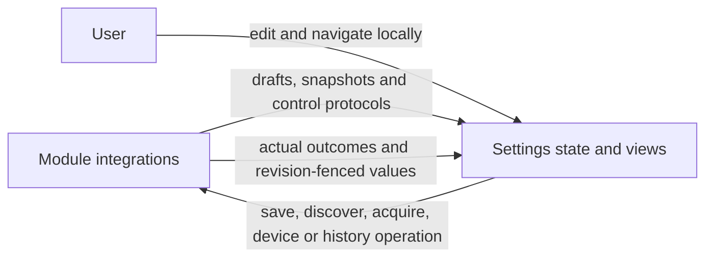

# Settings and History Presentation

✅ 历史图片检查器使用共享 retainedFullScreenCover，保留全屏查看/关闭行为而不让下层首页离窗；历史分页与解码仍是页面任务，离开时照常取消。

## Summary

Local settings drafts/navigation, resource/device snapshots, audio detection and read-only model history rendering.

## Ownership and boundaries

Injected controls submit operations to the owning AgentBindings request ports. UI owns localization, selection, presentation fallback and independent record schemas; it does not import Storage, Agents, Actions or device SDKs.

## External relationships and data flow

Runtime arrows show data or capability calls; dashed arrows show injection.

## Forms and resources

`CloudSettingsDraft` contains editable endpoint/model/key fields; credentials never enter model history or user logs. `SettingsControlling` handles restore/save/discovery and cancellation of page-scoped discovery. Draft revisions fence late results; navigation does not submit forms.

`ModelResourceGroup` presents recognition, synthesis, language and vision while preserving catalog IDs. Recognition activation requires Nemotron, synthesis requires MOSS; Silero availability is independent. Download never automatically enables custom speech. `ModelResourcesState` applies only the current refresh generation and displays queued/downloading/installing/deleting/cancelling facts supplied by the host.

## Device and audio detection

`BluetoothSettingsState` separates availability, discovery, connection phase, transport issue, control capability and recovery stage. Tapping a disconnected row submits connect; tapping a connected row opens local detail. Native recovery/manual workers are host-owned. Slider release/stop submits actual stop intent; connected does not mean physically verified.

`AudioDetectionSnapshot` distinguishes native input/support, actual spatial/mono layout, fallback, PCM freshness and direction evidence. More than one second without a frame becomes no-audio. Controls delegate one whole detection endpoint; no direction algorithm or microphone owner lives in UI.

## History

Settings Agent 记录 is a generic view-injection hub; currently only Assistant has a record destination. Each future Agent provides its own record schema/view. Assistant renders canonical current/archive conversations, with Task sources in the conversation timeline. Conversation titles use canonical metadata; Task association stays bound to indexed request identities. UI does not invent dates, usage, timing or outcomes.

`History*` values are presentation-owned. Actual request order, ReACT (orange type markers), native calls/results, usage and optional adapter-recorded request-start/first-token latency are retained. Generation metadata renders directly under Generation Meta. Timing is never inferred from record arrival. ✅ Assistant Response displays original text plus each recorded native Tool Call name/state, arguments and optional actual result/error, including native-only requests. These are labeled Tool Call and never substituted into stored response text or exports. Generation Meta renders the provider-sampled first text/native-argument latency; old or unsupported records retain absent values without backfilling. Exports preserve supplied evidence and real failures, without fabricated fields or diagnostic commentary.

Up to four image references are deduplicated from actual context. Page-cancellable reads allow at most 4 MiB per image; asynchronous UIKit preparation bounds thumbnails to 320 pixels and preview to 2048 while preserving aspect ratio. Actual failures offer retry; absent photos remain blank. Only structured imageReferences supply image identity; displayed text stays literal.

Local drafts/navigation, independent resource/device/history values and bounded image presentation.

## Related design

[Parent design](../README.md)

## Skill/task-mode contract

“Agent 记录” contains Assistant 聊天记录 only. Request details show immutable task/Skill/function evidence separately from generation information; only stored modelRequests become request rows.

## 泛化 Task 与独立 Skill

Conversation Task summaries display recorded goal/terminal status/result and source count; request details show immutable taskGoal/execution/Skill revisions separately from generation information. Task executor/parent/progress belongs to the separate execution diagnostics. Unavailable evidence remains absent.

音频完成等待使用原生回调、实际错误及作用域取消，不设置 ASR/TTS 收尾、PCM 首帧或播放 buffer 兜底计时器；完成依赖真实回调，失败保留实际来源。

## 历史记录接口

SettingsView opens AgentRecordsView under “Agent 记录”; ConversationHistoryView is the Assistant conversation page only. ConversationHistoryPresentation 仅展开 modelRequests、只解析结构化图片引用；删除旧续轮合成、虚构身份、缺失元数据标签与 Mode 回退。未关联输入不合成为虚构任务。

## Task history indexing and in-place compression

Conversation history v2 shows Task summary cards at their original request position, with goal/status/reported summary/failure and expandable raw request evidence. Task details use exact historyTaskID membership. Current/archived conversations and exports retain source diagnostics; no old history decoder is provided.

Ordering: each admitted model request receives a monotonic historyOrder from the archive revision. Order the flattened timeline and compression sources by this value, not parent turn order or wall-clock timestamps; a continuation can interleave with later user inputs. History facade refreshes authoritative revisions and rejects stale commits.

## 历史列表布局与单级详情导航

Task-row disclosure: ConversationHistoryView renders Task metadata as one plain Button that toggles the existing expandedTasks state with animations disabled. Status and source count read completed · N 轮对话; the trailing chevron uses request-row style/position, right when collapsed and down when expanded. Request/source cells stay independent in the contiguous timeline; source rows keep icon-free indentation and ReACT styling.

ReACT visual hierarchy: top-level ReACT requests use an orange arrow.clockwise single-arrow cycle symbol instead of the ordinary text bubble. ReACT input text retains its original orange color; ordinary input uses primary color and all responses use secondary color. ReACT icons/badges remain orange. Task summaries place a blue Task capsule after the status/count, sharing the caption2/bold, horizontal6/vertical2 and 15%-tint styling of ReACT badges through one private view helper. Expanded source rows retain their icon-free layout. No data/navigation/storage contracts change.

ConversationHistoryState defines a UI-local HistoryRequestNavigation value with one selected request and one presentation flag; repeated taps during an active destination do not replace or append it. ConversationHistoryDetail registers exactly one navigationDestination outside List rows, uses plain Buttons to select requests, and retains expansion state after Back/interactive dismissal. Async detail loading checks cancellation before applying results. No storage, backend or module interfaces change.

Hierarchical separators: keep timeline outer/top edges hidden and first-level boundaries full width. The Task summary's bottom separator is inset to the 52-point primary text column while expanded with sources, and full width while collapsed. Expanded source text/lines align to that text column; the last source closes the task with a full-width boundary. There is no expansion-control cell. Updated native simulator screenshots of production page code with synthetic records verify collapsed/expanded static geometry; model/storage and gesture acceptance remain separate.

## Detail headings and JSON sharing

ConversationTurnDetail retains the six English section titles. decisionMetadata.catalogJSON's Function Catalog disclosure belongs to Tasks and Skills; Prompts retains actual context messages and sent declarations. 解析输出与元数据直接显示在 Action Execution 和 Generation Meta。 Parsed interpretation still comes from controls.preview and is not execution evidence; no data/share/navigation contract changes.

Conversation/request values are Codable; the presentation JSON encoder uses pretty printed/sorted keys, default Codable dates and a 32 MiB output limit. A native Transferable JSON document uses the unmodified UI-owned conversation/request value, including original requestJSON strings and evidence. Encoding happens only when the share provider requests data, with cancellation checks and thrown failures; no file writes, view-body serialization, diagnostic report, fabricated empty export or storage API change. Conversation timelines share loaded full conversation JSON, request details share the displayed request JSON. Metadata is not substituted for a conversation that is still loading.

## Request Task and Skills panel

ConversationHistoryPresentation.taskReferences(for:) projects immutable record ownership and request-time task snapshots into unique ID references with explicit role flags. Equal historyTaskID/decisionMetadata.taskID merges both roles; distinct IDs remain separate, in record-owner then snapshot order. Active at request describes recorded request state only, never live task status. No storage/backend or Codable schema changes.

ConversationTurnDetail keeps one Tasks and Skills section. ViewThatFits renders Task/Skills subpanels side-by-side only when their minimum readable widths fit, otherwise vertically with an internal divider. Task goal, request execution mode and selectable unique IDs are grouped together. Sorted Skill ID/revision labels use a private wrapping Layout and tinted capsules rather than separate Form rows. Function Catalog remains a separate disclosure row within the same section; the panel native separator aligns with its internal divider at the content leading edge. Layout recomputes from available width and measured subviews; no async work/state/cache owner is added.

## Structured Function Catalog

HistoryFunctionCatalog/HistoryFunctionRegistration are UI-local Decodable projections of the current request snapshot schema. ConversationHistoryPresentation.functionCatalog(_:) strictly requires Actions/Tools and recorded registration fields; no old format import. ConversationTurnDetail decodes once on construction and retains the explicit failure message for malformed snapshots. Function Catalog stays in Tasks and Skills with grouped Actions/Tools counts, sorted alias/path rows and per-function Channel/required/optional/definition disclosure. Empty groups show actual zero counts; corrupted snapshots show the error and original JSON rather than fabricated empty success. Raw JSON sharing remains unchanged and catalog origin is the recorded request, never the live registry.

✅ Function Catalog 使用平铺的 Form 行：目录标题、Actions/Tools 标题、每个函数标题、字段正文和 Definition/Raw JSON 分别作为独立行。目录和函数/定义各自持有页面局部展开状态，标题文字、空白区域及箭头属于同一个 plain Button；不在 VStack 或父按钮内包含多个交互项。删除 HistoryCatalogDisclosureStyle 与目录嵌套 DisclosureGroup，避免样式作用域及复合 Form 行继续接管点击。排序、目录数据和导出保持原样；原生点按仍需单独验收。

AgentRecordDestination carries stable identity, display text and a MainActor view factory. AgentRecordsView renders those independently injected record pages; it has no conversation state or load/mutation workflow. ConversationHistoryView renders only canonical Assistant conversations, with no task-only state, subset page or separate export. Real Task compression/source schemas remain intact.

Required conversation reader: selected-conversation reads are a required injected interface, with no optional/default unavailable implementation. Tests inject explicit readers/failures.

## SQLite records and runtime identity

History controls expose explicit page/detail reads; UI remains independent of Storage/GRDB. The existing icons/colors/separators/navigation are preserved, with automatic paging footers for20-item pages and explicit retry after failure. Task source counts come from complete source indexes; expanded sources paginate independently. Sharing uses the corresponding displayed Codable values. Raw detail evidence loads only on row selection.

ConversationHistoryPresentation.timeline validates each loaded Task source pair against recorded sources instead of requiring all source input IDs to be loaded. HistoryConversation has a page-append operation that checks dialog identity and merges compression metadata/cursor with message previews; ConversationHistoryView uses it for list and expanded Task pages. Keep blue Task rows, source count, right/down chevrons and raw-request expansion.

An automatic paging footer starts when the lazy List reaches its row. Render loading and scoped error/manual retry without hiding existing rows. HistoryPageLoading provides cursor/ticket state in ConversationHistoryState.swift, use independent timeline/Task state, retain sixteen active Task-page reads and reject overflow explicitly. Cancellation releases only the matching attempt; stale responses cannot mutate replacement state. Archive controls accept an explicit retry flag. Keep20-item SQL cursor pages, source metadata merging, existing cell styling and navigation.

a completion-only paging revision re-arms a visible footer when a cancelled previous read finally releases its slot (rapid collapse/re-expand or navigation return); starting a read never changes that revision, so it cannot cancel itself.

## Native history refresh

archive and conversation Lists use native refreshable indicators; paging uses the system ProgressView without custom movement/insert animations. Pulling the timeline reloads its first page and preserves Task expansion/navigation. It cancels and joins its one timeline reader and at most sixteen Task readers before resetting paging tickets, so rapid refresh cannot overlap old/new read generations. Expanded source caches are discarded only after a successful refresh and reload through their visible paging footers; failed refresh retains visible records with an inline retryable error. Disable paging during refresh so late cancelled reads cannot append.

## Preserve history while returning from detail

separate per-page initial appearance from explicit refresh. A view-local HistoryInitialLoad gate admits the first successful read once and permits retry after failure/cancellation. Dialog-list and message-list .task callbacks must not replace loaded pages when a child destination is popped. Keep List identity/row IDs, expanded Task pages and cursor state intact; native List retains its offset without a forced scrollTo. Explicit pull-to-refresh/retry still reloads the first page. A newly created page gets a fresh initial-load gate; conversation destination identity is keyed by the stable dialog ID so a different dialog never reuses another dialog’s page cache.

✅ SettingsState 提供修订围栏下的发现、恢复、成功/失败呈现方法；ConversationHistoryState 提供快照提交；ModelResourcesState 提供安装提示/操作失败呈现。转换错误及领域结果留在 ActionBindings。

## 待实现

- Other Agent record schemas and native navigation/physical acceptance remain separate.

- 历史记录页面板块重新设计及原生 UI/真机验收。

- Native expansion layout, interactive Back and repeated navigation acceptance remain separate from state regressions and iOS compilation.

- Native receiving-app file acceptance remains separate from Codable regressions, simulator layout and Transferable/device compilation.

- Native scroll-offset retention and interactive Back after multiple pages still require device acceptance; lifecycle-state tests and iOS compilation are distinct evidence.

✅ HistoryTokenUsage 可选缓存读取/写入输入计数；Generation Meta 只显示已报告值，零不当作缺失，旧记录照常读取。
