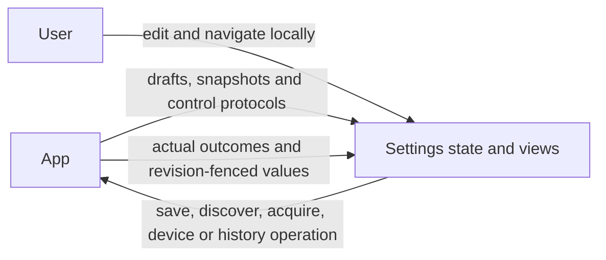

# Settings and History Presentation

## Summary

Local settings drafts/navigation, resource/device snapshots, audio detection and read-only model history rendering.

## Ownership and boundaries

Injected controls submit operations to App owners. UI owns localization, selection, presentation fallback and independent record schemas; it does not import Storage, Agents, Actions or device SDKs.

## External relationships and data flow

Runtime arrows show data or capability calls; dashed arrows show injection.

## Forms and resources

`CloudSettingsDraft` contains editable endpoint/model/key fields; credentials never enter model history or user logs. `SettingsControlling` handles restore/save/discovery and cancellation of page-scoped discovery. Draft revisions fence late results; navigation does not submit forms.

`ModelResourceGroup` presents recognition, synthesis, language and vision while preserving catalog IDs. Recognition activation requires Nemotron, synthesis requires MOSS; Silero availability is independent. Download never automatically enables custom speech. `ModelResourcesState` applies only the current refresh generation and displays queued/downloading/installing/deleting/cancelling facts supplied by the host.

## Device and audio detection

`BluetoothSettingsState` separates availability, discovery, connection phase, transport issue, control capability and recovery stage. Tapping a disconnected row submits connect; tapping a connected row opens local detail. Native recovery/manual workers are host-owned. Slider release/stop submits actual stop intent; connected does not mean physically verified.

`AudioDetectionSnapshot` distinguishes native input/support, actual spatial/mono layout, fallback, PCM freshness and direction evidence. More than one second without a frame becomes no-audio. Controls delegate one whole detection endpoint; no direction algorithm or microphone owner lives in UI.

## History

Agent destinations are Assistant, Photographer, Memory and ApplicationControl. Each has independent state and one host-owned load slot. Assistant renders current/archive controls; specialists render read-only task lists and task-scoped detail/export. Original task requests supply titles; missing task association stays separate. UI does not invent dates, usage, timing or outcomes.

`History*` values are presentation-owned. Actual request order, ReACT (orange), native calls/results, usage and optional adapter-recorded request-start/first-token latency are retained. Generation details are collapsed by default. Timing is never inferred from record arrival. Missing legacy values remain blank. Exports preserve supplied evidence and real failures, without injecting storage-migration explanations.

Up to four image references are deduplicated from actual context. Page-cancellable reads allow at most 4 MiB per image; asynchronous UIKit preparation bounds thumbnails to 320 pixels and preview to 2048 while preserving aspect ratio. Actual failures offer retry; absent photos remain blank. Legacy metadata is omitted from displayed captions only when represented by image values; exact export/request evidence remains intact.

✅ Local drafts/navigation, independent resource/device/history values and bounded image presentation.

❌ Specialist archive mutation and fabricated historical evidence.

## Related design

[Parent design](../README.md)
