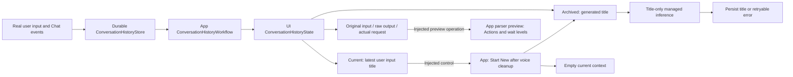
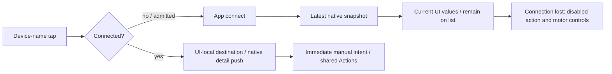
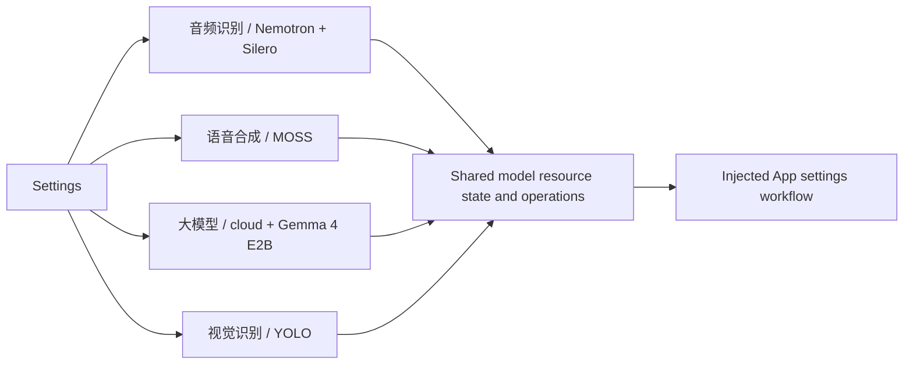

# Settings

> Current status (2026-10-03): model settings are grouped into 音频识别、语音合成、大模型、视觉识别. Backend resource acquisition remains shared. Physical acceptance of this reorganization remains pending.

Purpose: present App configuration with accessible native SwiftUI controls. Design goals: secure credentials, explicit model selection and immediate application without restarting.

| File | Responsibility |
| --- | --- |
| SettingsState.swift | Editable CloudSettingsDraft, loading/saving/errors and SettingsOperating interface; invoke injected operations |
| SettingsView.swift | Feature navigation and 大模型 cloud/local form; forward save and cancel only page-scoped model discovery on disappearance |
| ModelResourcesState.swift | Shared source draft, independent speech choices, resource-group presentation, operation admission and installation alerts |
| ModelResourcesView.swift | Recognition/synthesis/vision destinations and reusable filtered download/source sections for 大模型 |
| AudioDetectionState.swift | Display-only detection values, direction/PCM freshness and injected whole-endpoint/control contracts |
| AudioDetectionSection.swift | Compact recognition-page detection controls, capture/fallback results, level and current direction |
| ConversationHistoryState.swift | History snapshot/status and ConversationHistoryControlling interface |
| ConversationHistoryView.swift | Current/past lists, raw request/reply inspection, export and explicit mutation controls |

App owns these state instances and injects workflows. UI imports Storage for record values; it receives no store or model capability. Credentials exist in the editable form state and SecureField; persistence and model requests belong to AppWorkflows.

✅ SettingsView exposes the feature list; its 大模型 destination contains the enabled switch, URL and masked Key fields, model loading and picker. Editing credentials invalidates the old list. Enabling cloud requires a selected model; disabling and saving restores local chat while retaining credentials. Loading, saving and errors are visible. SettingsState owns form edits/status and receives SettingsOperating, implemented by AppWorkflows/SettingsWorkflow for storage/network/application effects.
✅ A standalone settings page is available from the home top-right controls even when voice startup fails. Key uses SecureField and privacySensitive. Saving is owned by App state and completes across navigation.
❌ Live provider and physical-device interaction acceptance require user configuration. No credentials are embedded; the visible default endpoint/model comes from the configured adapter defaults.

✅ Settings is now a pushed standalone page with a first-level feature list and second-level 大模型 form. Back navigates to settings/home. The enabled switch selects cloud/local on Save while preserving credentials. Native PasteButton controls beside URL/Key read text only on explicit tap. The 大模型 form uses push navigation; it has no sheet or automatic clipboard read.

✅ Native NavigationStack back items replace custom dismiss buttons, restoring interactive leading-edge swipe at both settings levels. Native back navigation stays present during saves; App-owned save work continues if the user navigates back. Cancelled swipes remain on the current page. ❌ Physical-device gesture acceptance pending.

✅ Save no longer removes/reinserts the back item, toolbar label or status Section. The spinner overlays the fixed save label and a stable status row updates in place without animation, preventing save-state navigation/form reflow. ❌ Real-device visual confirmation remains pending.

✅ URL and Key can be cleared. The form explains the official endpoint fallback and optional authentication; loading stays available with both fields empty. A default model is visible before discovery; loaded choices exclude known non-chat model families. ❌ Model-family filtering cannot establish compatibility of opaque third-party IDs.

✅ The first-level list includes 对话历史. App injects the shared durable journal and current managed chat capability into ConversationHistoryWorkflow. Its store loader joins voice cleanup before history operations; the page receives only history state and controls. The page displays actual conversations and can start a new logical conversation; it no longer runs standalone generation tests. See the conversation history section below. ❌ Historical parser preview does not execute Actions or establish device timing.

## Conversation history

✅ Settings → 对话历史 replaces the former independent single-turn raw-output test. `ConversationHistoryWorkflow` reads the process-wide durable journal and updates `ConversationHistoryState`; `ConversationHistoryView` renders those values. It shows current and archived conversations; the current title is the latest user input, never a generated summary. Expanding a conversation shows each original input, exact received model text, state, finish reason, generation options, model label, actual request (including system prompt and prior context), and escaped fragments. Text/XML uses verbatim rendering and explicit export. Per-turn diagnostic export includes the exact request, raw model text, fragments, IDs/options and error status.

✅ The journal records real Assistant traffic before Action parsing. Parsing, provider, cancellation and interrupted-process failures retain received prefixes; a failure stops production generation, so the record does not claim an unseen suffix. Executed effects are not rolled back. Execution errors observed by the App output pump are saved after producer cleanup. No provider HTTP data, token IDs or hidden reasoning is available.

✅ Start New joins voice cleanup, atomically archives the current nonempty conversation and creates an empty one, then requests a title through the current managed chat capability. Title generation is isolated from Action parsing and ordinary context. It samples up to 32 evenly spaced turns, at most 80 characters per role per selected turn; the title request has 64 output tokens, temperature zero, a 1024-byte output cap and a 30-second deadline. Failure/cancellation leaves the archive intact with a visible pending title and a retry button. Completed titles are at most 80 characters. Navigation/background cancellation stops title generation. One App-owned history operation slot, no pending work queue; cancellation keeps the slot until cleanup finishes.

Parser preview uses the current packaged JSON and GenerationTrace; it is a reinterpretation, not a historical execution trace or proof of concurrent timing. It never dispatches stored Actions. Completed raw records may still have token-length finish reasons; failure/cancellation records are visibly partial. Raw data stays in app-private local storage unless the user exports it. Archived conversations can be explicitly deleted after confirmation; no automatic eviction occurs. Exact journal/context limits live in [Storage](../../Storage/README.md).

❌ Live-model title quality, real GPT-4.1 wait compliance, device UI acceptance and physical execution timing remain separate verification. This page no longer sends independent test conversations; use normal conversation to create records.

✅ JSON v5 uses Channel-grouped callable Actions; Assistant text interpretation uses Assistant.mapText rather than JSON aliases. Regression coverage checks internal permissions cannot be called through model markup and preserves wait event order. ❌ Live-model/device acceptance is separate from automated checks.

✅ Chat output-token budgets are optional and default to nil. Assistant/cloud requests omit max_tokens so the provider chooses its default; local Gemma 4 E2B uses remaining room in its existing 4096-token context. History omits max tokens display and preserves older explicit budgets on disk. The separate 2000-byte whole-reply cap is removed; parser, queue, timeout and per-segment bounds remain. Explicit title/warmup budgets are unchanged. ❌ Live-provider/device acceptance remains separate.

✅ Source location: `MobileHarness/UI/Settings`; compiled by `UI`. Directory relocation preserves existing behavior and public contracts. ❌ No new runtime capabilities are implied.

✅ History receives ConversationHistoryState and ConversationHistoryControlling. ConversationHistoryWorkflow owns store access, archive/title ordering, errors and parser previews; the page imports only Storage value types and never receives ChatCapability or ConversationHistoryStore.

## Storage domain organization

✅ Conversation history views/state import StorageChat shared records. UI continues to receive operations through injected interfaces and never constructs a store.

❌ Image/video/semantic-memory stores remain planned; this migration adds no storage behavior.

## Bluetooth — current state and explicit navigation (ADR0134 / ADR0138)

✅ Device lists show the latest native connection/communication status and current reason only: 未连接、已连接、已连接，异常 and connecting/reconnecting/disconnecting/radio-wait transitions. Failed connection remains 未连接 with the latest reason. Each device occupies one tappable row. An unconnected name submits connection; native success stays on the list and a later connected-name tap opens detail. There are no per-device Connect rows or decorative device icons; only connected rows show a detail chevron and a Disconnect row below. Busy/unavailable connection admission dims and disables row taps, while a toolbar Cancel action remains available during connection/recovery. My Devices contains the connected or remembered device, with Forget available even while disconnected. A new unsuccessful selection stays in nearby rows without replacing the remembered entry. Current reasons are scoped to the attempted device. App owns connection effects; UI owns one local tap-selected destination.

✅ An open detail page survives disconnection. 当前状态 shows 未连接 when disconnected, current recovery phase/attempt/retry controls, and the latest connection reason only. A connected detail shows one 连接 row: 已连接, or yellow 已连接，异常. The latest native reason is shown in full red text immediately below 当前状态; healthy snapshots clear an earlier issue. There is no separate 通信 row. Connection progress remains visible during recovery. There is no exception modal, historical event list/count, clear operation or device diagnostic cache. Action/Tool outcomes stay in home scheduling issues and cannot alter Bluetooth state.

✅ Actions, whole-arm reset and six motor sliders are disabled/gray after disconnection or native cleanup. Slider disable/release/page exit clears input and springs to center. While connected, motion/refresh/feedback gaps do not impose Agent resource locks or block manual takeover. Settings submits immediately to App's replaceable worker, shares Actions recipes and ignores manual execution errors; it does not wait for completion.

✅ Measured end-effector/joint values and sample time remain separate from connection state. Entry/refresh/pull-to-refresh reads cached passive samples, not native queries or connection probes. Connection/recovery survives page navigation; page exit ends only discovery/page motor intent. System power/permission/unsupported state is truthful. Disconnect/forget disables auto-reconnect, and forget joins cleanup before removing persistence.

✅ Detail → device list → Settings uses the existing single NavigationStack and one UI-local tap-owned destination. Only a connected-name tap assigns it; page appearance and connection snapshots never reset a destination or initiate navigation; removing the former list onAppear reset prevents a second pop during an interactive return. Cancelled gestures leave navigation to SwiftUI.

❌ Physical iPhone navigation/touch, sustained BLE/firmware recovery and motor acceptance remain pending. No historical Bluetooth cache, durable diagnostics, system pairing removal, Bluetooth Classic or background physical control.

## Local model resources — current contract

✅ ModelResourcesView/State show download estimates, actual receipt-based installed sizes, progress, revision/license and download/cancel/retry/stop-and-delete. Official HF, hf-mirror.com and custom HTTPS domains automatically persist for new requests; App allows all system-permitted networks. UI imports no model SDK or services. Downloads survive page navigation; source controls appear inside the model section, with no source footer or save button. ❌ Full iOS rendering/lifecycle acceptance remains pending.

✅ 下载阶段显示确定进度条和百分比；排队、提交、安装、删除和取消阶段显示对应状态与活动指示。点击下载立即锁定该模型的操作，下载期间只显示取消，取消处理中禁用按钮；重试/删除仅在空闲时可用。状态层同时拒绝重复请求，最多 32 个同时提交的操作，超限明确报错；刷新失败仍保留已提交下载的锁定。取消先等待提交完成，避免迟到的提交重新开始下载。
❌ 原生 iOS 进度布局和真实网络交互仍需设备验证。

✅ 下载尚未收到数据时显示连接等待指示；收到数据后显示一位小数百分比，小于 0.1% 时显示 <0.1%，避免整数截断导致大型模型长期显示 0%。❌ 手机实际网络与界面验收仍需连接设备执行。

✅ Failed model transfers offer 继续下载; active rows remain cancel-only. Completed files are reused by the backend, while detailed network codes are surfaced by the injected App adapter. UI owns no download task.

✅ 音频识别 and 语音合成 have independent 使用自定义识别模型 / 使用自定义模型 switches; missing required installations bounce the switch off and show an installation alert. Recognition requires Nemotron only, synthesis requires MOSS. 大模型 keeps cloud configuration and adds Gemma 4 E2B download/removal; 视觉识别 retains YOLO. The shared ModelResourceSections component filters by business group and retains background progress, cancellation-only busy controls, source settings and safe deletion.

✅ Failed speech-preference saves restore both switches to the active durable policy. Prerequisite failures use an installation alert; other failures remain visible.

✅ New installations default both custom speech switches off. Legacy preferDownloadedSpeech JSON migrates to the two flags; App validates actual installations before applying them. Download completion does not automatically enable a custom mode. Removing a required model automatically disables only its owning speech mode. Gemma 4 E2B local selection is guarded by installation in 大模型; cloud URL/Key/discovery/save remain unchanged.

❌ Automated simulator page navigation is unavailable in this toolchain; compile/state tests do not establish physical visual acceptance.

✅ Speech switches validate/persist against the saved download source, preserving unfinished endpoint edits in the form. Changing voice mode never implicitly commits a draft download domain. Missing prerequisites bounce the switch and present the installation notice.

✅ Silero remains on the recognition page as an independent optional VAD download. Installing it selects Silero on the next session for either Apple or Nemotron; deleting it selects Energy without disabling custom ASR. Nemotron alone satisfies the ASR switch prerequisite. No model/storage dependency is added to UI.

✅ 下载源 appears within 自定义模型 / 本地大模型 with Hugging Face 官方, HF Mirror 中国镜像 and 自定义域名. YOLO has no source controls. No network toggle, save-source button or source footer remains. A single cancellable page task debounces endpoint edits by 600 ms; before download admission the state revalidates/persists the current endpoint using durable voice preferences. Failed saves prevent admission and retain the editable draft. Controls lock while saving; leaving the page cancels pending debounce without affecting background transfers. User guidance is brief and avoids implementation terminology.

✅ Settings helper copy is limited to short user guidance: model prerequisites/system fallback, local Gemma 4 E2B requirement, blank-URL default, conversation archiving/local privacy and Bluetooth connection/control behavior. The idle save instruction, developer explanations of context windows/record internals and model-page total storage row are removed. Each model retains its own size/status/license and progress; errors and destructive confirmations remain visible. ❌ Physical-page copy/layout acceptance remains pending.

✅ 设置首页按三个原生 List 板块组织：AI 模型（音频识别、语音合成、大模型、视觉识别）、外接设备（蓝牙外设）、用户（对话历史）。保留现有入口顺序、导航和无障碍标识。
❌ 三板块的真机视觉验收仍待完成。

✅ 本地模型列表采用左侧紧凑信息、右侧操作按钮布局：名称、安装状态/大小、版本/许可的间距为 4；下载、继续下载、取消、删除保留原有可用状态和删除确认。进度与错误在下方按需显示，不为闲置状态预留额外行。
❌ 真机不同字号的视觉验收仍待完成。

## Audio detection

✅ AudioDetectionState.swift owns display-only capture/direction snapshots, freshness and injected AudioDetectionControlling/AudioDetectionRunning protocols. AudioDetectionSection.swift adds a compact recognition-page section: start/stop, microphone permission/input, runtime spatial support, actual four-channel/mono mode, concise fallback reason, actual PCM level and active azimuth/elevation. The section is injected through SettingsView/ModelResourcesView; UI imports no Agent, device or workflow service. Page departure/background requests cancellation. Valid direction expires at the observation deadline; quiet/unavailable statuses contain no angles. Completed/stopped sessions clear angles.

❌ Native layout/accessibility and real capture-field coordinates require device acceptance. No distance, robot coordinate, source identity or ASR-quality result is presented.

## Passive BLE connection — ADR0130

✅ Native connection/subscription completion makes Settings controls available immediately. App performs no connection pose/version/IK probe, stationary validation or indication movement. It listens to unsolicited position packets and publishes measured state; refresh reads the latest received packet only. Feedback silence remains visible but does not disable manual commands, disconnect or start recovery. Native write/connection failures remain explicit. Actions uses passive BLE compatibility for this App connection; recipe IK resolution is deferred to an explicit preset request, not connection verification. Manual jog can start from the existing configured reference when no sample has arrived; that reference is not measured telemetry. Segment arrival observation and cancellable replacement remain in Actions/App.

❌ Physical feedback cadence, preset IK availability and sustained manual takeover require real-device acceptance. Passive connection does not establish physical clearance or target arrival.

✅ ADR0133: Bluetooth lists use explicit borderless button behavior to isolate operation taps within native List rows. Recovery-success copy distinguishes restored connectivity from unverified movement. No Action failure or resource policy is added to Settings. ❌ Device touch/layout verification remains pending.
