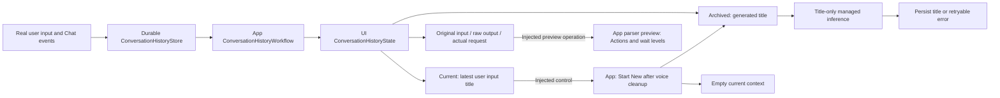
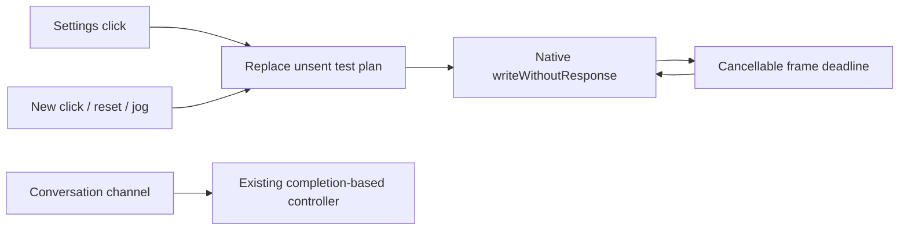

# Settings

> Current status (2026-09-30): user confirmed iPhone LLM conversation control. Broad BLE discovery and foreground recovery are implemented; acceptance of these latest UX changes remains pending.

Purpose: present App configuration with accessible native SwiftUI controls. Design goals: secure credentials, explicit model selection and immediate application without restarting.

| File | Responsibility |
| --- | --- |
| SettingsState.swift | Editable CloudSettingsDraft, loading/saving/errors and SettingsOperating interface; invoke injected operations |
| SettingsView.swift | Settings navigation and cloud form; forward save and cancel only page-scoped model discovery on disappearance |
| ConversationHistoryState.swift | History snapshot/status and ConversationHistoryControlling interface |
| ConversationHistoryView.swift | Current/past lists, raw request/reply inspection, export and explicit mutation controls |

App owns these state instances and injects workflows. UI imports Storage for record values; it receives no store or model capability. Credentials exist in the editable form state and SecureField; persistence and model requests belong to AppWorkflows.

✅ SettingsView exposes the feature list; its Cloud LLM destination contains the enabled switch, URL and masked Key fields, model loading and picker. Editing credentials invalidates the old list. Enabling cloud requires a selected model; disabling and saving restores local chat while retaining credentials. Loading, saving and errors are visible. SettingsState owns form edits/status and receives SettingsOperating, implemented by AppWorkflows/SettingsWorkflow for storage/network/application effects.
✅ A standalone settings page is available from the home top-right controls even when voice startup fails. Key uses SecureField and privacySensitive. Saving is owned by App state and completes across navigation.
❌ Live provider and physical-device interaction acceptance require user configuration. No credentials are embedded; the visible default endpoint/model comes from the configured adapter defaults.

✅ Settings is now a pushed standalone page with a first-level feature list and second-level Cloud LLM form. Back navigates to settings/home. The enabled switch selects cloud/local on Save while preserving credentials. Native PasteButton controls beside URL/Key read text only on explicit tap. No sheet or automatic clipboard read remains.

✅ Native NavigationStack back items replace custom dismiss buttons, restoring interactive leading-edge swipe at both settings levels. Native back navigation stays present during saves; App-owned save work continues if the user navigates back. Cancelled swipes remain on the current page. ❌ Physical-device gesture acceptance pending.

✅ Save no longer removes/reinserts the back item, toolbar label or status Section. The spinner overlays the fixed save label and a stable status row updates in place without animation, preventing save-state navigation/form reflow. ❌ Real-device visual confirmation remains pending.

✅ URL and Key can be cleared. The form explains the official endpoint fallback and optional authentication; loading stays available with both fields empty. A default model is visible before discovery; loaded choices exclude known non-chat model families. ❌ Model-family filtering cannot establish compatibility of opaque third-party IDs.

✅ The first-level list includes 对话历史. App injects the shared durable journal and current managed chat capability into ConversationHistoryWorkflow. Its store loader joins voice cleanup before history operations; the page receives only history state and controls. The page displays actual conversations and can start a new logical conversation; it no longer runs standalone generation tests. See the conversation history section below. ❌ Historical parser preview does not execute Actions or establish device timing.

## Conversation history

✅ Settings → 对话历史 replaces the former independent single-turn raw-output test. `ConversationHistoryWorkflow` reads the process-wide durable journal and updates `ConversationHistoryState`; `ConversationHistoryView` renders those values. It shows current and archived conversations; the current title is the latest user input, never a generated summary. Expanding a conversation shows each original input, exact received model text, state, finish reason, generation options, model label, actual request (including system prompt and prior context), and escaped fragments. Text/XML uses verbatim rendering and explicit export. Per-turn diagnostic export includes the exact request, raw model text, fragments, IDs/options and error status.

✅ The journal records real Assistant traffic before Action parsing. Parsing, provider, cancellation and interrupted-process failures retain received prefixes; a failure stops production generation, so the record does not claim an unseen suffix. Executed effects are not rolled back. Execution errors observed by the App output pump are saved after producer cleanup. No provider HTTP data, token IDs or hidden reasoning is available.

✅ Start New joins voice cleanup, atomically archives the current nonempty conversation and creates an empty one, then requests a title through the current managed chat capability. Title generation is isolated from Action parsing and ordinary context. It samples up to 32 evenly spaced turns, at most 80 characters per role per selected turn; the title request has 64 output tokens, temperature zero, a 1024-byte output cap and a 30-second deadline. Failure/cancellation leaves the archive intact with a visible pending title and a retry button. Completed titles are at most 80 characters. Navigation/background cancellation stops title generation. One App-owned history operation slot, no pending work queue; cancellation keeps the slot until cleanup finishes.

Parser preview uses the current packaged JSON and GenerationTrace; it is a reinterpretation, not a historical execution trace or proof of concurrent timing. It never dispatches stored Actions. Completed raw records may still have token-length finish reasons; failure/cancellation records are visibly partial. Raw data stays in app-private local storage unless the user exports it. Archived conversations can be explicitly deleted after confirmation; no automatic eviction occurs. Exact journal/context limits live in [Storage](../../Storage/README.md).

❌ Live-model title quality, real GPT-4.1 wait compliance, device UI acceptance and physical execution timing remain separate verification. This page no longer sends independent test conversations; use normal conversation to create records.

✅ JSON v5 uses Channel-grouped callable Actions; Assistant text interpretation uses Assistant.mapText rather than JSON aliases. Regression coverage checks internal permissions cannot be called through model markup and preserves wait event order. ❌ Live-model/device acceptance is separate from automated checks.

✅ Chat output-token budgets are optional and default to nil. Assistant/cloud requests omit max_tokens so the provider chooses its default; local Qwen uses remaining room in its existing 4096-token context. History shows 模型默认 for omitted values and preserves older explicit budgets. The separate 2000-byte whole-reply cap is removed; parser, queue, timeout and per-segment bounds remain. Explicit title/warmup budgets are unchanged. ❌ Live-provider/device acceptance remains separate.

✅ Source location: `MobileHarness/UI/Settings`; compiled by `UI`. Directory relocation preserves existing behavior and public contracts. ❌ No new runtime capabilities are implied.

✅ History receives ConversationHistoryState and ConversationHistoryControlling. ConversationHistoryWorkflow owns store access, archive/title ordering, errors and parser previews; the page imports only Storage value types and never receives ChatCapability or ConversationHistoryStore.

## Storage domain organization

✅ Conversation history views/state import StorageChat shared records. UI continues to receive operations through injected interfaces and never constructs a store.

❌ Image/video/semantic-memory stores remain planned; this migration adds no storage behavior.

## Bluetooth devices

✅ `BluetoothSettingsState` contains only UI values; `BluetoothControlling` is implemented by AppWorkflows. Settings → 蓝牙设备 uses native List sections for 我的设备 / 附近设备, searching/progress, explicit connect, verification, connected state, disconnect/cancel, and confirmed 忽略此设备. It displays permission/off/unsupported errors and offers a host-supplied system-settings action for permission denial. The page never imports CoreBluetooth or PlatformKit and never sends motor commands.

✅ Up to 32 discovered rows and one remembered device; rows use peripheral identifiers for stable identity. Only supported NexArm devices appear. Leaving the page stops discovery but preserves the root-owned connection and any joined lifecycle cleanup. Device names/state and completion/error feedback come from the workflow; no simulated success is displayed. The system radio cannot be toggled by this app, so its actual state is shown rather than an imitation toggle.

❌ iOS Settings pairing integration, audio accessories, automatic reconnection and background control are outside scope. UI rendering and physical-device acceptance are reported separately from workflow unit tests.

✅ Bluetooth connection and control readiness are distinct: a missing AT32 version shows “蓝牙已连接，控制待验证” with “重新验证”. Version queries are read-only; the first successful verification then runs the connection indication described below. Disconnect and forget remain available. A green control indicator requires validated firmware and pose. ❌ Real iPhone control acceptance remains pending.

✅ Connection explains whole-arm reset and the ID5 feedback gesture, shows “正在复位 / 提示…” while it runs, and enables control only after feedback completion. Cancel/disconnect remains available. Missing firmware does not animate or claim success. ❌ Physical-device presentation/motion acceptance pending.

## Current NexArm compatibility presentation

✅ After successful protocol/pose and connection-indication checks, the known missing-AT32 profile can show ready while device info truthfully displays “ESP32 1.0.2 · AT32 版本暂不可读”. The notice explains the compatibility checks. The connection footer describes whole-arm reset and ID5 about ±8° then center; the old pending-only behavior applies to earlier revisions. ❌ Actual iPhone reset/ID5 acceptance remains pending.

## Current Bluetooth UX

✅ User confirmed real iPhone conversation control. Connection status now follows service/pose and ID5 feedback validation, independently of firmware-version strings; AT32 version and its missing-read warning are removed. Nearby shows discovered BLE devices without name/service exclusion, sorts NexArm names first and explains that compatibility is checked after selection. Devices may be renamed. The old firmware retry button is removed.

✅ The footer explains foreground automatic reconnection, no repeat gesture/reset during recovery, and manual disconnect disabling recovery. Explicit connection retains the reset/ID5 gesture. ❌ Physical verification of broad scanning and lock/unlock recovery remains pending; not all Bluetooth Classic devices are BLE-discoverable.

## Bluetooth peripheral details (current)

✅ Settings → 蓝牙外设 removes developer-facing protocol/version/gesture explanations. The radio footer contains only foreground auto-reconnect behavior. Connected rows navigate to device details showing measured end-effector coordinates, six encoder positions and sample time; refresh on entry, explicit refresh/pull-to-refresh and completed operations update feedback. Presets expose all seven supported directional choices, plus a separate confirmed reset. Six sliders commit once on release and display measured positions separately from the draft target.

✅ UI receives presentation values and typed operations only. Movement is App-root-owned and survives navigation; sliders/actions disable during motion or refresh and disconnected details cannot control another device. Each release is limited to ±91 encoder counts (~8°), clipped to 1536...2560. Out-of-range motors stay visible but require repositioning before manual adjustment.

❌ Live iPhone layout, all-six-motor mechanical limits and physical acceptance remain pending. Values are sampled feedback, not a continuous telemetry stream. This section supersedes earlier statements that device details/manual controls are unavailable.

## Peripheral list cleanup (current)

✅ Nearby discovery omits missing/placeholder names. Connection stops scanning and clears the discovery list; explicit searching starts a fresh list. Forget clears saved/selected identity, telemetry and stale feedback. Successful connections clear old errors. A failed connection gesture no longer requires reconnecting a healthy link; actual transport loss receives one automatic read-only reconnect attempt.

❌ App-level 忽略 does not remove iOS system pairing. Physical list/recovery acceptance is still separate from simulated workflow tests.

## Spring-return motor controls (current)

✅ All six controls render regardless of available telemetry or current posture. Touch/drag sends a normalized direction/speed intent immediately; displacement from center sets speed. Release, gesture cancellation, disabled connection and leaving details return the thumb to center and stop further intent. Last observed encoder values remain explicitly labeled 上次位置. There is no per-release target/8° limit or home prerequisite.

✅ Preset Play retains completion-based execution. Reset stays available during a preset or jog, immediately requests priority takeover, and reports instruction submission rather than fabricated arrival. No confirmation sheet delays this explicit reset control. ❌ Actual physical stop timing, touch feel and sustained radio throughput require device acceptance.

## Settings test control (current)

✅ Settings Play uses native CMD8 writeWithoutResponse without telemetry/ATT completion waits. Fixed ready400ms → body800ms per frame → home600ms, maximum8 frames. These are cancellable playback deadlines, not arrival gates. One latest test slot replaces all unsent old frames; no command backlog. New Play/reset/jog can take over within the30ms worker cadence (subject to native transport admission). Buttons remain enabled while connected. Native congestion retains only the latest request, fails visibly after2s, and never replays skipped old frames. Page exit/background/disconnect discard unsent test frames. UI says sent, never physically completed. Conversation/channel performGesture retains its existing feedback-based contract.

❌ Wireless delivery and physical arrival are not established by local send admission. Optional NEXARM_SETTINGS_TEST validates the shared frame plan on USB, separate from default tests.

## Head gestures

✅ BluetoothArmAction exposes 点头 and 摇头 as typed settings intents; the existing list discovers them through CaseIterable. UI owns no motor implementation. ❌ Physical arrival is not inferred from a Settings send.

## NexArm feedback execution — 2026-10-01

✅ Settings labels the explicit motors1–5 reset as 整臂归位. UI consumes workflow status and connection-instability messages; it owns no executor, device lock or feedback policy.

❌ Sustained real-device acceptance remains pending.
